# Arquitetura da Solução — mobIA

> Agente SDR Imobiliário com IA Generativa — Hackathon FIAP (Tech Challenge, Fase 5).
> Documento de arquitetura para entrega junto ao repositório, README e pitch técnico.

## Sumário

1. [Visão geral](#1-visão-geral)
2. [Estilo arquitetural](#2-estilo-arquitetural)
3. [Diagrama de contexto (C4 — Nível 1)](#3-diagrama-de-contexto-c4--nível-1)
4. [Containers (C4 — Nível 2)](#4-containers-c4--nível-2)
5. [Componentes do backend (C4 — Nível 3)](#5-componentes-do-backend-c4--nível-3)
6. [Fluxos principais (sequência)](#6-fluxos-principais-sequência)
7. [RAG do catálogo de imóveis](#7-rag-do-catálogo-de-imóveis)
8. [Modelo de dados](#8-modelo-de-dados)
9. [Jobs e agendamentos (worker)](#9-jobs-e-agendamentos-worker)
10. [Segurança, privacidade e LGPD](#10-segurança-privacidade-e-lgpd)
11. [Inteligência Artificial](#11-inteligência-artificial)
12. [Deploy e infraestrutura](#12-deploy-e-infraestrutura)
13. [Observabilidade e escalabilidade](#13-observabilidade-e-escalabilidade)
14. [Decisões arquiteturais (ADRs)](#14-decisões-arquiteturais-adrs)
15. [Estrutura de diretórios](#15-estrutura-de-diretórios)
16. [Integrações externas](#16-integrações-externas)

---

## 1. Visão geral

O **mobIA** é um agente de pré-venda (SDR) para o mercado imobiliário. Ele atende
leads automaticamente por WhatsApp e por um widget web, conduz uma conversa
humanizada, **qualifica** o lead, identifica a **intenção** (compra, aluguel ou
investimento), consulta uma **base de imóveis** com busca semântica (RAG),
**agenda** reuniões/visitas, faz **follow-up automático** quando o lead esfria e
gera **resumos inteligentes** para os corretores, com um **painel** de
acompanhamento.

O sistema foi desenhado para o modo de falha real do negócio — lead perdido por
demora, falta de acompanhamento e sobrecarga do corretor — e por isso trata com
rigor três propriedades: **não perder mensagem** (durabilidade), **não responder
duas vezes** (idempotência) e **não vazar dado pessoal** (cifra + LGPD).

| Dimensão | Escolha |
|---|---|
| Linguagem/stack | Python 3.13, FastAPI (API), arq (worker assíncrono), Next.js (painel/widget) |
| Dados | PostgreSQL 16 + `pgvector` (busca vetorial), Redis (fila + rate limit + sessão do painel) |
| IA | Anthropic Claude (agente/resumo/moderação), OpenAI (embeddings e transcrição) |
| Canais | WhatsApp Cloud API (Meta), widget web (WebSocket) |
| Integrações | SMTP, Google Calendar, Webhook de CRM |
| Deploy | Contêineres Docker atrás de Traefik em VPS (ou Heroku, como alternativa) |

---

## 2. Estilo arquitetural

**Monólito modular, publicado como três tipos de processo.** Todo o backend vive
num único pacote Python (`mobia`) com fronteiras de módulo bem definidas por
domínio; o mesmo artefato roda em dois papéis — **API** (HTTP, síncrono ao lead)
e **worker** (arq, assíncrono) — e o **frontend** Next.js é o terceiro processo.
Essa separação dá o isolamento de "micro-serviço" (web e worker escalam
independentemente) sem o custo operacional de múltiplos repositórios e contratos
de rede.

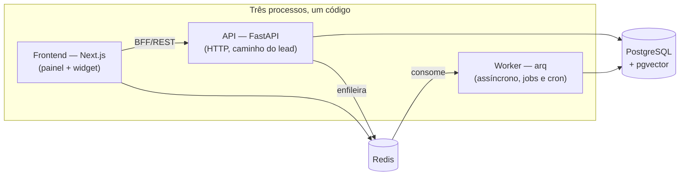

Princípios que atravessam o código:

- **Domínio no centro, adaptadores na borda.** `domain/` não conhece HTTP nem
  rede; `infra/` isola Postgres, Redis, Anthropic, OpenAI, S3, SMTP, TLS.
- **Durabilidade antes de efeito.** A mensagem é gravada no Postgres **antes** de
  ir para o Redis; se o processo morrer no meio, um cron (`sweep_stalled`)
  reenfileira.
- **Idempotência no efeito externo.** Todo envio passa por `outbound_dispatches`
  com `UNIQUE (message_id, kind)` — reprocessar não duplica mensagem ao lead.
- **Configuração que recusa subir insegura.** Chaves de desenvolvimento, segredo
  de JWT curto ou TLS ausente em produção **abortam o boot** em vez de degradar
  em silêncio.

---

## 3. Diagrama de contexto (C4 — Nível 1)

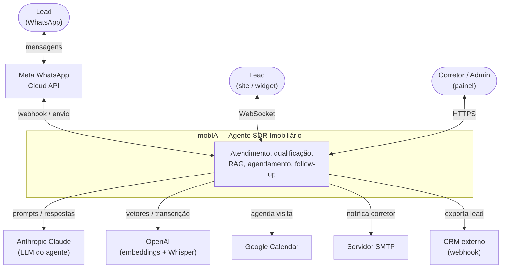

---

## 4. Containers (C4 — Nível 2)

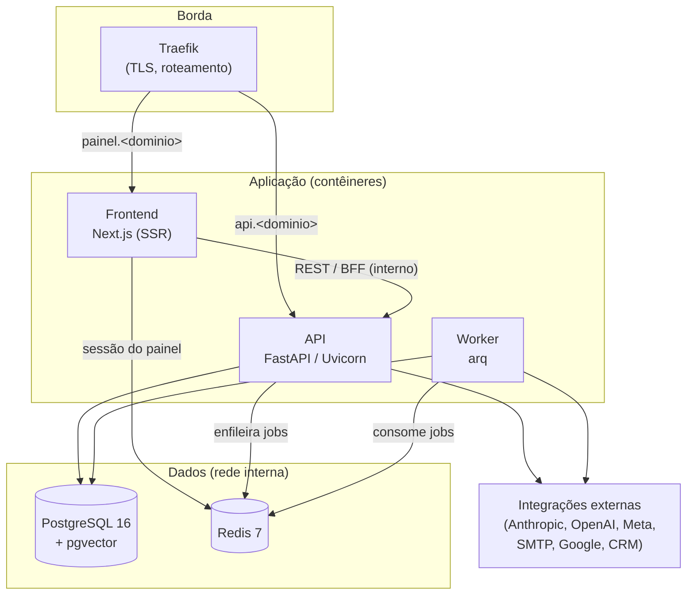

Responsabilidades por container:

| Container | Responsabilidade | Observações |
|---|---|---|
| **Frontend (Next.js)** | Painel do corretor/admin e página do widget; BFF que fala com a API | Sessão do painel no Redis; sem segredo exposto ao browser |
| **API (FastAPI)** | Webhook do WhatsApp, WebSocket do widget, REST do painel, autenticação | Caminho rápido: persiste e enfileira, não bloqueia o lead |
| **Worker (arq)** | Turno do agente, RAG, resumo, notificação, follow-up, sweeps (cron) | Onde mora o custo (LLM, embeddings) e a recuperação |
| **PostgreSQL + pgvector** | Verdade do sistema: mensagens, leads, catálogo, vetores, auditoria | Só na rede interna, sem porta pública |
| **Redis** | Fila do arq, rate limiting, sessão do painel | Só na rede interna |

---

## 5. Componentes do backend (C4 — Nível 3)

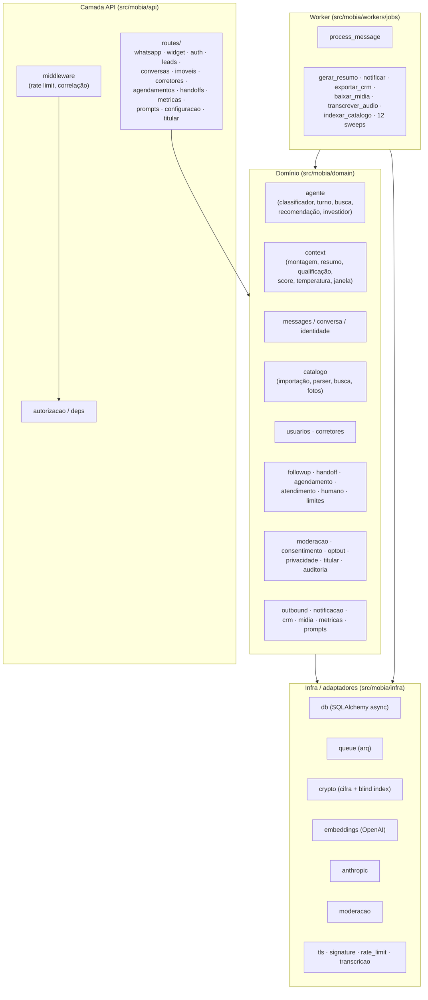

O domínio é dividido em **29 módulos** por responsabilidade de negócio; a API
expõe **16 grupos de rotas**; o worker tem **23 jobs** (um de processamento de
turno e o resto de efeitos e varreduras agendadas). Cada módulo de domínio
publica funções puras de regra e um `repositorio.py` que fala com o banco — o
teste exercita a regra sem subir rede.

---

## 6. Fluxos principais (sequência)

### 6.1 Ingestão do WhatsApp e resposta do agente

O cerne do sistema. A API faz o mínimo no caminho síncrono (validar, persistir,
confirmar) e devolve `200` rápido; o trabalho caro acontece no worker.

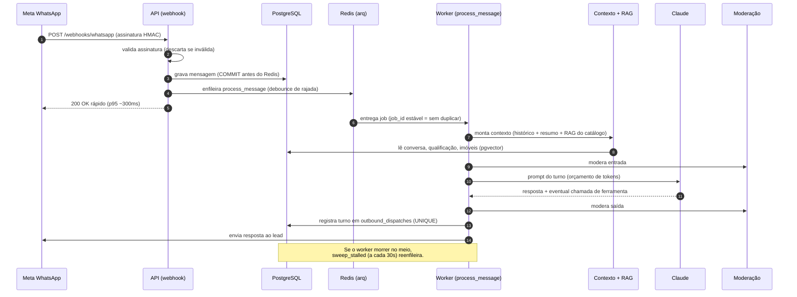

Garantias de robustez:

- **Durabilidade:** a mensagem é commitada no Postgres antes de ir ao Redis.
- **Idempotência:** `_job_id` estável no arq (recusa re-enqueue do mesmo turno) +
  `outbound_dispatches UNIQUE (message_id, kind)` no efeito externo.
- **Rajada:** `debounce` agrupa mensagens picotadas do lead em um só turno.
- **Recuperação:** `sweep_stalled` reenfileira mensagens recebidas e não
  processadas; `sweep_midias_pendentes`, `sweep_importacoes_travadas` cobrem os
  demais caminhos parados.

### 6.2 Qualificação e intenção

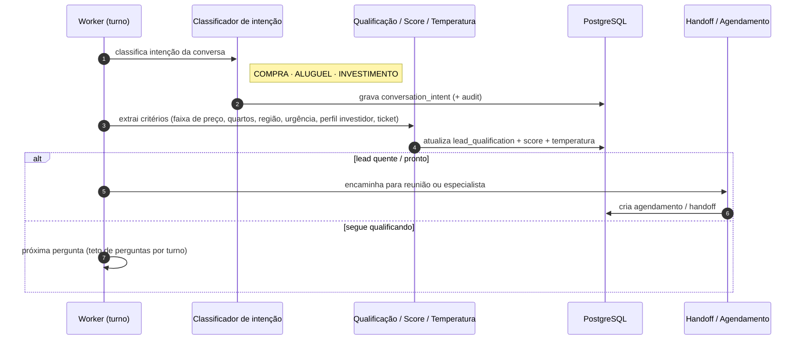

A intenção dirige a trilha: **compra** pergunta faixa de preço, quartos, região e
urgência; **investimento** levanta perfil investidor, ticket e expectativa de
retorno (módulo `agente/investidor.py`) e direciona ao especialista. O **score** e
a **temperatura** priorizam o lead quente.

### 6.3 Follow-up automático (reengajamento)

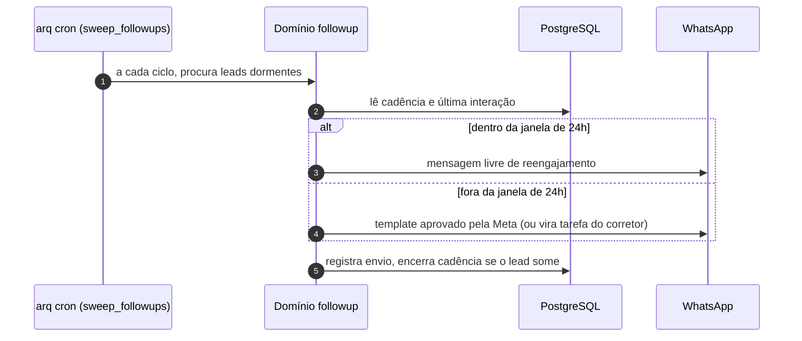

A cadência respeita a **janela de 24h** da Meta (fora dela só template aprovado) e
o **horário de atendimento** configurável; quando o lead responde, a cadência é
retomada com contexto; quando some, é encerrada (`sweep_followups`,
`sweep_sla`, `sweep_lembretes`).

### 6.4 Autenticação do painel (corretor/admin)

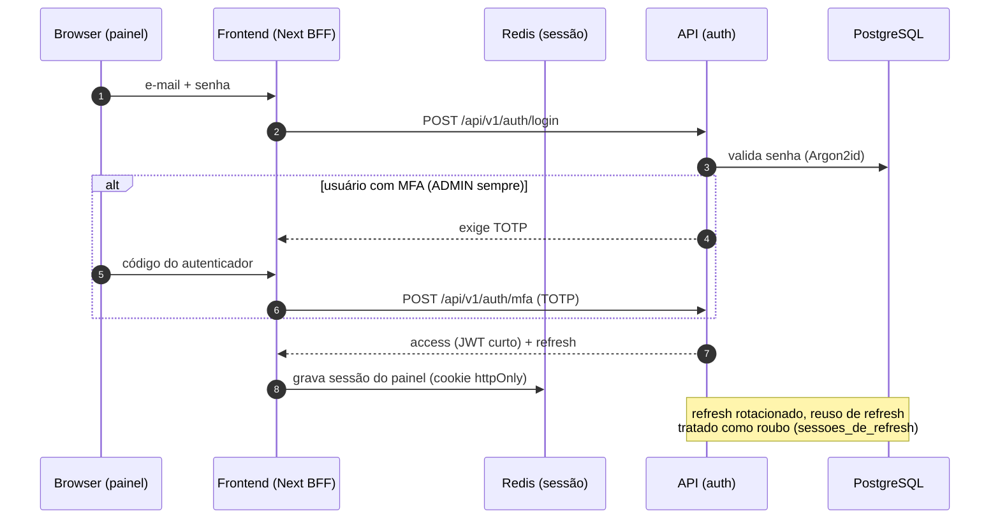

Senhas com **Argon2id**, segundo fator **TOTP** (obrigatório para ADMIN), **JWT**
curto com **refresh rotacionado** e detecção de reuso de refresh. A sessão do
painel vive no Redis; o segredo do Redis nunca chega ao browser.

---

## 7. RAG do catálogo de imóveis

O agente responde sobre imóveis reais por **busca híbrida** (vetorial + filtros
estruturados) sobre o catálogo, com embeddings gerados na ingestão.

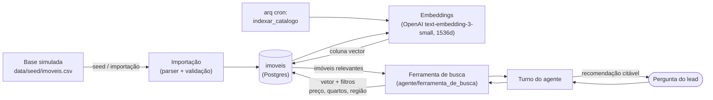

Pontos de desenho:

- **Indexação incremental** por cron (`indexar_catalogo`): só vetoriza o que mudou,
  em lotes, com teto por passagem.
- **Busca híbrida:** o vetor do `pgvector` dá a semântica ("apartamento perto da
  praia"), e os filtros estruturados aplicam preço, quartos e região; há
  **relaxamento** controlado quando a busca estrita volta vazia.
- **Resposta citável:** a recomendação referencia imóveis existentes, evitando o
  agente "inventar" imóvel (combate a alucinação).
- **Extensões Postgres** criadas por migration: `vector` (pgvector) e `btree_gist`.

---

## 8. Modelo de dados

O esquema tem ~35 tabelas sob migrations Alembic. O diagrama abaixo mostra o
núcleo e as relações principais (atributos resumidos).

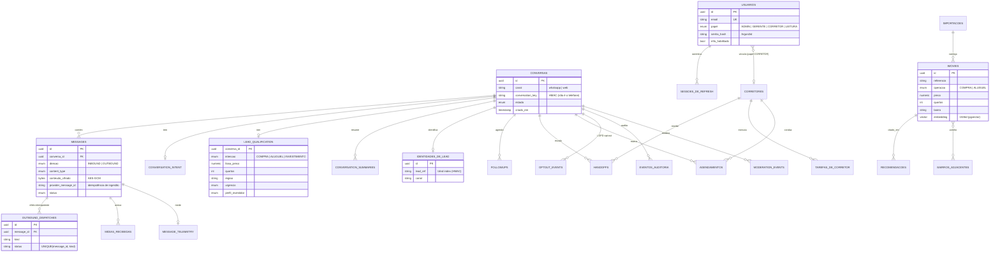

Notas de modelagem relevantes para a avaliação:

- **PII cifrada em repouso.** O conteúdo das mensagens é cifrado (AES-GCM) com
  keyring versionado; o telefone do lead nunca é chave — a conversa é referenciada
  por um `conversation_key` (HMAC) e a auditoria por um `lead_ref` (blind index),
  o que permite buscar sem armazenar o identificador em claro.
- **Idempotência no banco.** `provider_message_id` barra ingestão duplicada;
  `outbound_dispatches (message_id, kind)` barra efeito duplicado.
- **Trilha e retenção.** `eventos_auditoria`, `moderation_events`,
  `conversation_intent_audit`, `lead_score_audit` registram o porquê das decisões;
  sweeps diários aplicam retenção (LGPD).

---

## 9. Jobs e agendamentos (worker)

O worker arq roda **jobs sob demanda** (enfileirados pela API) e **cron** (varreduras
periódicas de recuperação e manutenção).

| Job | Tipo | Papel |
|---|---|---|
| `process_message` | sob demanda | Turno do agente (o fluxo da seção 6.1) |
| `gerar_resumo` | sob demanda | Resumo inteligente da conversa para o corretor |
| `notificar` | sob demanda | Notifica o corretor (SMTP / template WhatsApp) |
| `baixar_midia` / `transcrever_audio` | sob demanda | Mídia recebida (imagem/doc) e áudio → texto (Whisper) |
| `exportar_crm` | sob demanda | Exporta lead qualificado via webhook de CRM |
| `importar_catalogo` / `indexar_catalogo` | demanda / cron 30s | Importa catálogo e gera embeddings incrementais |
| `sweep_stalled` | cron 30s | Reenfileira mensagens recebidas e não processadas |
| `sweep_midias_pendentes` | cron | Recupera download/transcrição parados |
| `sweep_followups` / `sweep_sla` / `sweep_lembretes` | cron | Cadência de follow-up, SLA de aceite, lembretes |
| `sweep_remarcacoes` / `sweep_lista_de_espera` | cron | Remarcação e fila de espera de agendamento |
| `sweep_conversas_inativas` | cron diário | Encerra conversas inativas |
| `sweep_crm_pendentes` | cron 15min | Reenvio de exportações de CRM pendentes |
| `sweep_importacoes_travadas` | cron | Destrava importações de catálogo paradas |
| `sweep_retencao_auditoria` / `sweep_retencao_de_leads` / `eliminar_lead` | cron diário | Retenção e eliminação (LGPD) |

O `keep_result = 0` e o `_job_id` estável garantem que uma varredura que
reenfileira **não multiplique** trabalho nem chamadas pagas de LLM/embedding.

---

## 10. Segurança, privacidade e LGPD

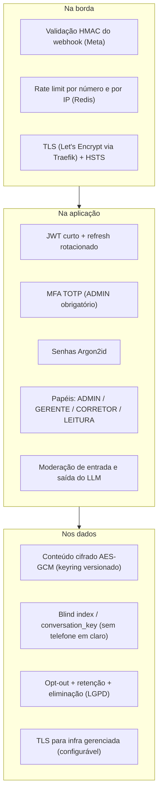

- **Guardas de boot:** em produção, chave de cifra de desenvolvimento, segredo de
  JWT fraco/padrão, chaves HMAC padrão ou Redis sem TLS (em rede não confiável)
  **abortam a subida** — o sistema recusa rodar inseguro em vez de degradar calado.
- **LGPD:** opt-out reversível só por operação administrativa auditada; retenção e
  eliminação de leads por cron; o titular tem rota de solicitação
  (`solicitacoes_de_titular`).
- **Moderação:** entrada e saída do agente passam por um modelo de moderação; os
  eventos ficam em `moderation_events`.

---

## 11. Inteligência Artificial

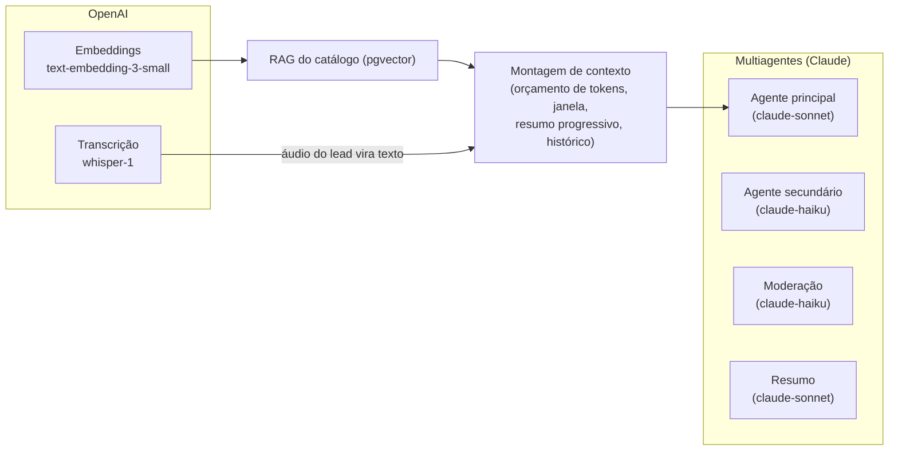

- **Multiagentes por papel:** agente de conversa, agente secundário, moderação e
  resumo — modelos e prompts configuráveis por agente, com **versionamento de
  prompt** (`versoes_de_prompt`, `ativacoes_de_prompt`) e comparação/rollback de
  versão pelo painel.
- **Memória conversacional:** histórico + **resumo progressivo** da conversa,
  montados dentro de um **orçamento de tokens** (regeneração do resumo quando
  estoura), de modo que conversas longas cabem no contexto sem perder o fio.
- **Humanização:** indicador de digitação, debounce de rajada, acentuação e tom na
  fala ao lead, teto de perguntas por turno.
- **Observabilidade de IA:** telemetria por mensagem (`message_telemetry`) com
  custo por modelo materializado no registro; suíte de **evals** versionada
  (`evals/`) como gate de regressão de prompt no CI.

---

## 12. Deploy e infraestrutura

Duas topologias suportadas; a **VPS com Docker + Traefik** é a escolhida para a
entrega. A alternativa **Heroku** está preservada em outra branch.

### 12.1 VPS (Docker Compose + Traefik) — escolhida

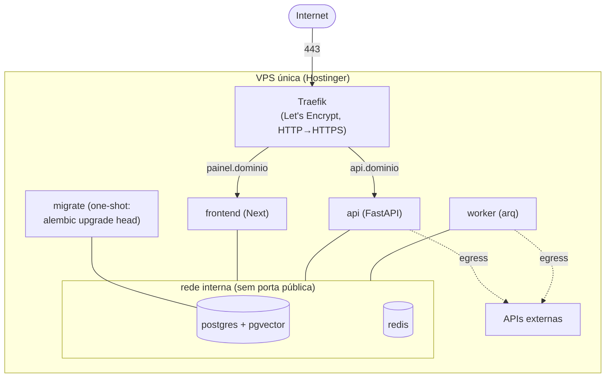

- **Traefik** termina TLS (Let's Encrypt) e roteia por subdomínio; só 80/443
  expostos. Postgres e Redis ficam na **rede interna** (`internal: true`), sem
  porta pública nem saída para a internet.
- **Migração antes do app:** o serviço `migrate` roda `alembic upgrade head` e sai;
  `api`/`worker` só sobem depois dele (`service_completed_successfully`).
- **CI/CD:** GitHub Actions builda imagens (tag = SHA) no GHCR, faz deploy por SSH,
  migra e sobe; **rollback automático** por healthcheck (tag anterior em
  `.last-good`).
- **Operação:** imagens não-root com healthcheck no `/health`; backup diário do
  Postgres (`pg_dump | gzip`, retenção 14 dias); `ufw` + `fail2ban`. Detalhes em
  `docs/deploy-vps.md`.

### 12.2 Heroku (alternativa)

Mesmo código, dois apps: um Python com `web` (uvicorn) + `worker` (arq) via
Procfile e add-ons gerenciados de Postgres/Redis; outro para o frontend.
Documentado em `docs/deploy-heroku.md` (branch `feature/deploy-heroku`).

### 12.3 Pipeline de deploy (VPS)

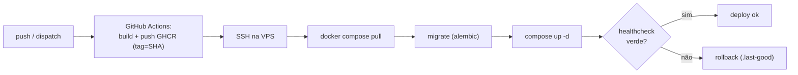

---

## 13. Observabilidade e escalabilidade

**Observabilidade.** Logs estruturados (`structlog`) com correlação de requisição
(middleware), máscara de PII nos campos estruturados, e o cuidado de **não vazar a
linha do banco** por dentro de mensagens de exceção (parâmetros ocultados, erro do
driver reduzido a `sqlstate`/constraint). Telemetria por mensagem
(`message_telemetry`) com custo por modelo. A suíte de evals mede qualidade e
regressão de prompt no CI.

**Escalabilidade.** Os três processos escalam de forma independente:

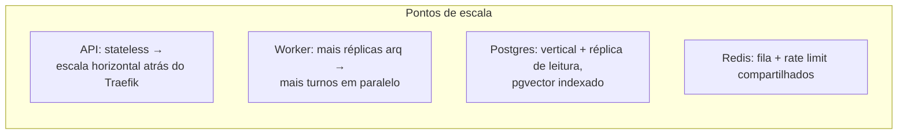

- **API** é stateless (sessão no Redis/JWT): replica horizontalmente sem afinidade.
- **Worker** é a vazão do agente: adicionar réplicas aumenta turnos simultâneos; o
  `_job_id` estável mantém a idempotência mesmo com concorrência.
- **Caminho do lead desacoplado do caminho caro:** a API responde em milissegundos
  e o LLM roda no worker — picos de mensagens viram fila, não timeout.
- **Rate limiting** por número e por IP protege contra abuso e surto.

---

## 14. Decisões arquiteturais (ADRs)

| # | Decisão | Motivo | Trade-off aceito |
|---|---|---|---|
| 1 | Monólito modular com 3 processos (não microsserviços) | Isolamento de escala sem custo de rede/repos; prioridade é velocidade e simplicidade | Um deploy acopla os três artefatos de código |
| 2 | Persistir antes de enfileirar + `sweep_stalled` | Nunca perder mensagem do lead | Latência extra de um COMMIT antes do enqueue |
| 3 | Idempotência via `outbound_dispatches` + `_job_id` | Nunca responder o lead duas vezes | Tabela e chave únicas a manter |
| 4 | PII cifrada + blind index (sem telefone em claro) | LGPD e vazamento por log/erro | Busca por identidade exige HMAC, não `LIKE` |
| 5 | RAG com `pgvector` no mesmo Postgres | Uma base só; busca híbrida simples | Indexação incremental a orquestrar (cron) |
| 6 | Multiagentes com prompt versionado | Qualidade/humanização e rollback de prompt | Mais modelos e configuração a gerir |
| 7 | Config que recusa subir insegura | Falha de segurança é barulhenta, não silenciosa | Boot aborta se o ambiente estiver incompleto |
| 8 | VPS + Docker + Traefik (vs. PaaS) | Controle, custo e demonstração de arquitetura/cloud | Operação (backup, patch, firewall) é responsabilidade nossa |

---

## 15. Estrutura de diretórios

```text
mobIA/
├── src/mobia/
│   ├── app/            # FastAPI: main, config (guardas de produção), logging
│   ├── api/            # routes/, middleware, autorizacao, deps, saida
│   ├── domain/         # 29 módulos de negócio (agente, context, catalogo, ...)
│   ├── infra/          # db, queue, crypto, embeddings, anthropic, tls, ...
│   ├── workers/        # main (WorkerSettings) + jobs/ (process_message + sweeps)
│   ├── admin/          # criar_usuario, seed_catalogo, seed_producao, ...
│   └── evals/          # corpus/runner de avaliação de IA
├── alembic/            # migrations (cria extensões vector e btree_gist)
├── data/seed/          # base simulada de imóveis (imoveis.csv)
├── frontend/           # Next.js (painel + widget)
├── docs/               # arquitetura.md (este doc), deploy-vps.md, deploy-heroku.md
├── Dockerfile · frontend/Dockerfile · docker-compose.prod.yml
├── .github/workflows/  # ci.yml, evals.yml, deploy-vps.yml
└── pyproject.toml · uv.lock
```

---

## 16. Integrações externas

| Integração | Uso | Direção | Observação |
|---|---|---|---|
| **Anthropic Claude** | Agente, moderação, resumo | saída | Modelos configuráveis por agente |
| **OpenAI** | Embeddings do catálogo + transcrição de áudio | saída | `text-embedding-3-small` (1536d), `whisper-1` |
| **Meta WhatsApp Cloud API** | Recebe (webhook HMAC) e envia mensagens | entrada/saída | Janela de 24h; templates aprovados |
| **Widget web** | Canal alternativo ao WhatsApp | entrada/saída | WebSocket (`/widget/chat`) |
| **SMTP** | Notificação ao corretor | saída | Obrigatório para o worker subir |
| **Google Calendar** | Agendamento de visitas/reuniões | saída | Opcional (desliga se sem credencial) |
| **CRM (webhook)** | Exporta lead qualificado | saída | Opcional; assinado; com reenvio |

---

*Documento gerado para a entrega do Tech Challenge (Fase 5). Diagramas em Mermaid,
renderizados nativamente pelo GitHub. Para o passo a passo de publicação, ver
`docs/deploy-vps.md`.*
