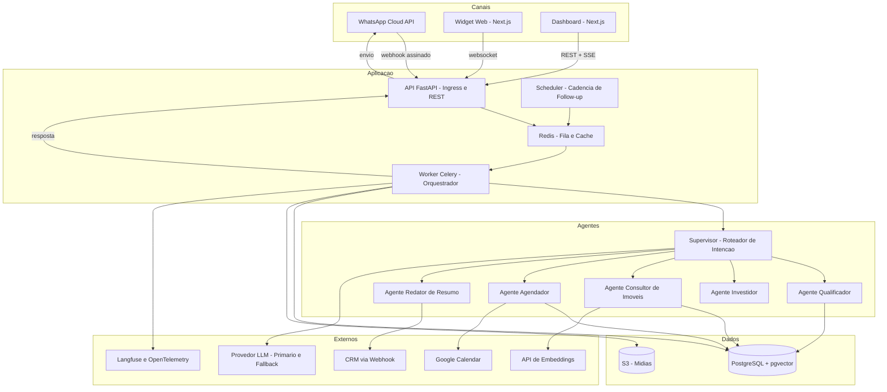
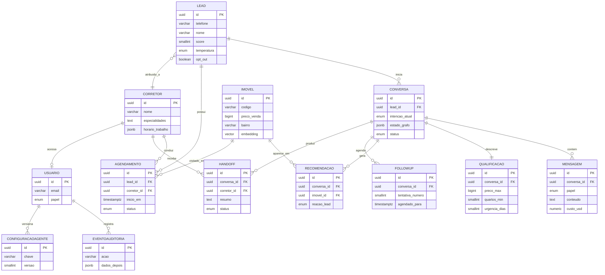

# Especificação de Requisitos de Software — Agente SDR Imobiliário com IA Generativa

**Versão:** 1.0 | **Data:** 22/08/2026 | **Status:** Rascunho para validação
**Contexto:** Tech Challenge — Fase 5 (Hackathon FIAP / POS TECH). Prova de Conceito.

> **Este arquivo é o SRS v1.0 versionado no repositório, com emendas em linha.**
> O corpo é o original de 22/08/2026, byte a byte. Toda mudança posterior aparece
> como um item aninhado **Emenda E-nn (TEC-nnn, data)** logo abaixo da regra que
> altera, nunca reescrevendo o texto original — quem lê vê o que a v1.0 dizia e o
> que mudou depois.
>
> | Emenda | Regras | Card | Data |
> | --- | --- | --- | --- |
> | E-01 | RN-04.2, RN-05.4 | [TEC-255](https://eduardodurieuxlopes.atlassian.net/browse/TEC-255) | 01/09/2026 |
> | E-01 | RN-06.4 | [TEC-152](https://eduardodurieuxlopes.atlassian.net/browse/TEC-152) | 02/09/2026 |
> | E-01 | RN-05.7 | [TEC-148](https://eduardodurieuxlopes.atlassian.net/browse/TEC-148) | 03/09/2026 |
> | E-01 | RN-06.2 | [TEC-151](https://eduardodurieuxlopes.atlassian.net/browse/TEC-151) | 03/09/2026 |
> | E-01 | RN-13.4 | [TEC-183](https://eduardodurieuxlopes.atlassian.net/browse/TEC-183) | 03/09/2026 |
> | E-01 | RN-13.3 | [TEC-185](https://eduardodurieuxlopes.atlassian.net/browse/TEC-185) | 04/09/2026 |
> | E-01 | RN-13.7 | [TEC-188](https://eduardodurieuxlopes.atlassian.net/browse/TEC-188) | 04/09/2026 |
> | E-01 | RN-08.5, RN-08.1, Seção 6.3 (`POST /api/v1/imoveis/importar`) | [TEC-156](https://eduardodurieuxlopes.atlassian.net/browse/TEC-156) | 06/09/2026 |
> | E-01 | RN-08.2 | [TEC-157](https://eduardodurieuxlopes.atlassian.net/browse/TEC-157) | 07/09/2026 |
> | E-01 | RN-09.1, RN-09.6 | [TEC-158](https://eduardodurieuxlopes.atlassian.net/browse/TEC-158) | 07/09/2026 |
> | E-02 | RN-08.2 | [TEC-158](https://eduardodurieuxlopes.atlassian.net/browse/TEC-158) | 07/09/2026 |
> | E-02 | RN-08.1, RN-09.1 | [TEC-262](https://eduardodurieuxlopes.atlassian.net/browse/TEC-262) | 08/09/2026 |
> | E-01 | RN-09.3 | [TEC-160](https://eduardodurieuxlopes.atlassian.net/browse/TEC-160) | 11/09/2026 |
> | E-01 | CA-09.1 | [TEC-160](https://eduardodurieuxlopes.atlassian.net/browse/TEC-160) | 11/09/2026 |
> | E-01 | RN-10.3 | [TEC-163](https://eduardodurieuxlopes.atlassian.net/browse/TEC-163) | 12/09/2026 |
> | E-01 | RN-10.4 | [TEC-163](https://eduardodurieuxlopes.atlassian.net/browse/TEC-163) | 12/09/2026 |
> | E-03 | RN-04.2 | [TEC-163](https://eduardodurieuxlopes.atlassian.net/browse/TEC-163) | 12/09/2026 |
> | E-02 | RN-10.3 | [TEC-275](https://eduardodurieuxlopes.atlassian.net/browse/TEC-275) | 13/09/2026 |
> | E-01 | RN-05.5 | [TEC-149](https://eduardodurieuxlopes.atlassian.net/browse/TEC-149) | 14/09/2026 |
> | E-01 | RN-07.2 | [TEC-153](https://eduardodurieuxlopes.atlassian.net/browse/TEC-153) | 14/09/2026 |
> | E-01 | RN-05.2 | [TEC-153](https://eduardodurieuxlopes.atlassian.net/browse/TEC-153) | 14/09/2026 |
> | E-01 | RN-07.3, RN-07.5, RN-10.1 | [TEC-154](https://eduardodurieuxlopes.atlassian.net/browse/TEC-154) | 14/09/2026 |
> | E-01 | RN-13.2 | [TEC-184](https://eduardodurieuxlopes.atlassian.net/browse/TEC-184) | 14/09/2026 |
> | E-01 | RN-13.5 | [TEC-187](https://eduardodurieuxlopes.atlassian.net/browse/TEC-187) | 14/09/2026 |
> | E-01 | RN-03.3 | [TEC-136](https://eduardodurieuxlopes.atlassian.net/browse/TEC-136) | 15/09/2026 |
> | E-02 | RN-06.4 | [TEC-136](https://eduardodurieuxlopes.atlassian.net/browse/TEC-136) | 15/09/2026 |
> | E-02 | RN-02.3 | [TEC-138](https://eduardodurieuxlopes.atlassian.net/browse/TEC-138) | 16/09/2026 |
> | E-01 | RN-03.5 | [TEC-138](https://eduardodurieuxlopes.atlassian.net/browse/TEC-138) | 16/09/2026 |
> | E-01 | RN-13.6 | [TEC-186](https://eduardodurieuxlopes.atlassian.net/browse/TEC-186) | 22/09/2026 |
> | E-01 | RN-12.2 | [TEC-171](https://eduardodurieuxlopes.atlassian.net/browse/TEC-171) | 25/09/2026 |
> | E-02 | RN-13.3 | [TEC-171](https://eduardodurieuxlopes.atlassian.net/browse/TEC-171) | 25/09/2026 |
> | E-01 | RN-12.3, RN-12.4, RN-12.5 | [TEC-172](https://eduardodurieuxlopes.atlassian.net/browse/TEC-172) | 25/09/2026 |
> | E-03 | RN-13.3 | [TEC-172](https://eduardodurieuxlopes.atlassian.net/browse/TEC-172) | 25/09/2026 |
> | E-01 | RN-11.1, RN-11.3, RN-11.4, RN-11.5, CA-11.1, CA-11.2 | [TEC-371](https://eduardodurieuxlopes.atlassian.net/browse/TEC-371) | 25/09/2026 |
> | E-04 | RN-12.1 | [TEC-371](https://eduardodurieuxlopes.atlassian.net/browse/TEC-371) | 25/09/2026 |
> | E-02 | RN-12.2 | [TEC-371](https://eduardodurieuxlopes.atlassian.net/browse/TEC-371) | 25/09/2026 |
> | E-04 | RN-17.1 | [TEC-371](https://eduardodurieuxlopes.atlassian.net/browse/TEC-371) | 25/09/2026 |
> | E-03 | RN-12.2 | [TEC-372](https://eduardodurieuxlopes.atlassian.net/browse/TEC-372) | 25/09/2026 |
> | E-02 | RN-12.3 | [TEC-372](https://eduardodurieuxlopes.atlassian.net/browse/TEC-372) | 25/09/2026 |
> | E-01 | CA-12.2 | [TEC-372](https://eduardodurieuxlopes.atlassian.net/browse/TEC-372) | 25/09/2026 |
> | E-05 | RN-17.1 | [TEC-376](https://eduardodurieuxlopes.atlassian.net/browse/TEC-376) | 25/09/2026 |
> | E-04 | RN-17.2 | [TEC-376](https://eduardodurieuxlopes.atlassian.net/browse/TEC-376) | 25/09/2026 |
> | E-03 | CA-17.1 | [TEC-376](https://eduardodurieuxlopes.atlassian.net/browse/TEC-376) | 25/09/2026 |
> | E-01, E-02 | RN-18.1 | [TEC-195](https://eduardodurieuxlopes.atlassian.net/browse/TEC-195) | 25/09/2026 |
> | E-01 | RN-18.5 | [TEC-195](https://eduardodurieuxlopes.atlassian.net/browse/TEC-195) | 25/09/2026 |
> | E-03 | RNF-12 | [TEC-195](https://eduardodurieuxlopes.atlassian.net/browse/TEC-195) | 25/09/2026 |
> | E-02 | RNF-18 | [TEC-195](https://eduardodurieuxlopes.atlassian.net/browse/TEC-195) | 25/09/2026 |
> | E-02 | RN-12.5 | [TEC-374](https://eduardodurieuxlopes.atlassian.net/browse/TEC-374) | 25/09/2026 |
> | E-01 | RN-18.2 | [TEC-193](https://eduardodurieuxlopes.atlassian.net/browse/TEC-193) | 26/09/2026 |
> | E-04 | RNF-12 | [TEC-193](https://eduardodurieuxlopes.atlassian.net/browse/TEC-193) | 26/09/2026 |
> | E-03 | RNF-18 | [TEC-193](https://eduardodurieuxlopes.atlassian.net/browse/TEC-193) | 26/09/2026 |
> | E-01 | RN-18.3 | [TEC-194](https://eduardodurieuxlopes.atlassian.net/browse/TEC-194) | 26/09/2026 |
> | E-01 | RN-18.4 | [TEC-194](https://eduardodurieuxlopes.atlassian.net/browse/TEC-194) | 26/09/2026 |
> | E-06 | RN-16.4 | [TEC-194](https://eduardodurieuxlopes.atlassian.net/browse/TEC-194) | 26/09/2026 |
> | E-01 | RN-19.1 | [TEC-197](https://eduardodurieuxlopes.atlassian.net/browse/TEC-197) | 26/09/2026 |
> | E-01 | RN-19.3, CA-19.1 | [TEC-198](https://eduardodurieuxlopes.atlassian.net/browse/TEC-198) | 26/09/2026 |
> | E-04 | RNF-18 | [TEC-198](https://eduardodurieuxlopes.atlassian.net/browse/TEC-198) | 26/09/2026 |
> | E-01 | RN-19.4, CA-19.2 | [TEC-199](https://eduardodurieuxlopes.atlassian.net/browse/TEC-199) | 26/09/2026 |
> | E-02 | RN-19.3 | [TEC-199](https://eduardodurieuxlopes.atlassian.net/browse/TEC-199) | 26/09/2026 |
> | E-05 | RNF-18 | [TEC-199](https://eduardodurieuxlopes.atlassian.net/browse/TEC-199) | 26/09/2026 |
> | E-01 | RN-17.4 | [TEC-191](https://eduardodurieuxlopes.atlassian.net/browse/TEC-191) | 26/09/2026 |
> | E-03 | RN-19.3 | [TEC-191](https://eduardodurieuxlopes.atlassian.net/browse/TEC-191) | 26/09/2026 |
> | E-01 | RNF-27 | [TEC-209](https://eduardodurieuxlopes.atlassian.net/browse/TEC-209) | 26/09/2026 |
> | E-01 | RNF-32 | [TEC-209](https://eduardodurieuxlopes.atlassian.net/browse/TEC-209) | 26/09/2026 |
> | E-01 | RNF-33 | [TEC-209](https://eduardodurieuxlopes.atlassian.net/browse/TEC-209) | 26/09/2026 |
> | E-02 | RN-01.4 | [TEC-207](https://eduardodurieuxlopes.atlassian.net/browse/TEC-207) | 26/09/2026 |
> | E-02 | RN-01.6 | [TEC-207](https://eduardodurieuxlopes.atlassian.net/browse/TEC-207) | 26/09/2026 |
> | E-01 | RN-14.4 | [TEC-207](https://eduardodurieuxlopes.atlassian.net/browse/TEC-207) | 26/09/2026 |
> | E-08 | RN-16.1 | [TEC-207](https://eduardodurieuxlopes.atlassian.net/browse/TEC-207) | 26/09/2026 |
> | E-06 | RNF-18 | [TEC-207](https://eduardodurieuxlopes.atlassian.net/browse/TEC-207) | 26/09/2026 |
> | E-01 | RNF-21 | [TEC-207](https://eduardodurieuxlopes.atlassian.net/browse/TEC-207) | 26/09/2026 |
> | E-01 | RNF-22 | [TEC-207](https://eduardodurieuxlopes.atlassian.net/browse/TEC-207) | 26/09/2026 |
> | E-01 | Seção 6.7 (`GET` e `DELETE /api/v1/leads/{leadId}/dados-pessoais`) | [TEC-207](https://eduardodurieuxlopes.atlassian.net/browse/TEC-207) | 26/09/2026 |
>
> **Este índice está incompleto e a linha acima não o conserta.** Emendas do corpo de várias cards (TEC-139, TEC-142, TEC-161, TEC-162, TEC-174 a TEC-179, TEC-196, TEC-278) nunca foram indexadas — a TEC-275 acrescentou só a sua. Quem procura a lista completa lê o corpo do documento, não esta tabela.

---

## 1. Visão Geral do Sistema

### 1.1 Objetivo e proposta de valor

O sistema é um **SDR (Sales Development Representative) digital** para o mercado imobiliário: um agente conversacional que atende leads 24 horas por dia no WhatsApp e no site da imobiliária, conduz uma conversa natural para descobrir o que a pessoa procura, consulta a base de imóveis para mostrar opções aderentes, classifica o lead por temperatura, agenda a visita ou reunião com o corretor certo e, quando o lead some, retoma o contato sozinho.

O ganho comercial vem de três frentes mensuráveis: **tempo de primeira resposta** cai de horas para segundos, **nenhum lead fica sem follow-up** porque a cadência é automática, e o corretor só recebe o lead depois de qualificado, com um resumo pronto — em vez de gastar as primeiras trinta perguntas descobrindo se a pessoa tem orçamento. O agente não vende: ele filtra, aquece e entrega. A negociação continua sendo humana.

Como POC de hackathon, o sistema é uma aplicação completa e funcional ponta a ponta, com base de imóveis simulada, mas construída com decisões de arquitetura que sobrevivem à produção — sem atalhos que exijam reescrita para virar produto.

### 1.2 Público-alvo e personas

**Marina, 34 anos — lead compradora.** Está no WhatsApp às 22h30 depois de ver um anúncio no Instagram. Escreve "oi, esse apartamento da zona sul ainda tá disponível?" e, se ninguém responder em dez minutos, já mandou mensagem para outras três imobiliárias. Ela não quer preencher formulário nem falar com robô que responde por menu numerado. Ganha: resposta imediata, três opções que realmente cabem no bolso dela e uma visita marcada sem trocar quinze mensagens.

**Ricardo, 48 anos — lead investidor.** Tem R$ 800 mil para alocar e quer saber rentabilidade de aluguel, não metragem de varanda. Detesta ser tratado como quem compra para morar. Ganha: um atendimento que reconhece o perfil dele na segunda mensagem e o direciona para o especialista em investimentos, com o ticket e a expectativa de retorno já registrados.

**Paulo, 41 anos — corretor.** Recebe 60 leads por semana no celular pessoal, misturados com mensagens de família. Perde tempo com curioso e esquece de retomar quem estava quente. Ganha: uma fila priorizada por score, resumo de uma tela por lead, e a agenda preenchida com visitas confirmadas em vez de "depois eu vejo".

**Anelise, 37 anos — gerente comercial.** Hoje não sabe quantos leads entraram, quantos foram atendidos e onde o funil vaza; monta relatório no Excel toda segunda. Ganha: dashboard com funil em tempo real, taxa de qualificação, tempo médio de resposta e volume por origem.

### 1.3 Escopo

**Dentro do MVP (POC entregável):**

| # | Item |
|---|---|
| 1 | Atendimento conversacional em WhatsApp (Meta Cloud API) e widget web de chat |
| 2 | Orquestração multiagente com roteamento por intenção (compra, aluguel, investimento) |
| 3 | Memória conversacional persistente entre sessões e canais |
| 4 | Qualificação progressiva com lead scoring automático |
| 5 | RAG sobre base simulada de imóveis (busca híbrida: vetorial + filtros estruturados) |
| 6 | Agendamento de visitas e reuniões com verificação de disponibilidade do corretor |
| 7 | Follow-up automático em cadência configurável |
| 8 | Resumo inteligente e handoff para o corretor |
| 9 | Dashboard web de acompanhamento (funil, leads, conversas, agendamentos) |
| 10 | Observabilidade de LLM (tracing, custo por conversa, latência) e guardrails |
| 11 | Deploy em cloud com CI/CD |

**Fora do MVP:**

- Fechamento de contrato, geração de proposta, assinatura digital, análise de crédito.
- Integração com portais externos (VivaReal, ZAP, OLX) — a base é simulada e carregada por seed/CSV.
- Voice AI (atendimento por áudio em tempo real). O sistema aceita **áudio recebido** no WhatsApp com transcrição (RF-01.3), mas não faz chamadas de voz. Fica como evolução declarada, com o ponto de extensão previsto na arquitetura.
- Integração bidirecional com CRM de mercado. O MVP entrega um **adaptador CRM com implementação de webhook genérico**; conectores para Pipedrive/HubSpot ficam como plug-in.
- App mobile nativo. O dashboard é web responsivo.
- Multi-tenant real (várias imobiliárias isoladas na mesma instância). A modelagem já prevê a coluna `tenant_id`, mas o MVP roda com um único tenant.
- Pagamentos, assinatura de plano, faturamento.

### 1.4 Premissas

Nenhuma destas informações estava no briefing; foram arbitradas com base em prática de mercado e precisam de validação antes de virarem backlog.

| ID | Premissa | Impacto se for diferente |
|---|---|---|
| PR-01 | Volume da POC: até 200 leads simultâneos e 5.000 mensagens/dia. | Acima de ~50 mensagens/s a fila de processamento precisa de partição por tenant e o rate limit da Meta vira gargalo. |
| PR-02 | A base simulada tem entre 500 e 2.000 imóveis, carregada por seed em JSON/CSV com fotos por URL. | Acima de 100 mil imóveis, `pgvector` com IVFFlat deixa de bastar e exige HNSW ou banco vetorial dedicado. |
| PR-03 | Um único tenant (uma imobiliária) na POC, com `tenant_id` já modelado. | Multi-tenant real exige RLS no Postgres e isolamento de índice vetorial — 2 a 3 dias de trabalho adicional. |
| PR-04 | Idioma único: português do Brasil. | Multi-idioma exige detecção de idioma no ingress e prompts versionados por locale. |
| PR-05 | Conta WhatsApp Business API em modo de teste (até 5 números verificados) durante a POC. | Produção exige verificação de negócio na Meta e aprovação de templates de mensagem — prazo de 3 a 15 dias úteis, fora do controle do time. |
| PR-06 | Janela de atendimento: agente responde 24/7; corretor humano atende de segunda a sábado, 9h–19h. | Handoff fora do horário cai em fila com aviso ao lead, não em espera silenciosa. |
| PR-07 | Provedor de LLM principal: Anthropic Claude via API, com OpenAI como fallback. | Restrição de fornecedor único elimina a estratégia de fallback do RT-02 e aumenta o risco de indisponibilidade. |
| PR-08 | Orçamento de POC de até US$ 150 em créditos de LLM para desenvolvimento, demo e testes. | Abaixo disso, é preciso trocar o modelo de qualificação por um modelo menor e cachear respostas de demo. |
| PR-09 | Os dados dos leads são dados pessoais reais desde a POC (nome, telefone, preferências). | Se a demo usar apenas dados sintéticos, o rigor de LGPD pode ser demonstrado sem tratar titulares reais — mas o código deve permanecer o mesmo. |
| PR-10 | Prazo de execução do hackathon: 4 a 6 semanas com equipe de 3 a 5 pessoas. | Prazo menor exige cortar o Anexo B (roadmap) na coluna "P2". |

---

## 2. Requisitos Funcionais

Cada requisito tem identificador rastreável. `RF-` = requisito funcional, `RN-` = regra de negócio, `CA-` = critério de aceite.

### 2.1 Módulo A — Atendimento Conversacional

#### RF-01 — Recepção multicanal de mensagens

**História:** Como lead, quero mandar mensagem pelo WhatsApp ou pelo chat do site e ser atendido imediatamente, para não precisar esperar horário comercial nem preencher formulário.

**Regras de negócio:**
- RN-01.1: O sistema aceita mensagens de dois canais: WhatsApp (webhook da Meta Cloud API) e widget web (WebSocket). Um mesmo lead identificado pelo telefone tem histórico unificado entre canais.
  - **Emenda E-01 (TEC-124, 24/09/2026):** a identidade do canal web é o **UUID de sessão emitido pelo servidor**, não o telefone. A segunda frase desta regra — "um mesmo lead identificado pelo telefone tem histórico unificado entre canais" — descreve a TEC-129 e não esta card: aqui, duas sessões da mesma pessoa, em dois navegadores, são duas conversas sem relação entre si, e o widget não pede telefone em momento algum. O id é emitido no primeiro frame e reapresentado pela página na reconexão; ele nunca viaja em URL, porque em query string entraria em log de acesso, `Referer` e histórico do navegador. O canal é gravado como `web`, minúsculo, e não `WEB` como a card escrevia: a coluna `messages.channel` já estava povoada com `whatsapp` em minúsculas. **Consequência declarada:** quem tiver o id lê aquela conversa — é a mesma exposição de um link mágico, mitigada por ser UUIDv4 e por não haver autenticação de visitante nesta fase.
  - **Emenda E-02 (TEC-129, 24/09/2026):** a unificação é **assimétrica**: o atendimento pelo WhatsApp herda o que a mesma pessoa disse no widget web, e o widget não herda nada do WhatsApp. O vínculo nasce quando a visitante digita um telefone no chat — só número brasileiro, reconhecido por regex sobre a fala, sem o agente pedir — e o primeiro telefone de uma sessão é o que vale. O motivo da assimetria é que a sessão web é anônima e nada verifica que o número digitado é de quem o digitou: com a herança nos dois sentidos, quem soubesse o telefone de outra pessoa leria, pela boca do agente, o que ela disse no WhatsApp. O que o WhatsApp herda são os critérios de qualificação, as recusas e as falas literais — o orçamento e os campos de investidor só de sessão cuja intenção está na mesma banda de preço, e só o que foi dito no site até cada fala do WhatsApp, de no máximo três sessões vinculadas (as mais recentes); opt-out, handoff, imóveis já apresentados e o resumo da sessão web não atravessam (as falas web herdadas podem, estas sim, entrar no resumo do WhatsApp quando a janela dele é dobrada).
- RN-01.2: O webhook responde `200 OK` em até 500 ms e processa a mensagem de forma assíncrona via fila. Nunca processa LLM dentro do ciclo de requisição do webhook.
- RN-01.3: Mensagens de áudio recebidas são transcritas (Whisper ou equivalente) e tratadas como texto. Áudios acima de 120 segundos são recusados com resposta cordial pedindo texto.
- RN-01.4: Imagens e documentos recebidos são armazenados e o agente responde reconhecendo o envio, sem tentar interpretá-los no MVP.
  - **Emenda E-01 (TEC-132, 24/09/2026):** a mídia é guardada fora do banco, cifrada pela aplicação antes de sair do processo (AES-GCM, a mesma chave de conteúdo), com o ponteiro numa tabela ligada à mensagem. Só imagem e documento são guardados, e só nos tipos que um corretor recebe (JPEG, PNG, WebP, PDF, Word, Excel), até 25 MB. A legenda que acompanha a mídia é tratada como texto do lead. Sem nenhum texto do lead na rajada, a confirmação é uma mensagem fixa, sem o modelo, e não se repete: se a última fala do agente já foi essa confirmação, há menos de 10 minutos, a mídia seguinte fica sem resposta nova. É essa mensagem fixa a garantia de "não interpretar": com legenda, o turno segue normal e o modelo é avisado de que não vê a mídia, o que torna a garantia probabilística. O download é assíncrono, e a confirmação não depende dele. A retenção da RNF-22 ainda não se aplica à mídia, porque não há job de retenção.
  - **Emenda E-02 (TEC-207, 26/09/2026):** a Emenda E-01 acima termina dizendo que a retenção da RNF-22 ainda não se aplica à mídia, porque não havia job de retenção. **Passou a se aplicar.** O job diário `sweep_retencao_de_leads` apaga a mídia junto com o conteúdo das mensagens de mais de 12 meses, e a anonimização do lead (Emenda E-01 à RNF-22) apaga toda a mídia dele, em qualquer estado de download. Nos dois casos sai a linha que aponta para o arquivo e sai o arquivo — este depois do commit, para que um rollback não deixe linha apontando para arquivo apagado. O pior caso é um arquivo órfão, que já não se liga a lead nenhum; a falha ao apagar e o cancelamento no meio do laço deixam a chave no log, e só uma morte abrupta do processo o deixa sem rastro. A mídia cujo download ainda não gravou o ponteiro é apagada pela mesma chave que o download usa, porque o arquivo pode ter sido gravado antes da linha.
- RN-01.5: Mensagens duplicadas (mesmo `message_id` da Meta) são descartadas por idempotência — a Meta reenvia em caso de timeout.
- RN-01.6: Se o lead enviar 3 mensagens em menos de 8 segundos, o sistema aguarda o fim da rajada (debounce de 6 s) e responde uma única vez considerando todas — comportamento humano, não uma resposta por linha.
  - **Emenda E-01 (TEC-128, 21/09/2026):** o debounce é **incondicional** — toda mensagem recebida aguarda a janela antes de virar turno, e não apenas a que integra uma rajada de três em oito segundos. A condição original não é implementável: a rajada só é reconhecível depois de terminada, e a essa altura a resposta à primeira mensagem já teria sido entregue e a reserva dela em `outbound_dispatches` já estaria commitada. A janela é configurável (`debounce_de_rajada_segundos`, default 6 s) e mensagem de opt-out não a aguarda.
  - **Emenda E-02 (TEC-207, 26/09/2026):** além do opt-out e do pedido de humano, **o pedido de direito do titular** (acesso ou eliminação dos dados, Emenda E-01 à RNF-21) também não aguarda a janela, e também não é descartado como parte de uma rajada que uma mensagem mais nova superou — e o mesmo vale para a palavra que confirma a eliminação ("apagar", Emenda E-01 à RNF-21), sempre que a mensagem inteira é essa palavra, haja ou não pergunta pendente: furar sem ser confirmação só faz o turno rodar sem esperar. O prazo de 15 dias só começa a contar quando o turno registra o pedido, e um pedido engolido pelo agrupamento seria um pedido perdido sem registro nem aviso.

**Critérios de aceite:**
- CA-01.1: Dado um webhook da Meta com mensagem de texto, quando recebido, então o `200 OK` retorna em menos de 500 ms e a mensagem aparece na fila.
- CA-01.2: Dado o mesmo `message_id` entregue duas vezes, quando processado, então apenas uma resposta é enviada ao lead.
- CA-01.3: Dadas 3 mensagens em 5 segundos, quando processadas, então o lead recebe uma única resposta que contempla o conteúdo das três.

#### RF-02 — Memória conversacional e continuidade

**História:** Como lead que voltou dois dias depois, quero continuar de onde parei, para não repetir tudo que já falei.

**Regras de negócio:**
- RN-02.1: Toda mensagem (entrada e saída) é persistida com timestamp, canal, papel (`lead`/`agente`/`corretor`) e metadados de custo/tokens.
- RN-02.2: O contexto enviado ao LLM é composto por: (a) as últimas 20 mensagens na íntegra, (b) um resumo comprimido das mensagens anteriores, (c) o estado estruturado de qualificação do lead. O resumo é regerado a cada 20 mensagens novas.
  - **Emenda E-01 (TEC-297, 21/09/2026):** a composição descrita acima exclui a fala que a moderação de entrada bloqueou, e essa exclusão nunca foi escrita nesta especificação — existia só no código desde a TEC-236 (agosto de 2026). O item (a) lê `messages` filtrando a marca de bloqueio, e o item (b) **herda a exclusão por construção**: a dobra que forma o resumo opera sobre a lista que a leitura do item (a) devolve e nunca relê a tabela, então o que não sai de lá nunca chega ao resumo permanente. A mesma definição de fala do lead governa a contagem do lead score (RF-06) desde a TEC-152 e a âncora da cadência de reengajamento (RF-13) desde a TEC-183 — ver a Emenda E-01 da RN-13.4 —, e a TEC-295 acrescentou um quarto leitor sob a mesma definição, o do agrupamento de rajada, prendendo os quatro com teste. A TEC-297 estendeu a marca aos cinco caminhos que retornavam antes da moderação — ver a Emenda E-03 da RN-04.5. **Consequência aceita:** a fala bloqueada também deixa de contar para o gatilho de regeneração do resumo descrito na segunda frase desta regra.
- RN-02.3: A conversa é considerada **encerrada** após 30 dias sem interação, ou por handoff concluído, ou por opt-out. Nova mensagem após encerramento abre nova conversa vinculada ao mesmo lead, com acesso ao histórico anterior via resumo.
  - **Emenda E-01 (TEC-278, 13/09/2026):** concluir o handoff **não** encerra a conversa. A regra acima junta *"handoff concluído"* e *"conversa encerrada"* como se fossem o mesmo fato, e este sistema precisa separá-los: o handoff acaba quando o humano termina o atendimento, e `POST /api/v1/conversas/devolver` — a rota que o conclui, ver a Emenda E-04 da RN-16.4 — significa **retomar** o atendimento automático, não encerrá-lo. Se concluir encerrasse, o lead que o corretor acabou de atender voltaria a falar com um agente sem memória do que aconteceu. O encerramento de conversa segue sendo só por inatividade (TEC-130, ainda a fazer) ou por opt-out. **A TEC-130 tem de respeitar essa separação quando chegar.** Ver a D3 do desenho da TEC-278.
  - **Emenda E-02 (TEC-138, 16/09/2026):** a Emenda E-01 acima afirmava que *"o encerramento de conversa segue sendo só por inatividade (TEC-130, ainda a fazer) ou por opt-out"* e advertia que *"a TEC-130 tem de respeitar essa separação quando chegar"*. As duas frases datam de antes desta card e não valem mais: existe hoje um **terceiro** motivo de encerramento, `FORA_DE_ESCOPO` (RN-03.5) — e a entidade de conversa que a regra pressupõe, e que a Emenda E-01 da RN-05.7 registrava como deferida, **passou a existir nesta card**: a tabela `conversas`, com colunas `status` (`ATIVA`/`ENCERRADA`) e `motivo_do_encerramento`, este último um vocabulário aberto a outros motivos. **A TEC-130, quando chegar, estende essa entidade em vez de criá-la**: acrescenta `INATIVIDADE` ao vocabulário de motivos e o escritor que fecha a conversa por inatividade, sem tabela nova nem uma segunda noção de "encerrada". **E ganha com isso a escrituração do encerramento, não a janela de silêncio**: os 30 dias em que o agente não responde são política do `FORA_DE_ESCOPO` (RN-03.5), não propriedade do `status` — a guarda do turno exige o motivo, e um motivo novo só entra no silêncio se quem o acrescentar decidir isso explicitamente. A distinção não é acadêmica: silêncio por omissão calaria o agente por 30 dias em toda conversa fechada por inatividade, destruindo exatamente o reengajamento que esta regra existe para ter — *"nova mensagem após encerramento abre nova conversa vinculada ao mesmo lead"*. A advertência da Emenda E-01 continua valendo como registro histórico — de uma separação que, na época, ainda dependia de a TEC-130 chegar primeiro, o que não aconteceu.
  - **Emenda E-03 (TEC-130, 22/09/2026):** esta regra ganhou implementação, e em três pontos ela diverge do que a card pedia. **(1) Concluir o handoff não encerra a conversa**, e o cenário Gherkin da TEC-130 que pedia isso foi descartado — a Emenda E-01 acima já havia decidido a separação, e sob esta card ela passou a ter uma consequência que não tinha em 13/09: o encerramento agora dobra o histórico no resumo, então encerrar ao concluir faria o lead que o corretor acabou de atender voltar a um agente sem a transcrição daquele atendimento. **(2) Os motivos de encerramento passam a ser três:** `FORA_DE_ESCOPO` (RN-03.5), `INATIVIDADE` e `OPTOUT` — nenhum dos dois novos herda a janela de 30 dias de silêncio, que continua sendo política do primeiro. **(3) O encerramento por inatividade conta a partir da última fala do lead** (`INBOUND`), não da última mensagem de qualquer direção: *"sem interação"* é o lead sem interagir, e o agente falando sozinho é a evidência de que não há interação, não o contrário. **O filtro é preventivo**, e não o conserto de um adiamento que exista: `sweep_followups` entrega o follow-up da RN-13.1 por `outbound.send` e não grava linha em `messages` — a contabilidade dele é a tabela `followups` —, e o único criador de linha OUTBOUND ali é `MessageRecorder.record_agent_message`, chamado só de dentro do turno. Contar OUTBOUND, hoje, não adiaria encerramento nenhum; o filtro existe para que o dia em que a entrega do follow-up virar linha em `messages` não mude o encerramento de quem sumiu. A promessa *"com acesso ao histórico anterior via resumo"* passou a ser verdade por construção — a primeira mensagem depois do encerramento dobra o histórico no resumo antes de montar o contexto, então a conversa nova recebe o resumo da anterior e **nenhuma linha da transcrição dela**. Sem exceção: o gatilho é um intervalo de 30 dias entre duas mensagens consecutivas do que ainda não foi resumido, e o corte cai exatamente nesse intervalo, de modo que fica literal só o que veio depois dele. Nem a fala bloqueada pela moderação de entrada (Emenda E-01 da RN-02.2) abre exceção: a recusa que aquele ramo entrega é gravada como fala do agente antes da montagem, e é ela que marca o lado novo do intervalo. **A única forma de a transcrição anterior chegar ao prompt é a degradação declarada:** o resumidor fora do ar na hora da dobra mantém o resumo anterior e não avança a marca, com alarme próprio (`contexto.dobra_forcada_falhou`) e nova tentativa no turno seguinte. **Lacuna declarada:** não nasceu identidade por conversa; `Lead 1:N Conversa`, no modelo de dados da seção 5, continua sendo o diagrama e não o esquema — não há como listar nem contar as conversas anteriores de um lead. Ver `docs/superpowers/specs/2026-09-22-tec-130-encerrar-por-inatividade-design.md`.
- RN-02.4: O estado estruturado (intenção, orçamento, região, quartos, urgência) nunca é reconstruído pelo LLM a cada turno — é lido do banco e injetado no prompt. O LLM apenas propõe atualizações via tool call.
- RN-02.5: Contexto máximo enviado ao modelo: 12.000 tokens. Excedido, o resumo é comprimido antes da chamada.

**Critérios de aceite:**
- CA-02.1: Dado um lead que informou orçamento na conversa e retorna após 48 horas, quando escreve novamente, então o agente não repergunta o orçamento e faz referência explícita ao que já sabia.
- CA-02.2: Dada uma conversa com 60 mensagens, quando o agente responde, então o prompt enviado contém resumo + 20 mensagens e não estoura 12.000 tokens.

#### RF-03 — Identificação de intenção e roteamento

**História:** Como lead investidor, quero que o atendimento entenda logo que não estou comprando para morar, para não responder perguntas irrelevantes.

**Regras de negócio:**
- RN-03.1: Intenções suportadas: `COMPRA`, `ALUGUEL`, `INVESTIMENTO`, `VENDER_IMOVEL`, `SUPORTE_CONTRATO`, `INDEFINIDA`, `FORA_DE_ESCOPO`.
- RN-03.2: A intenção é classificada a cada turno com confiança de 0 a 1. Abaixo de 0,6, o agente faz **uma** pergunta aberta de desambiguação em vez de assumir.
- RN-03.3: A intenção pode mudar durante a conversa (lead começa em aluguel e migra para compra). A mudança é registrada com histórico e dispara reavaliação da qualificação, preservando os campos ainda válidos (região, quartos).
  - **Emenda E-01 (TEC-136, 15/09/2026):** O descarte vale para qualquer troca de **banda de valor**, não só para o par ALUGUEL↔COMPRA que o Gherkin da card nomeia: `COMPRA`, `INVESTIMENTO` e `VENDER_IMOVEL` compartilham a mesma banda, então migrar entre elas não descarta nada, e migrar de qualquer uma delas para `ALUGUEL` (ou vice-versa) descarta. Uma conversa sem intenção acumulada ainda conta como troca: o número foi admitido sob a banda frouxa (a união das duas, sem validar nenhuma), e por isso não sobrevive à primeira classificação que o lead recebe. **Só o orçamento é descartado** — `faixa_preco_min_centavos`, `faixa_preco_max_centavos` e a marca de pergunta nas duas colunas que a guardam (`perguntados_sem_resposta`, `campos_recusados`); `forma_pagamento`, `tem_imovel_para_vender` e o bloco inteiro de investidor sobrevivem à troca e continuam contando para a completude. O teto de perguntas da RN-05.5 não devolve nada — a pergunta que descobriu o orçamento descartado continua contada. A troca fica registrada em `conversation_intent_audit` (append-only, uma linha por troca), e o recálculo de score que ela dispara nomeia a causa na trilha da RN-06.4, mesmo quando nenhum dos cinco fatores se move.
- RN-03.4: `VENDER_IMOVEL` e `SUPORTE_CONTRATO` não são qualificados pelo SDR — vão direto para a fila de handoff com a etiqueta correspondente.
  - **Emenda E-01 (TEC-137, 15/09/2026):** para estas duas intenções, o lead deixa de receber a prosa do modelo — recebe um texto fixo de encaminhamento, um por intenção (`venda-imovel` e `suporte-contrato` são filas diferentes, e quem tem dúvida de contrato já é cliente, não um lead comum). A substituição vale em **todo turno** com aquela intenção, não só no primeiro: o lead que insiste recebe a mesma frase de novo. Fora da janela de atendimento da imobiliária (TEC-143), o texto ganha um aviso de horário formatado a partir da configuração, nunca de um literal. **Divergência declarada:** o Gherkin da card fala em *"de segunda a sábado, das 9h às 19h"*; a janela real, configurada pela TEC-143, é 9h–18h, sem componente de dia da semana. O texto formata a partir da configuração — diz o que o sistema de fato faz —, e alinhar os dois números é decisão de produto, não de código.
  - **Emenda E-02 (TEC-285, 19/09/2026):** a divergência que a Emenda E-01 declarou está **fechada**, e no sentido do Gherkin: a janela de atendimento da imobiliária passa a ser **de segunda a sábado, das 9h às 19h**, alinhando-se ao PR-06. O que muda no sistema são duas coisas, e só a primeira estava na E-01: `atendimento_horario_fim` vai de 18 para 19, e **domingo deixa de ser dia de atendimento** — um eixo que a configuração não tinha. Os dias são **regra em código** e não configuração (`_DOMINGO`, em `domain/humano/deteccao.py`), enquanto as horas continuam vindo de `Settings` e sendo formatadas no texto, que era o argumento da E-01 e não cai. **Consequências declaradas:** sábado às 18h30 passava a fora da janela e passa a dentro, porque a mudança de horas alcança os seis dias; e o aviso de janela humana da TEC-177 continua prometendo "de segunda a sábado" com as horas do **corretor**, cuja jornada ainda não tem dia da semana — a divergência encolhe pela metade e só fecha com a agenda real (TEC-170). Ver `docs/superpowers/specs/2026-09-19-tec-285-janela-de-atendimento-com-dia-da-semana-design.md`.
- RN-03.5: `FORA_DE_ESCOPO` (assunto sem relação com imóveis) recebe resposta cordial que redireciona ao tema; após 3 tentativas seguidas fora de escopo, a conversa é encerrada educadamente.
  - **Emenda E-01 (TEC-138, 16/09/2026):** o encerramento desta regra é uma **janela de silêncio de 30 dias, e não um estado terminal**: passados os 30 dias, a próxima mensagem do lead reabre a conversa (`status` volta a `ATIVA`) e o turno segue normalmente. A contagem de *"3 tentativas seguidas"* é de mensagens cuja intenção **efetiva** é `FORA_DE_ESCOPO`, **consecutivas** — qualquer outra intenção zera o contador, inclusive dentro da mesma conversa. "Efetiva" é a intenção depois do limiar de desambiguação: um palpite `FORA_DE_ESCOPO` com confiança abaixo do limiar vale `INDEFINIDA` e **zera** o contador, pela mesma convenção que as outras regras deste sistema já seguem — uma classificação que não sustenta roteamento não pode sustentar 30 dias de silêncio. A *"resposta cordial que redireciona ao tema"* das duas primeiras mensagens continua sendo prosa do modelo, sem literal nem instrução de prompt que garanta o redirecionamento; só a terceira mensagem recebe texto fixo do repositório, que substitui a resposta do modelo — **exceto quando a moderação de saída bloqueia aquele turno**, caso em que o lead recebe o texto neutro da moderação e a conversa é encerrada mesmo assim, sem ouvir a despedida. O encerramento não espera um turno desbloqueado: esperar deixaria a conversa aberta indefinidamente diante de um interlocutor cujo texto a moderação sempre barra, que é justamente o perfil de abuso que esta regra limita. A partir da **quarta** mensagem dentro da janela, o turno não chama mais o modelo: uma guarda no topo de `executar_turno` devolve antes da moderação de entrada, da montagem de contexto e da classificação. **A guarda é cega ao conteúdo** — a partir desse ponto ela não classifica mais nada, só olha o relógio e o contador que a terceira mensagem já fechou; uma mensagem dentro do assunto que chegue nessa janela é silenciada exatamente do mesmo jeito, e o turno é só *rotulado* `"fora_de_escopo"`, não verificado como tal. Um falso positivo do classificador nas três primeiras mensagens produz esse mesmo silêncio — é a lacuna que o próprio desenho da TEC-138 declara. Essa guarda abre duas exceções, e as duas são decisão de pessoa vencendo política automática: o pedido de opt-out (LGPD) e o pedido explícito de atendimento humano — este último também **reabre** a conversa, ainda dentro da janela, porque o lead voltou com um pedido que não é fora de escopo. Ver a D5 do desenho da TEC-138.

**Critérios de aceite:**
- CA-03.1: Dada a mensagem "quero investir em imóveis para renda", quando classificada, então a intenção é `INVESTIMENTO` com confiança ≥ 0,8 e o agente pergunta sobre ticket ou expectativa de retorno — não sobre número de quartos.
- CA-03.2: Dada a mensagem "queria ver umas casas aí", quando classificada com confiança < 0,6, então o agente faz uma pergunta de desambiguação entre comprar e alugar.

#### RF-04 — Humanização e guardrails

**História:** Como lead, quero conversar com algo que soe humano e nunca me prometa o que não pode cumprir, para confiar na imobiliária.

**Regras de negócio:**
- RN-04.1: O agente se identifica como assistente virtual da imobiliária na primeira mensagem de cada conversa. Não finge ser pessoa física se perguntado diretamente.
  - **Emenda E-01 (TEC-139, 11/09/2026):** "conversa", na expressão *"primeira mensagem de cada conversa"*, passa a ter definição operacional: **não há mensagem desta conversa, em qualquer direção, nos últimos 30 dias**, derivada do timeline de `messages`. A definição é **provisória** e existe porque a entidade de conversa não existe — a emenda E-01 da TEC-148 sob a RN-05.7 registra que ela foi deferida, e a TEC-130 é quem a cria. O limiar de 30 dias é o mesmo que a TEC-130 nomeia, e não um segundo número: quando aquela card chegar, esta definição é substituída pela entidade, não reconciliada com ela. A identificação vale para a **primeira mensagem de saída** da conversa em qualquer trilha — resposta do agente, recusa da moderação (RN-04.5), texto neutro de saída ou confirmação de opt-out (RN-14.2) —, porque a regra protege o lead de receber texto nosso sem saber de quem é, e a trilha que produziu o texto não muda isso. Ver as D1 e D2 do desenho.
- RN-04.2: Respostas limitadas a 600 caracteres por mensagem, com no máximo 2 mensagens consecutivas. Uma pergunta por vez — nunca um questionário de cinco itens.
  - **Emenda E-01 (TEC-255, 01/09/2026):** a cláusula *"uma pergunta por vez"* passa a admitir **até duas perguntas por turno**. As outras duas cláusulas desta regra — 600 caracteres e no máximo 2 mensagens consecutivas — ficam inalteradas.

    **Motivo, medido.** Duas execuções pagas de 31/08/2026, sobre 294 turnos, mostraram que o cenário que a regra teme não acontece: as violações são quase todas de duas perguntas de qualificação genuínas (*"Você tem alguma região de preferência? E precisa de vaga?"*), e o maior turno observado tem **três** perguntas, uma única vez. O teto de uma pergunta marcava ~19% dos turnos como violação de um comportamento que ninguém pretendia corrigir, e régua que ninguém pretende obedecer vira régua ignorada. Sob o teto de duas, as mesmas execuções dão 98,0% e 99,3% de aderência, e a régua continua pegando o turno de três perguntas.

    O "questionário de cinco itens" que esta regra existe para impedir continua proibido — é justamente o que o teto de duas passa a vigiar.
  - **Emenda E-02 (TEC-162, 09/09/2026):** o teto de *"no máximo 2 mensagens consecutivas"* passa a valer para mensagens de **texto**. A apresentação de imóveis da RN-10.2 pode emitir até 3 mensagens de **apresentação** por turno — mídia, ou texto quando o imóvel não tem foto (RN-10.2, D13 do desenho da TEC-162): a ficha sem foto cai no caminho de texto que já existe, e não deixa de contar como apresentação por isso. A emenda E-01 acima declarou esta cláusula inalterada oito dias antes; o que mudou é que a RN-10.2 e a RN-04.2 se contradizem na prática, e a CA-10.1 desempata — ela pressupõe três imóveis apresentados (*"quando o lead responde 'gostei do segundo'"*), então baixar o teto de imóveis para 2 invalidaria um critério de aceite em vez de resolver o conflito. O teto existe contra parede de texto, e três fichas de apresentação — com ou sem foto — não são isso. A cláusula dos 600 caracteres por mensagem continua inalterada e passa a ser respeitada por construção em `domain/agente/apresentacao.py`.
  - **Emenda E-03 (TEC-163, 12/09/2026):** o teto de mensagens de **texto** — já separado da apresentação pela Emenda E-02 acima — sobe de 2 para até **3**. O teto existe contra parede de texto, e três avisos determinísticos curtos — identificação (RN-04.1), ajuste de filtro (RN-10.4) e ampliação de critério (RN-09.3) — não são isso: cada um carrega um fato distinto, nenhum é escrito por modelo, e o pior caso que reúne os três exige um lead que já descartou dois imóveis numa conversa que acabou de começar. **Declarado junto, como a Emenda E-01 da RN-09.3 já declarou para aquele teto:** este teto volta a ficar empatado. A próxima trilha de aviso determinístico **não deve pedir uma Emenda E-04** — deve agrupar os avisos determinísticos existentes num mecanismo só. Esta é a última emenda barata deste teto. Ver a D15, D16 e a L2 do desenho de `docs/superpowers/specs/2026-09-12-tec-163-recomendacao-e-reacao-design.md`.
- RN-04.3: O agente **nunca** afirma preço, disponibilidade, condição de pagamento ou característica de imóvel que não venha do catálogo via tool call. Sem resultado no catálogo, ele diz que vai verificar com o corretor.
- RN-04.4: Proibido: prometer desconto, negociar valor, dar consultoria jurídica ou tributária, garantir aprovação de financiamento, afirmar rentabilidade futura como certa.
- RN-04.5: Filtro de conteúdo na entrada e na saída. Discurso discriminatório na entrada (por exemplo, pedido de restrição de vizinhança por raça, religião ou origem) recebe recusa educada e é registrado como evento de auditoria.
  - **Emenda E-01 (TEC-142, 10/09/2026):** o "evento de auditoria" da regra passa a ter forma: uma linha em `moderation_events` com canal, conversa, direção, categoria, referência à mensagem e carimbo do servidor — **sem o texto julgado**, que permanece só na forma cifrada em `messages`, pelo mesmo argumento de `optout_events` na RN-14.2. A regra fala de discriminação na **entrada**; o registro passa a cobrir também os bloqueios de **saída** e as demais categorias (ameaça, assédio, incitação, ofensa, aconselhamento, negociação de valor), porque o que distingue discriminação é a coluna `categoria` e não a existência da linha — auditar só um eixo deixaria os outros sem registro consultável a custo zero de economia. O vocabulário difere por direção porque as duas cláusulas de moderação sempre diferiram: ofensa ao lead é bloqueio só na saída, incitação é bloqueio só na entrada. Ver as D1 e D2 do desenho.
  - **Emenda E-02 (TEC-271, 18/09/2026):** o enquadramento do pedido não o descaracteriza, e a cláusula vale para **toda** a lista de conteúdo bloqueado na entrada desta regra (racismo, machismo, homofobia, xenofobia, capacitismo, intolerância religiosa, restrição de vizinhança por composição familiar) — não só para o eixo de composição familiar que motivou a medição: pedido ou discurso dito de forma educada, apresentado como preferência pessoal, ou justificado por sossego continua sendo o que era e recebe a recusa da regra.

    **Motivo, medido.** A Emenda E-01 (TEC-142) nomeou "restricao de vizinhanca por composicao familiar" na lista de `SISTEMA_DA_ENTRADA` e moveu só o gêmeo velado do eixo — o caso direto, dito como preferência e justificado por sossego, continuou passando. A TEC-271 mediu que esse caso bloqueava sob o prompt de produção em 11/20 (55%), não nos 12/12 ou 11/12 que execuções únicas anteriores haviam registrado; a frase acima, testada numa sonda de 20 repetições contra duas candidatas, levou o mesmo caso a 20/20 sem mover os dois controles do eixo, que seguiram 20/20 liberando. Números completos em `evals/relatorios/2026-09-18-tec-271-composicao-familiar-c894b5d.md`, sonda de 240 chamadas em três braços mais o par antes/depois do gate de 51 casos. A frase que entrou em produção — "A lista acima nao cede a tom" — não nomeia o eixo de composição familiar: ela qualifica a lista inteira, por isso a cláusula desta emenda cobre a lista inteira, e não só o eixo medido. Uma segunda candidata, que declarava também uma fronteira entre critério sobre o imóvel e critério sobre quem mora ao lado, mediu o mesmo número nos quatro casos do eixo e perdeu o desempate por ser mais longa — não foi medida inferior, e a fronteira que ela descrevia não foi para produção nem entra nesta emenda.
  - **Emenda E-03 (TEC-297, 21/09/2026):** a regra base junta *"recebe recusa educada"* e *"é registrado como evento de auditoria"* como se fossem inseparáveis, e há cinco caminhos em que a segunda metade acontece sem a primeira. `executar_turno` tem cinco saídas que retornam antes da moderação — lead já em opt-out, conversa com handoff aberto ou silenciada, conversa encerrada por fora de escopo dentro da janela, pedido de opt-out e pedido explícito de humano. **A moderação passa a rodar em todas as cinco, para toda fala de entrada com texto, e nenhuma entrega a recusa.** Nas três silenciosas (opt-out já registrado, handoff aberto ou conversa assumida, fora de escopo dentro da janela), entregá-la quebraria o silêncio que a guarda existe para manter — e no ramo de atendimento humano ela seria também redundante, porque a Emenda E-03 da RN-16.4 já barra qualquer saída que não seja a confirmação de opt-out. No pedido de opt-out, seria mandar mensagem a quem acabou de pedir para sair, que é o que a RN-14.1 impede. No pedido explícito de humano vale o critério geral da D2 do desenho, que é o mesmo dos quatro anteriores: o lead recebe só o texto do próprio ramo — aqui, o aviso de transferência —, e nenhum dos cinco entrega recusa. O que essas falas recebem é a marca e a linha de auditoria, e é o suficiente para o efeito que a moderação de entrada existe para produzir — manter a fala fora do contexto e do resumo, conforme a Emenda E-01 da RN-02.2. A moderação acontece depois da ação e depois da entrega de cada ramo, e por isso não afeta o prazo da CA-04.3 nem o da Emenda E-01 da RN-04.7.
  - **Emenda E-04 (TEC-298, 22/09/2026):** a linha de `moderation_events` que a Emenda E-01 definiu passa a significar **uma fala recusada**, e não uma tentativa de recusa — mas só no caminho da moderação de **entrada gravada pelo turno**, o que `_ModeracaoDoTurno` resolve dentro de `executar_turno`. Até esta card, um turno que falhasse depois da moderação era reprocessado, a fala era julgada de novo e uma segunda linha era gravada para a mesma recusa — comportamento que a docstring de `marcar_bloqueada` registrava como aceito ("duas tentativas de recusar a mesma fala foram duas recusas"). A retentativa desse caminho agora reconhece o carimbo de `bloqueada_em`, que só `marcar_bloqueada` escreve e que já é o veredito persistido do caso bloqueado, e não regrava.

    **A cláusula não se estende às linhas de saída nem às do ramo do agrupado, e é a própria Emenda E-01 acima quem explica por quê.** Foi ela que estendeu o registro de auditoria aos bloqueios de **saída**, gravados por `registrar_bloqueio_de_saida` e ancorados no mesmo `message_id` da fala de entrada que originou o turno — não existe, para o caso de saída, nenhum carimbo equivalente a `bloqueada_em`, então um turno com saída bloqueada que falhe e seja reprocessado chama o modelo de novo, modera a saída de novo e grava outra linha de saída para a mesma fala. E `moderar_entrada_e_marcar` tem um segundo chamador além do turno: `_moderar_superada`, que modera a fala que vai fechar "agrupado" — a mensagem superada nunca passa por `_ModeracaoDoTurno`, então a blindagem desta card não a alcança, e uma superada bloqueada cujo turno falhe e seja reprocessado também grava uma segunda linha de entrada. Quem audita continua contando **tentativas**, não falas, nas linhas de saída e nas de entrada gravadas pelo ramo do agrupado; só a linha de entrada gravada pelo turno passou a significar uma fala.

    **Consequência para quem audita:** a contagem de recusas de entrada gravadas pelo turno passa a ser de falas e não de tentativas — mais próxima do que a regra base diz, e diferente do que a tabela vinha registrando. Nos outros dois caminhos a tabela continua dizendo o que sempre disse, e nada nesta emenda muda isso. **O caso liberado não mudou:** "moderou e liberou" continua sem ser persistido, então um turno que falha depois de uma moderação limpa continua sendo remoderado no reprocessamento. Ver a D5 e a D6 do desenho em `docs/superpowers/specs/2026-09-22-tec-298-pendencia-perdida-apos-recusa-design.md`.
- RN-04.6: Pedido explícito de falar com humano interrompe o fluxo imediatamente e cria handoff prioritário (RF-16), sem tentativa de retenção.
- RN-04.7: Latência percebida: se a resposta demorar mais de 4 s, o sistema envia indicador de digitação no WhatsApp.
  - **Emenda E-02 (TEC-362, 24/09/2026):** a regra passa a valer **também no canal web**, com o mesmo limiar de 4 s e a mesma duração de 25 s. **E sem o efeito colateral que o WhatsApp impõe:** a Emenda E-01 registra que na Cloud API o indicador sai no mesmo corpo que marca a fala do lead como lida, e não há variante sem isso. No chat web ele é evento próprio no WebSocket, não anotação sobre a mensagem recebida — não marca nada como lido, e não há tique azul a dar. A assimetria entre os canais é do canal, não da regra.
  - **Emenda E-01 (TEC-274, 19/09/2026):** o indicador desta regra **não existe isolado na Cloud API da Meta**. Ele sai no mesmo `POST /{phone_number_id}/messages` do envio de mensagem, num corpo que exige `"status": "read"` e o `wamid` da mensagem de entrada — ou seja, **enviar o indicador marca a fala do lead como lida**, e não há variante sem esse efeito. A regra passa a valer com ele: um turno que ultrapassa os 4 s dá tique azul; um turno rápido não dá. A regra também ganha a duração que o canal impõe — o indicador desaparece após 25 s, e a TEC-274 não o renova (L1 do desenho). E os "4 s" passam a ser medidos do início do processamento da mensagem até a primeira entrega, e não da chamada ao modelo: é o silêncio que o lead percebe, e um turno com três segundos de montagem de contexto e três e meio de modelo deixa o lead seis segundos e meio no vazio sem que nenhuma parte isolada ultrapasse o limiar. Ver as D1, D2 e a L1 do desenho em `docs/superpowers/specs/2026-09-19-tec-274-indicador-de-digitacao-design.md`.

**Critérios de aceite:**
- CA-04.1: Dado que o lead pergunta "você é um robô?", quando o agente responde, então ele confirma ser um assistente virtual e oferece transferência para corretor.
- CA-04.2: Dada uma pergunta sobre um imóvel inexistente no catálogo, quando o agente responde, então não inventa dados e propõe verificação humana.
- CA-04.3: Dado o pedido "quero falar com uma pessoa", quando processado, então um handoff é criado em até 5 s com prioridade alta e o agente para de conduzir a qualificação.

### 2.2 Módulo B — Qualificação de Leads

#### RF-05 — Coleta progressiva de critérios

**História:** Como agente, quero descobrir orçamento, região, tipologia e prazo ao longo de uma conversa natural, para qualificar sem parecer um formulário falado.

**Regras de negócio:**
- RN-05.1: Campos de qualificação para `COMPRA`/`ALUGUEL`: intenção, faixa de preço (mín/máx), região(ões), tipo de imóvel, número de quartos, vagas, urgência (prazo de decisão), forma de pagamento (à vista/financiamento), se já tem imóvel para vender.
- RN-05.2: Campos para `INVESTIMENTO`: ticket disponível, expectativa de retorno (% a.a. ou valor de aluguel), horizonte (curto/médio/longo), tolerância a reforma, preferência por tipo (residencial, comercial, temporada), se já investe em imóveis.
  - **Emenda E-01 (TEC-153, 14/09/2026):** A regra nomeia seis campos de qualificação do investidor; o dicionário de dados registra três. A emenda declara os três que faltavam — `horizonte`, `tolerancia_reforma`, `ja_investe_em_imoveis` — como colunas de `lead_qualification`, na mesma chave por lead que a E-01 da RN-05.7 estabeleceu. **Fica fora, e é a única redução deliberada:** *preferência por tipo (residencial, comercial, temporada)*. Aquele vocabulário é um eixo diferente do `TipoImovel` do catálogo — um apartamento residencial pode ser de temporada —, não alimenta perfil nem roteamento, e nenhum critério de aceite o exercita. Gravar um campo meio modelado que ninguém lê é pior que declarar a ausência. Ver a L3 do desenho da TEC-153, em `docs/superpowers/specs/2026-09-14-tec-153-trilha-do-investidor-design.md` — a L3 não existe neste documento.
- RN-05.3: Campos **obrigatórios mínimos** para considerar o lead qualificado: intenção + faixa de preço (ou ticket) + região + urgência. Os demais são desejáveis.
- RN-05.4: Uma pergunta por turno. Se o lead responde espontaneamente três campos de uma vez, todos são extraídos e nenhum é reperguntado.
  - **Emenda E-01 (TEC-255, 01/09/2026):** *"uma pergunta por turno"* passa a *"até duas perguntas por turno"*, pela mesma medição e pelo mesmo motivo da emenda a RN-04.2. A segunda metade da regra — extrair tudo que o lead informa de uma vez e não reperguntar — fica inalterada.
- RN-05.5: O agente não faz mais de 8 perguntas de qualificação em uma conversa. Atingido o limite sem os obrigatórios, ele oferece a conversa com o corretor mesmo assim.
  - **Emenda E-01 (TEC-149, 14/09/2026):** A regra fala em *"8 perguntas de qualificação em uma conversa"*, e o dicionário de dados põe o contador em `conversa.perguntas_feitas`. Não há entidade de conversa: a Emenda E-01 da RN-05.7 já estabeleceu que `conversation_key` é o id externo do lead e deferiu a criação da entidade. O contador vive em `lead_qualification`, na mesma chave, e o teto passa a valer **por lead, sem fronteira de conversa e sem expirar**. **Consequência declarada:** um lead que esgotou as oito perguntas nunca mais é qualificado pelo agente, mesmo voltando meses depois com outra intenção — ele é oferecido ao corretor. Erra na direção de não incomodar, como a E-01 da RN-05.7. Fica também declarado que a contagem é por **campo perguntado**, e não por turno, porque a E-01 da RN-05.4 permite duas perguntas por turno desde a TEC-255; e que o teto morde entre a sétima e a oitava pergunta quando o último turno pergunta dois campos, porque a prosa é entregue inteira ou não é entregue.
- RN-05.6: Valores monetários são normalizados: "uns 500 mil", "500k" e "R$ 500.000" viram `50000000` (centavos, inteiro). Faixa aberta ("até 500 mil") vira `max=50000000, min=null`.
- RN-05.7: Recusa em responder um campo é registrada como `recusado` e o campo não é reperguntado na mesma conversa.
  - **Emenda E-01 (TEC-148, 03/09/2026):** a recusa vale para o **lead**, e não para a conversa. Não há fronteira de conversa no sistema: `conversation_key` é o id externo do lead, e `messages`, `lead_qualification`, `conversation_summaries` e `optout_events` todos o usam com esse sentido; introduzir a entidade de conversa é maior que esta card e fica deferido. A consequência é que o campo recusado não é reperguntado **nunca**, e não só na conversa corrente — erro na direção de não incomodar o lead. A recusa também deixa de contar na qualificação (RN-05.3) e na completude do score (RN-06.1), fechando a divergência que a TEC-150 declarou.

**Critérios de aceite:**
- CA-05.1: Dada a frase "procuro apto de 2 quartos na zona sul até 600 mil pra mudar em janeiro", quando processada, então 4 campos são preenchidos em uma única passagem e o próximo turno não repergunta nenhum deles.
- CA-05.2: Dado um lead que disse "prefiro não falar de valor agora", quando a conversa continua, então o campo orçamento não é reperguntado e fica marcado como recusado.

#### RF-06 — Lead scoring e classificação de temperatura

**História:** Como corretor, quero receber os leads ordenados por probabilidade de fechar, para atacar os quentes primeiro.

**Regras de negócio:**
- RN-06.1: Score de 0 a 100, determinístico (calculado em código, não pelo LLM), recalculado a cada atualização de qualificação. A composição é auditável e configurável:

| Fator | Peso | Critério |
|---|---|---|
| Completude da qualificação | 25 | 5 pontos por campo obrigatório preenchido |
| Urgência | 25 | ≤30 dias = 25; 31–90 = 15; 91–180 = 8; sem prazo = 0 |
| Aderência ao catálogo | 20 | ≥5 imóveis compatíveis = 20; 1–4 = 12; 0 = 0 |
| Engajamento | 15 | Nº de mensagens do lead e tempo médio de resposta |
| Capacidade financeira | 15 | Pagamento à vista = 15; financiamento pré-aprovado = 12; a avaliar = 6 |

- RN-06.2: Temperatura derivada do score: `QUENTE` ≥ 70, `MORNO` 40–69, `FRIO` < 40.
  - **Emenda E-01 (TEC-151, 03/09/2026):** `QUENTE` por faixa passa a exigir também `esta_qualificado` (RN-05.3); um lead não-qualificado com score ≥ 70 fica em `MORNO`. Os gatilhos da RN-06.3 ignoram o teto — quem pede visita está pronto para agir mesmo sem os quatro campos obrigatórios. O motivo é a RN-06.5: a TEC-150 declarou dois estados alcançáveis que somam 70 com `esta_qualificado` False — um deles com `intencao = None`, cuja intenção o sistema nunca determinou —, e enquanto nada consumia o número declarar bastava. Com a notificação ao corretor, o número passou a fazer um telefone tocar. Os cortes de 70 e 40 **não** se mexeram: perguntou-se em 02/09/2026 se deveriam recalibrar para o teto real do score (75 sem catálogo) e a decisão foi aceitar a consequência — só três totais alcançam 70 hoje, `{70, 72, 75}`, então `QUENTE` por faixa é uma conjunção de quase-máximos e não uma faixa.
- RN-06.3: Gatilhos que forçam `QUENTE` independentemente do score: pedido explícito de visita, pedido de falar com corretor, menção a proposta ou contrato.
- RN-06.4: Todo recálculo grava um registro de auditoria com score anterior, novo, fatores e timestamp.
  - **Emenda E-01 (TEC-152, 02/09/2026):** o registro é gravado quando o resultado do recálculo **difere do último registrado**, e não a cada recálculo. A comparação é sobre os cinco fatores, não sobre o total — completude +15 com urgência −15 deixa o total igual e é justamente o caso que a trilha existe para explicar. O gancho roda a cada turno com estado, e a maioria dos recálculos não move nada: uma linha por mensagem de entrada enterraria as transições no meio das duplicatas. A consequência declarada é que a trilha não prova que um recálculo *aconteceu*, só que o resultado *mudou*.
  - **Emenda E-02 (TEC-136, 15/09/2026):** A última frase da Emenda E-01 deixou de valer. Uma causa informada pelo chamador (`causas_externas`) passou a ser, por si só, razão suficiente para gravar — unida à tupla de causas **antes** da guarda que decide se grava, e não depois. A primeira causa desse tipo é a troca da intenção acumulada (RN-03.3): **sempre que ela muda**, a trilha grava uma linha com a causa `MUDANCA_DE_INTENCAO` mesmo que nenhum dos cinco fatores do score tenha se movido e o total novo seja idêntico ao anterior. O gatilho é a troca, e não o descarte do orçamento: entram tanto as trocas dentro da mesma banda (COMPRA → INVESTIMENTO), que não descartam nada, quanto o `NULL` → X de uma conversa cuja linha de qualificação **já existia sem intenção** — a porta que INDEFINIDA abre, quando uma extração anterior gravou campos sem classificar —, que descarta. O primeiro turno da maioria das conversas não entra em nenhum dos dois: ali a linha de qualificação ainda não existe quando a troca é avaliada, não há o que invalidar, e nenhuma causa é emitida. A razão é o que a trilha responde — "o que disparou este recálculo" —, e uma intenção que mudou é resposta a essa pergunta tenha ela invalidado o orçamento ou não; o que a troca descartou é a pergunta da outra trilha, `conversation_intent_audit`, que guarda `faixa_descartada` por linha. A trilha passa a poder registrar uma linha em que nenhum fator mudou, então "o resultado mudou" deixa de ser o que toda linha prova; o que continua valendo é a forma negativa: nenhum `if` no chamador decide gravar, só que agora a tupla de causas soma as derivadas do diff **e** as externas, não só as primeiras.
- RN-06.5: Lead `QUENTE` dispara notificação ao corretor em até 60 segundos (RF-16), mesmo sem agendamento.

**Critérios de aceite:**
- CA-06.1: Dado um lead com os 4 obrigatórios, prazo de 20 dias, 6 imóveis compatíveis e pagamento à vista, quando o score é calculado, então é ≥ 70 e a temperatura é `QUENTE`.
- CA-06.2: Dado qualquer lead que peça para agendar visita, quando o pedido é registrado, então a temperatura é `QUENTE` mesmo com score 35.
- CA-06.3: Dado o mesmo conjunto de dados calculado duas vezes, quando comparado, então o score é idêntico — o cálculo não depende do LLM.

#### RF-07 — Trilha de perfil investidor

**História:** Como lead investidor, quero falar de rentabilidade e ticket, para chegar rápido a quem entende de investimento.

**Regras de negócio:**
- RN-07.1: Intenção `INVESTIMENTO` ativa um subagente especializado com prompt, vocabulário e catálogo de perguntas próprios.
- RN-07.2: Perfil classificado em `RENDA` (foco em aluguel recorrente), `VALORIZACAO` (revenda) ou `MISTO`, a partir das respostas sobre horizonte e expectativa de retorno.
  - **Emenda E-01 (TEC-153, 14/09/2026):** A regra manda classificar o perfil *"a partir das respostas sobre horizonte e expectativa de retorno"*, e a única expectativa que o dicionário de dados modela é `retorno_esperado_pct numeric(4,2)`, em % a.a. Percentual não separa renda de valorização — a mesma taxa descreve os dois. A emenda fixa que a expectativa usada na classificação é **qualitativa**, num campo próprio (`retorno_esperado_tipo`: `ALUGUEL`, `REVENDA`, `AMBOS`), e que o percentual permanece como dado, sem papel na classificação. Fica declarado também que o perfil é `NULL` — e não `MISTO` — enquanto qualquer um dos dois campos faltar, porque `MISTO` afirma um perfil e a ausência não afirma nada. **Consequência declarada:** a RN-07.3 e a TEC-154 não podem tratar perfil ausente como misto.
- RN-07.3: Ao apresentar imóveis para investidor, o sistema exibe indicadores calculados a partir dos dados do catálogo: valor do aluguel estimado, **yield bruto anual** (`aluguel_mensal × 12 ÷ preço_venda`) e valor do condomínio + IPTU. Não projeta valorização futura (RN-04.4).
  - **Emenda E-01 (TEC-154, 14/09/2026):** A regra diz "valor do aluguel estimado" sem nomear a origem. Fica fixado que a origem é a coluna `preco_aluguel` do catálogo: **não existe coluna de aluguel estimado**, e nada é estimado pelo sistema nem pelo modelo. O yield usa `preco_venda` do catálogo qualquer que tenha sido a operação buscada, e não o preço apresentado ao lead. **Consequência declarada:** imóvel sem `preco_aluguel` ou sem `preco_venda` não exibe yield — no seed de 520 imóveis isso alcança 467 deles, entre eles todos os 375 que são só VENDA.
- RN-07.4: Investidor com ticket ≥ R$ 1.000.000 é roteado para corretor com especialidade `INVESTIMENTO_ALTO_TICKET`; abaixo disso, para `INVESTIMENTO`.
- RN-07.5: Todo número de rentabilidade é apresentado como estimativa baseada em dados do catálogo, com ressalva explícita de que não é garantia.
  - **Emenda E-01 (TEC-154, 14/09/2026):** A ressalva é texto determinístico do código, repetido em **cada** ficha que carregue número estimado, e não redigido pelo modelo — precedente do aviso de ampliação (TEC-160) e do motivo de match (TEC-163). Ela **não** acompanha condomínio e IPTU quando não há número estimado: são fato do catálogo, e ressalvá-los ensinaria o lead a ignorar a ressalva onde ela importa.

**Critérios de aceite:**
- CA-07.1: Dado "quero investir em imóveis para renda", quando o agente responde, então o subagente investidor assume e a primeira pergunta é sobre ticket ou expectativa de retorno.
- CA-07.2: Dado um imóvel de R$ 500.000 com aluguel estimado de R$ 2.500, quando apresentado a um investidor, então o yield bruto exibido é 6,0% a.a. com ressalva de estimativa.

### 2.3 Módulo C — Catálogo de Imóveis e RAG

#### RF-08 — Ingestão e indexação do catálogo

**História:** Como administrador, quero carregar a base de imóveis e ter tudo pesquisável pelo agente, para que as recomendações usem dados reais.

**Regras de negócio:**
- RN-08.1: Carga por arquivo CSV/JSON via CLI de seed e por endpoint administrativo. A POC vem com base simulada de no mínimo 500 imóveis, gerada com distribuição realista de bairros, preços e tipologias.
  - **Emenda E-01 (TEC-156, 06/09/2026):** o contrato do arquivo, que a regra chama apenas de "CSV/JSON", é: colunas nomeadas em `snake_case` com cabeçalho obrigatório e ordem livre; preços em **reais com decimais** (`580000.00`), convertidos a centavos na borda com `Decimal`; `|` como separador de `caracteristicas` e `fotos`; enums em maiúscula exata, sem normalização; leitura em `utf-8-sig`; delimitador `,` ou `;` detectado pelo cabeçalho. JSON é lista de objetos com as mesmas chaves, sem envelope. A guarda de plausibilidade de preço — recusa fora da faixa `[R$ 1.000, R$ 500.000.000]` — se aplica só a `preco_venda` e `preco_aluguel`: `condominio` e `iptu_mensal` são cobranças mensais, e um condomínio de R$ 850 ou um IPTU de R$ 320 são o comum, não a exceção — um piso de R$ 1.000 rejeitaria quase todo imóvel real nesses dois campos. Os dois são convertidos a centavos com o mesmo `Decimal`, mas sem guarda de faixa nenhuma. **Consequência declarada:** valor que não parseia vira rejeição visível, nunca campo vazio — o oposto do módulo de valores monetários da RN-05, que erra por falta porque a entrada dele é fala de lead. Mas um erro de unidade em `condominio` (alguém digitando centavos num campo de reais) passa em silêncio — é a mesma classe de erro que a guarda de `preco_venda`/`preco_aluguel` existe para pegar, só que num campo menos visível no relatório. As duas tolerâncias de leitura (BOM e delimitador) são sobre conseguir ler a célula, nunca sobre o que há dentro dela.
  - **Emenda E-02 (TEC-262, 08/09/2026):** o domínio de `tipo` passa a ter **seis** valores, com `RURAL` entre eles — o enum do catálogo não o tinha, e a busca da RN-09.1 filtrava `tipo = 'RURAL'` contra uma coluna que nunca podia conter o valor, devolvendo zero sem erro para todo lead que dissesse "chácara". O contrato do arquivo se corrige pelo próprio enum, porque o parser valida por `enumerado("tipo", TipoImovel)`: nada no parser muda, e uma linha `RURAL` deixa de ser rejeitada. **A base simulada da própria regra passa a conter exemplares dele** (25 das 520 linhas), porque uma tipologia que o agente sabe pedir e o catálogo nunca tem não satisfaz a "distribuição realista de tipologias" que esta regra promete — e sem exemplar a correção fica certa e inobservável. Ver a D1 e a D3 do desenho.
- RN-08.2: Cada imóvel gera um documento textual normalizado (descrição + características + bairro + diferenciais) que é embeddado e armazenado com `pgvector`.
  - **Emenda E-01 (TEC-157, 07/09/2026):** o documento embeddado inclui `titulo` e `cidade` além dos quatro itens que a seção 4.4 lista — o título porque é texto livre descritivo do imóvel, a cidade porque bairro homônimo em cidades diferentes colide e o filtro estruturado da RN-09.1 filtra por bairro. Ficam **fora** todos os numéricos e também quatro textuais: `operacao`, `status`, `zona` e `uf`, por serem dimensões de filtro por igualdade resolvidas no `WHERE` — o mesmo princípio que a seção 4.4 aplica ao preço. `fotos` fica fora por não ser texto descritivo. A definição vive em `domain/catalogo/documento.py` e em nenhum outro lugar; ver a D3 do desenho.
  - **Emenda E-02 (TEC-158, 07/09/2026):** a E-01 estabeleceu que o embedding do catálogo nasce numa varredura em cron, e a TEC-157 derivou daquela topologia a garantia de que falha de embedding não bloqueia o atendimento. A emenda distingue os **dois** embeddings do sistema: o do **catálogo** continua nunca sendo gerado no turno — o cron segue sendo o único caminho —; o da **consulta** do lead é gerado no turno pela busca híbrida da RN-09.1, e a não-obstrução passa a vir de **degradação declarada** em vez de topologia: sem vetor de consulta (por falta de texto, de chave ou por falha do provedor), a busca devolve o subconjunto filtrado ordenado por aderência de preço, e nunca vazio nem erro. **Consequência declarada:** o que antes era garantido por construção agora depende de um teste, e o teste é `test_provedor_caido_devolve_candidatos_filtrados_e_nao_erro`. Ver a D9 do desenho.
- RN-08.3: Reindexação automática ao criar ou atualizar imóvel. Alteração apenas de preço ou status não regera embedding (economia de custo) — só campos textuais o fazem.
- RN-08.4: Imóvel com status ≠ `DISPONIVEL` é excluído dos resultados de busca, mas mantido no banco para histórico.
- RN-08.5: Ingestão registra falhas por linha sem abortar o lote; ao final devolve relatório com total processado, inserido, atualizado e rejeitado.
  - **Emenda E-01 (TEC-156, 06/09/2026):** o relatório traz **cinco** totais, e não quatro: `processados`, `inseridos`, `atualizados`, `inalterados` e `rejeitados`, com `processados = inseridos + atualizados + inalterados + rejeitados`. O quinto existe porque o critério de aceite CA-08.1 da própria história fixa o significado de `atualizados`: reimportar 500 imóveis com 10 preços alterados deve reportar **10** atualizados, não 500. Isso obriga `atualizados` a contar linhas cujo conteúdo mudou de fato, e não linhas que casaram com um código já existente — e deixa as 490 restantes sem categoria nos quatro totais originais. **Consequência declarada:** um relatório de reimportação sem alterações mostra `processados` igual a `inalterados` e zeros no resto, o que antes era indistinguível de "nada foi processado". A detecção campo a campo que o quinto total exige é a mesma que a RN-08.3 usa para decidir se regera o embedding.

**Critérios de aceite:**
- CA-08.1: Dado um CSV com 500 imóveis e 3 linhas inválidas, quando importado, então 497 são indexados, o relatório aponta as 3 falhas com o motivo e o processo não aborta.
- CA-08.2: Dado um imóvel marcado como `VENDIDO`, quando uma busca compatível é feita, então ele não aparece nos resultados.

#### RF-09 — Busca híbrida de imóveis

**História:** Como agente, quero encontrar os imóveis que atendem ao que o lead descreveu, para recomendar com precisão e sem inventar.

**Regras de negócio:**
- RN-09.1: Busca **híbrida**: filtros estruturados (preço, quartos, vagas, tipo, bairro, status) aplicados em SQL **antes** da similaridade vetorial sobre o subconjunto filtrado. Filtro numérico nunca é delegado ao embedding.
  - **Emenda E-01 (TEC-158, 07/09/2026):** a regra lista "bairro" entre as dimensões estruturadas. O filtro de região é a **união** de bairro e zona (`bairro_busca = ANY(...) OR zona = ANY(...)`), e não uma escolha entre os dois: "centro" é nome de zona **e** de bairro em quase toda cidade brasileira, e classificar o texto do lead como um ou outro erra metade das vezes devolvendo resultados plausíveis do lado errado. A comparação é contra a coluna `bairro_busca` — o bairro dobrado em caixa e acento, gravado pela mesma função que dobra a fala do lead —, e não contra `bairro`: o lead digita "aclimacao" e o arquivo trouxe "Aclimação". A dimensão `cidade` **não** entra, porque a regra não a lista: num catálogo multicidade, "centro" casa o Centro de todas elas. Ver a D4 e a D5 do desenho.
  - **Emenda E-02 (TEC-262, 08/09/2026):** o filtro de tipo ganha a segunda exceção à igualdade pura, e ela aponta num sentido só: um pedido de `APARTAMENTO` casa `tipo IN ('APARTAMENTO', 'COBERTURA')`, e um pedido de `COBERTURA` casa só cobertura. O motivo é que a D1 da TEC-242 já decidiu que, para a fala do lead, cobertura é uma espécie de apartamento — ela anota os três turnos de `compra-06` que dizem "cobertura" como `APARTAMENTO`, e mantém o mapa fora do domínio (*"nada no schema, nada no prompt"*). Deixar a cobertura fora do resultado faria o filtro **contradizer a anotação do corpus**, e na base simulada esconderia 8% do catálogo do pedido mais comum. **Consequência declarada:** a cláusula de tipo deixa de ser igualdade em um caso, e quem a ler sem esta emenda vai achar a assimetria um defeito. A regra mora em `domain/catalogo/busca.py`, como tabela de exceção de uma entrada. Ver a D2 do desenho.
- RN-09.2: Retorna no máximo 10 candidatos ao agente, dos quais no máximo 3 são apresentados ao lead por vez.
- RN-09.3: Se zero resultados, o sistema executa **um** relaxamento automático de faixa de preço em até 10% e amplia para bairros adjacentes (tabela de adjacência pré-carregada), e avisa o lead de que ampliou o critério.
  - **Emenda E-01 (TEC-160, 11/09/2026):** a regra deixa em aberto pontos que o código teria de decidir sozinho — o mesmo defeito que a Emenda E-01 da RN-09.6 corrigiu quando aquela regra dava o peso e nunca dizia o que se media. Esta emenda fixa: "um relaxamento" é uma consulta a mais, com as duas dimensões — preço e bairro — relaxadas juntas na mesma consulta, nunca uma escada que relaxa uma e só depois a outra; a faixa cede nas duas pontas, teto e piso, em 10 pontos percentuais inteiros sobre centavos, sem ponto flutuante entrando na conta; a âncora da ordenação da RN-09.6 **não** se move junto com o `WHERE` relaxado, e é isso que mantém verdadeira a promessa da própria Emenda E-01 daquela regra, de que 10% acima do teto pontua 0,9; `relaxamentoAplicado` significa "o que você está vendo veio do passe relaxado", e vale `false` também quando o passe relaxado devolve zero — o domínio guarda três estados internamente, e é a borda quem deriva o booleano; sem teto **e** sem região não há segunda consulta, porque ela seria idêntica à primeira; a tabela de adjacência é chaveada pelo nome do bairro na forma dobrada, guarda as duas direções de cada par, e não tem chave estrangeira por não existir entidade de bairro no domínio — a integridade é responsabilidade de teste, não do schema; o aviso da CA-09.3 é mensagem determinística nossa, com kind próprio, nunca prosa do modelo, e nomeia a **dimensão** que foi ampliada, nunca o valor nem o nome do bairro; e a ampliação de região é a união entre as regiões pedidas e as adjacentes a elas — o bairro que o lead pediu continua na busca, e "apenas adjacentes" limita de onde vêm os bairros novos, não quem sai da busca. Fica declarado também que uma busca por zona relaxa preço e não amplia bairro, porque a zona já é o agregado de bairros e ampliá-la seria mudar de ordem de grandeza, o que esta regra não autoriza. **Um nono ponto, que a regra tampouco fixava:** a regra 4 da card exige que, quando mesmo depois de relaxar não houver resultado, o agente não tente de novo — informa e oferece a lista de espera ou o corretor. A implementação entrega a metade do corretor (a lista de espera fica fora do escopo desta card, ver E5) como mensagem determinística nossa, distinta da usada quando o laço de busca é excedido, porque aquela promete voltar com opções e aqui não há nenhuma para prometer. Ver as D2, D3, D4, D5, D6, D7, D8, D10, D11 e D14 do desenho.
- RN-09.4: Resultado sempre acompanha o `imovel_id` e o preço vindos do banco. A camada de apresentação valida que todo imóvel citado na resposta existe entre os candidatos retornados; citação de imóvel fora da lista bloqueia o envio e força regeneração (guardrail anti-alucinação).
  - **Emenda E-01 (TEC-161, 09/09/2026):** a regra manda que citação fora da lista *"bloqueia o envio e força regeneração"*. A regeneração sai. O que passa a valer: a citação divergente **bloqueia a prosa do modelo** e o lead recebe as fichas montadas do banco, sem prefixo; num turno sem ficha a entregar, recebe o texto de verificação com o corretor. Nenhuma segunda geração é tentada. Três razões. A moderação de saída, mais acima no mesmo `executar_turno`, já barra e substitui sem regerar — duas políticas para o mesmo problema no mesmo turno seriam uma a mais. Uma segunda chamada reexecuta o laço de tool use da TEC-265, isto é, uma busca nova com embedding, dentro de um `job_timeout` de 240 s que o pior caso das chamadas atuais já estoura. E o fato novo que a regra de 22/08 não podia conhecer: depois da TEC-162 a ficha é montada por código a partir do banco, então descartar a prosa ainda entrega até três imóveis corretos — quando a regra foi escrita, a resposta inteira vinha do modelo e descartá-la deixava o lead sem nada. **Consequência declarada:** a voz do agente some no turno bloqueado, e o lead recebe ficha sem frase de abertura; o turno não registra a pergunta como feita, nem consome o único desambiguador do episódio. Ver a D8 de `docs/superpowers/specs/2026-09-09-tec-161-citacao-fora-dos-candidatos-design.md`.
  - **Emenda E-02 (TEC-290, 19/09/2026):** a Emenda E-01 acima descarta a segunda geração com três argumentos, e o segundo deles — *"dentro de um `job_timeout` de 240 s que o pior caso das chamadas atuais já estoura"* — **deixou de ser verdade**. O pior caso do turno voltou a caber: são 207 s contra 240 s, com 33 s de folga, desde que a fase de montagem passou a ter um deadline agregado em vez de somar teto por requisição. **A E-01 não cai junto:** a segunda geração continua descartada, agora porque gasta uma folga que voltou a ser escassa — 33 s sobre um mínimo de 30 — e não porque estoura. Os outros dois argumentos da E-01 (a moderação de saída já barra e substitui sem regerar; a ficha montada por código entrega imóveis corretos sem a prosa) seguem intactos e são os que sustentam a regra. Ver `docs/superpowers/specs/2026-09-19-tec-290-orcamento-agregado-da-montagem-design.md`.
- RN-09.5: Latência da busca: p95 ≤ 400 ms para catálogo de até 10.000 imóveis.
- RN-09.6: Ordenação padrão por relevância combinada: `0,6 × similaridade + 0,4 × aderência ao filtro de preço`.
  - **Emenda E-01 (TEC-158, 07/09/2026):** a regra dá o peso (`0,4`) e nunca define *aderência ao filtro de preço*. Como o filtro estruturado é **duro**, "respeita a faixa" valeria 1 para todo candidato e zeraria o termo — 40% do peso sem efeito, e a ordenação sendo similaridade pura com um nome errado. A emenda fixa `aderencia = clamp(1 - |preco - teto| / teto, 0, 1)`, e `1` quando o lead não informou teto. A âncora é o teto e não o centro da faixa porque o piso não aparece em regra nenhuma da RF-09 — a RN-09.3 relaxa a faixa em até 10% e a CA-09.1 cobra só o teto — e porque o relaxamento da RN-09.3 decai sozinho: 10% acima do teto sai com 0,9, sem cláusula extra. **Consequência declarada:** a ordenação favorece sistematicamente o imóvel mais caro que cabe no orçamento. É o comportamento de um corretor competente, e é também a direção em que um erro de calibragem viraria upsell. A definição vive uma única vez, como expressão SQL em `domain/catalogo/busca.py`, e não tem gêmea em Python. Ver a D7 do desenho.

**Critérios de aceite:**
- CA-09.1: Dado o filtro "2 quartos, até R$ 600 mil, zona sul", quando a busca executa, então nenhum resultado tem preço acima de R$ 600 mil ou menos de 2 quartos.
  - **Emenda E-01 (TEC-160, 11/09/2026):** o critério diz que nenhum resultado tem preço acima de R$ 600 mil, e a RN-09.3 devolve até 10% acima quando relaxa — lido ao pé da letra, relaxar viola a CA-09.1. A emenda declara que este critério descreve o **passe de filtro duro**, que continua exato e é o único que roda quando há resultado, e que o passe relaxado da RN-09.3 é a exceção nomeada: visível ao lead pelo aviso explícito e ao chamador por `relaxamentoAplicado`. **A metade dos quartos não se mexe**: a RN-09.3 relaxa preço e bairro, nunca quartos, tipo ou vagas, então "menos de 2 quartos" continua valendo sem ressalva em ambos os passes. Ver a D2 e a D14 do desenho.
- CA-09.2: Dada uma resposta do LLM citando um imóvel que não está entre os candidatos, quando validada, então o envio é bloqueado e a resposta é regerada.
  - **Emenda E-01 (TEC-161, 09/09/2026):** o critério passa a ser *"o envio da prosa é bloqueado e o lead recebe as fichas do banco, sem prefixo"*. A cláusula "e a resposta é regerada" sai pelo mesmo argumento da Emenda E-01 da RN-09.4, acima.
- CA-09.3: Dada uma busca sem resultados, quando o relaxamento é aplicado, então o lead recebe alternativas com aviso explícito de que o critério foi ampliado.

#### RF-10 — Apresentação de recomendações

**História:** Como lead, quero ver as opções de forma clara e com foto, para decidir rápido se quero visitar.

**Regras de negócio:**
- RN-10.1: Cada imóvel apresentado traz: título, bairro, preço, quartos, vagas, área útil, condomínio e um diferencial em uma frase.
  - **Emenda E-01 (TEC-154, 14/09/2026):** A regra fixa oito campos por imóvel apresentado. Na trilha do investidor (RN-07.3), a ficha leva **três linhas além dos oito**, ao fim: aluguel estimado com yield bruto anual, condomínio somado ao IPTU, e a ressalva da RN-07.5. Os oito campos não mudam nem cedem espaço — inclusive a linha de condomínio, que permanece ao lado do somatório com o IPTU. Fora da trilha do investidor a ficha é exatamente a de hoje.
- RN-10.2: No WhatsApp, envia-se uma imagem por imóvel com legenda estruturada; no widget web, um card clicável. Máximo de 3 por turno.
  - **Emenda E-01 (TEC-162, 09/09/2026):** o *"card clicável"* no widget web fica com a TEC-124, que é quem traz o canal. Na data desta emenda o widget não existe — `channel` conhece `wa` e `eval` — e desenhar o formato do card sem widget contra o qual validá-lo seria palpite sem consumidor. A TEC-162 entrega a ficha agnóstica de canal e o renderizador do WhatsApp; a TEC-124 escreve o renderizador de card contra a ficha que já existirá. A cláusula do *"máximo de 3 por turno"* continua inalterada.
- RN-10.3: Toda apresentação é registrada como `Recomendacao` com o motivo do match, permitindo medir taxa de conversão por imóvel.
  - **Emenda E-01 (TEC-163, 12/09/2026):** o `conversa_id UUID FK → Conversa` desta regra vira o par `(channel, conversation_key)` — `Conversa` não é entidade neste sistema e nunca foi. `conversation_summaries`, `lead_qualification` e `conversation_intent` já se chaveiam nesse par, e esta emenda chega três tabelas atrasada: não é escolha desta card, é o registro de uma divergência que o sistema já vive. Fica declarado também que `motivo_match` é **por busca**, não por imóvel — todos os candidatos de uma mesma apresentação casaram o mesmo filtro, o que os distingue é `score_match` (coluna própria), e um motivo por imóvel repetiria a mesma frase em cada linha da apresentação. E a tabela ganha `UNIQUE (channel, conversation_key, imovel_id)`, que a regra não pede e que torna "os já apresentados não são repetidos" garantia de schema, não disciplina de consulta. Ver as D2, D3 e D4 do desenho de `docs/superpowers/specs/2026-09-12-tec-163-recomendacao-e-reacao-design.md`.
  - **Emenda E-02 (TEC-275, 13/09/2026):** a tabela `Recomendacao` ganha três colunas que a regra não pede — `message_id` (FK → `messages`, `ON DELETE SET NULL`), `preco_centavos` (bigint) e `kind` (varchar(32)), todas **nullable** —, porque a linha deixou de servir só à medição de conversão: ela é agora a memória que permite **continuar** uma apresentação que falhou no meio da entrega, em vez de refazer o turno inteiro. Sem `message_id`, "a apresentação desta mensagem" não é consultável, só inferível pelo `apresentado_em` mais recente da conversa, que é inferência e não fato. `preco_centavos` guarda o preço **já resolvido** — o número que o lead viu —, porque a linha de `imoveis` carrega `preco_venda` e `preco_aluguel` e não diz qual foi mostrado; é fato histórico sobre o que foi apresentado, não segunda cópia do preço do imóvel, e continua certo depois de o preço mudar. `kind` guarda o kind de `outbound_dispatches` com que a ficha saiu, que **não** é reconstruível pela posição: a linha de uma ficha recusada é apagada e as restantes reindexam. O nullable é declaração, não descuido — apresentação gravada antes desta card não tem dono e **não é continuável**. **Ressalva (mesma card, onda de conserto da revisão final): as três colunas são persistidas por apresentação exceto quando a apresentação REPETE um imóvel que esta conversa já mostrou.** A gravação usa `ON CONFLICT DO NOTHING` sobre o `UNIQUE (channel, conversation_key, imovel_id)` que a Emenda E-01 acima introduziu, e nada exclui da busca um imóvel já apresentado — reapresentar é legítimo, o lead pede "mostra de novo aquele do Campeche". A linha do imóvel repetido fica **intocada**: ela mantém o `message_id`, o `kind` e o `apresentado_em` da apresentação **anterior**, e a apresentação de hoje não tem linha própria para aquele imóvel. A consequência para a continuação está na L4 do desenho. **E fica declarado o que `apresentado_em` significa:** é o carimbo do **lote**, não o instante em que cada ficha chegou ao lead. Uma ficha entregue na segunda passada mantém o carimbo da primeira, de propósito — é esse carimbo que impede a conciliação de fechar as linhas do próprio lote, e trocá-lo por um relógio novo era metade do defeito que esta card fecha. Quem ler esta coluna como "quando o lead viu" acerta o lote e erra a ficha. *"Toda apresentação é registrada como `Recomendacao`"* continua inalterado, e a contrapartida também: ficha que não chegou ao lead não é apresentação e sua linha é apagada — na hora da recusa (D8), ou em lote quando nenhuma das três saiu (D4). Ver as D2, D3, D4, D8 e D9 do desenho de `docs/superpowers/specs/2026-09-13-tec-275-continuar-a-entrega-parcial-design.md`.
- RN-10.4: Reação do lead (interesse, descarte, pedido de mais opções) é registrada e realimenta os próximos filtros na mesma conversa — descartar dois imóveis por "longe demais" restringe a busca de bairro.
  - **Emenda E-01 (TEC-163, 12/09/2026):** a regra dá um exemplo e nunca define a operação; esta emenda fixa o que faltava. O limiar é **dois** descartes por distância na mesma conversa. "Restringir a busca de bairro" significa excluir das buscas seguintes os bairros dos imóveis descartados por essa razão. `motivo_descarte` guarda a **categoria** do descarte — `DISTANCIA`, `PRECO`, `TAMANHO` ou `OUTRO` — e não a frase do lead: "realimenta o filtro" exige um valor comparável, e a frase continua disponível na linha do tempo de `messages`, sem precisar de segunda cópia aqui. Um descarte sem categoria legível **não conta** para o limiar. Um pedido explícito do lead por um bairro excluído **levanta a exclusão** para aquela busca — a exclusão é inferência nossa a partir de dois descartes, e nomear o bairro é declaração dele, que prevalece sobre a inferência. *"Realimenta"*, lido como "sempre informado", significa **quando o ajuste nasce ou muda**, não a cada busca subsequente. E a exclusão **sobrevive ao relaxamento da RN-09.3**: a ampliação para bairros adjacentes não devolve um bairro que o lead acabou de pedir para excluir. Ver as D10 a D14 do desenho de `docs/superpowers/specs/2026-09-12-tec-163-recomendacao-e-reacao-design.md`.

**Critérios de aceite:**
- CA-10.1: Dados 3 imóveis apresentados, quando o lead responde "gostei do segundo", então o sistema identifica corretamente o imóvel referido e o marca com interesse.

### 2.4 Módulo D — Agendamento

#### RF-11 — Consulta de disponibilidade e proposta de horários

**História:** Como lead, quero escolher um horário de visita dentro da conversa, para não precisar ligar nem esperar retorno.

**Regras de negócio:**
- RN-11.1: O sistema propõe até 3 janelas disponíveis, considerando: agenda do corretor, horário comercial (PR-06), antecedência mínima de 3 horas e duração padrão de 60 minutos (visita) ou 30 minutos (reunião remota).
  - **Emenda E-01 (TEC-371, 25/09/2026):** **a regra passa a ter chamador na conversa**, e as janelas saem por dois caminhos conforme a fala. Sem dia nomeado, `domain/agendamento/janelas.py::janelas_alocadas` dá **uma janela por dia**, para dar escolha de data. Com dia nomeado, `domain/agendamento/conversa.py::_janelas_da_data_falada` recorta naquele dia e dá até três ali, porque o que falta ao lead já é só a hora — é o que a CA-11.1 pede. **Só `VISITA_PRESENCIAL`**: reunião remota não tem vocabulário no detector da conversa, então os 30 minutos continuam sem caminho de lead.
- RN-11.2: A alocação do corretor considera especialidade (compra, aluguel, investimento, alto ticket) e região de atuação. Sem corretor com match exato, cai no corretor generalista de plantão.
- RN-11.3: Interpretação de linguagem natural de data: "amanhã de tarde", "quinta às 15h", "no fim de semana" são resolvidas para timestamp em `America/Sao_Paulo`, sempre com confirmação explícita da data e hora absolutas antes de gravar.
  - **Emenda E-01 (TEC-371, 25/09/2026):** a confirmação explícita acontece **num turno próprio**, entre a escolha e a gravação: a escolha vira `RESERVADO`, o agente repete o horário por extenso (`mensagens.py::TEXTO_DA_ESCOLHA`) e só o assentimento do lead chama `confirmar()`. Toda janela dita ao lead passa por `data_falada.py::data_e_hora_absolutas` — dia da semana, dia do mês e hora —, e nenhum texto desta trilha diz "amanhã" ou "que vem". **Data ambígua vira pergunta e não chute** (`conversa.py::Perguntou`), com o texto que `resolver` já devolve: chutar é o RT-10, visita marcada no dia errado.
- RN-11.4: Slot é reservado com lock otimista por 5 minutos durante a confirmação; expirado sem confirmação, volta a ficar disponível.
  - **Emenda E-01 (TEC-371, 25/09/2026):** "durante a confirmação" é literal — a reserva vive entre o turno da escolha e o do "sim", e é por isso que a conversa tem **três** turnos e não dois. Reserva que vence ou que o lead recusa é marcada **`EXPIRADO`**, e não `CANCELADO`: `workers/jobs/sweep_remarcacoes.py` varre os `CANCELADO` e convidaria o lead a remarcar uma visita que nunca existiu.
- RN-11.5: Sem disponibilidade nas próximas 72 horas, o sistema oferece lista de espera e cria handoff para o corretor propor horário.
  - **Emenda E-01 (TEC-371, 25/09/2026):** a regra continua **sem código** — é a TEC-169. O que mudou é que a condição passou a ser alcançável por um lead de verdade, e o que acontece hoje é que a conversa de agendamento **cai fora** e o turno normal responde. Não há texto para esse caso de propósito: "um corretor vai te propor horário" e "eu te aviso quando abrir" são as duas frases que a TEC-174 e a TEC-286 proibiram, porque nada as executa. **Consequência prática: um lead que pede visita numa semana lotada recebe uma resposta genérica e nada registra que ele pediu.**
  - **Emenda E-02 (TEC-169, 25/09/2026):** **a regra passa a ter código, e a lacuna que a E-01 declarou fecha.** `domain/agendamento/conversa.py::_oferecer` oferece a lista de espera no lugar de cair fora, e é o único sítio onde a condição das 72 horas é avaliada — os seis chamadores a herdam. Seis decisões que a regra não fixava, e uma lacuna herdada:

    **A fila ordena por ACEITE, não por oferta.** "Entra na lista com o momento de entrada registrado" é `lista_de_espera.aceita_em`: quem recebeu a oferta e não respondeu não está na fila, e ordenar pela oferta poria na frente quem nunca disse sim. Uma linha viva por conversa, por índice parcial — um lead que insiste numa semana lotada não ocupa três posições.

    **Quem está remarcando não entra.** Com `remarcando_id`, a ausência de janela continua caindo fora: pela Emenda E-01 da RN-12.3 o agendamento original só vira `REAGENDADO` na escolha, então esse lead continua `CONFIRMADO` — dizer a ele que está sem horário seria falso.

    **O texto não promete contato, e isso diverge do CA-11.1 tal como escrito.** O critério pede que o agente "explique que o corretor entrará em contato"; essa é literalmente uma das frases que a TEC-174 e a TEC-286 proibiram, e que `tests/unit/test_promessa_ao_lead.py` barra. O que o texto afirma é o que é verdade — que existe uma fila de corretor, porque o handoff é criado na mesma transação do aceite. **A promessa de contato só volta a ser dizível quando alguém garantir o contato**, e nada o garante hoje.

    **O aviso de slot liberado é para UM lead por slot.** "Quem está na lista é avisado, na ordem de entrada" se lê das duas formas; avisar todos sobre uma vaga produz uma corrida e N−1 decepções, e o lock otimista da RN-11.4 só protege depois da escolha. O pareamento é gravado em `lista_de_espera.avisada_por_agendamento_id`, com UNIQUE. O aviso **não nomeia o horário** e não o reserva: a fila é por "quero visitar", e prometer aquele slot criaria uma reserva que ninguém segura.

    **`avisada_em` tira da fila mesmo quando o envio não sai.** É o que impede o primeiro da fila de travá-la atrás de um lead que não pode ser avisado.

    **Recusar a lista abre o horizonte para catorze dias** (`domain/agendamento/espera.py::HORIZONTE_ESTENDIDO`), que é o quarto cenário da card. As 72 horas continuam sendo o que define indisponibilidade; o horizonte estendido só existe depois de um pedido explícito, e não reoferece a fila que o lead acabou de recusar.

    **A entrega do aviso continua presa ao template da Meta (TEC-373)**, como a dos lembretes e a do convite de remarcação: com `WHATSAPP_TEMPLATES_APROVADOS` vazio, quem está na fila há dias — por construção, alguém que parou de falar com o agente — não recebe nada. A fila anda assim mesmo. Ver `docs/superpowers/specs/2026-09-25-tec-169-lista-de-espera-design.md`.

**Critérios de aceite:**
- CA-11.1: Dado "pode ser quinta de manhã", quando processado, então o agente propõe horários concretos daquela quinta e pede confirmação com data e hora explícitas antes de gravar.
  - **Emenda E-01 (TEC-371, 25/09/2026):** exercitado em `tests/features/test_agendamento_pela_conversa.py`, com a fala literal do critério. Ela é reconhecida pela **segunda via** de `agendamento/deteccao.py::quer_agendar` — enquadramento de proposta mais data —, porque não traz verbo de agendamento nem a palavra visita, e nenhuma lista de termos a pegaria sem ficar larga demais.
- CA-11.2: Dados dois leads confirmando o mesmo slot simultaneamente, quando processados, então apenas um agendamento é criado e o outro recebe alternativas.
  - **Emenda E-01 (TEC-371, 25/09/2026):** exercitado ponta a ponta, e **sem uma linha de código nova**: a conversa chama `repositorio.py::reservar_ou_alternativas`, que já traduzia a recusa da constraint de exclusão em alternativas do mesmo corretor desde a TEC-168 e estava sem chamador.

#### RF-12 — Confirmação, lembrete e cancelamento

**História:** Como corretor, quero que as visitas sejam confirmadas e lembradas, para reduzir o não comparecimento.

**Regras de negócio:**
- RN-12.1: Confirmado o agendamento, lead e corretor recebem mensagem com data, hora, endereço e nome do corretor; evento é criado no Google Calendar do corretor com convite (integração opcional, desligável por flag).
  - **Emenda E-01 (TEC-170, 25/09/2026):** o endereço da mensagem é título, código, bairro, cidade e UF do imóvel (`domain/agendamento/mensagens.py::endereco_de`), porque o catálogo não tem logradouro, número nem CEP — o corretor passa o número exato na conversa com o lead. O corretor é avisado por e-mail (`domain/agendamento/confirmacao.py::_avisar_corretor`), não por WhatsApp: o template aprovado carrega só etiqueta, prioridade e link, sem espaço para os dados da visita. O evento nasce na agenda da conta organizadora com o corretor convidado (`domain/agendamento/calendario.py::GoogleCalendar`), e a integração fica desligada quando `GOOGLE_CALENDAR_REFRESH_TOKEN` está vazio (`domain/agendamento/calendario.py::CalendarioNoop`). **Nada na conversa confirma agendamento ainda**: esta regra descreve o que acontece depois de `confirmar()`, e nenhum caminho de produção chama isso.
  - **Emenda E-04 (TEC-371, 25/09/2026):** **"nada na conversa confirma agendamento ainda" deixou de ser verdade.** O turno chama `confirmar()`, commita e só então enfileira o job (`agendamento/agendador.py::AgendadorDeAvisosArq`), nessa ordem — um job consumido antes do commit não encontraria a linha. O aviso continua saindo do job, e **o turno não manda texto nenhum ao lead nesse caso**: duas mensagens dizendo a mesma coisa, a segunda com menos dados, seriam pior que uma. O custo declarado: com o worker parado, o "sim" do lead fica sem resposta visível embora o agendamento já esteja `CONFIRMADO` — o desfecho `agendamento_confirmado` em `ResultadoDoTurno` é o que torna isso contável em vez de invisível.
- RN-12.2: Lembretes automáticos: 24 horas antes e 2 horas antes. O de 24 h pede confirmação de presença ("sim/remarcar/cancelar").
  - **Emenda E-01 (TEC-171, 25/09/2026):** os dois lembretes saem de uma **varredura** que lê o estado de agora (`workers/jobs/sweep_lembretes.py::sweep_lembretes`), e não de dois jobs adiados na confirmação — um job na fila não se desmarca, e um agendamento que deixar de ser `CONFIRMADO` precisa parar de receber os lembretes antigos.

    **Cada lembrete é devido numa FAIXA, e não num instante** (`domain/agendamento/lembretes.py::lembrete_devido`): o de 24 h vale de `inicio - 24h` até `inicio - 2h`, o de 2 h de `inicio - 2h` até `inicio`. O teto não é enfeite — sem ele, um worker parado por três horas mandaria o lembrete de 24 horas junto com o de 2 horas, e perguntar "você consegue ir? dá para remarcar" noventa minutos antes da visita é outra mensagem, não a mesma atrasada. **E um lembrete cujo momento já tinha passado quando o agendamento foi confirmado não existe**: um agendamento fechado três horas antes da visita não recebe "lembrete de 24 horas", porque a mensagem de confirmação (RN-12.1) acabou de levar a mesma data, a mesma hora e o mesmo endereço.

    **Nada lê a resposta do lead.** O de 24 h oferece confirmar, remarcar e cancelar, como esta regra manda, e nenhuma das três é lida por lugar nenhum: `domain/agente/turno.py` não importa nada de `domain/agendamento/`, e remarcar e cancelar são a RF-12 pela RN-12.3, que é outra card. O texto por isso **convida** a responder e não promete que alguém age. Decidido em conversa em 25/09/2026, escolhendo seguir o texto da regra em vez de encurtar a oferta.

    **Fora da janela de 24 h da Meta o lembrete depende de template aprovado** (`domain/agendamento/lembretes.py::escolher_template_do_lembrete`), e com `WHATSAPP_TEMPLATES_APROVADOS` vazio — o default, e a realidade do RT-03 — ele **não sai**. Como um lead que marcou visita ontem provavelmente não escreveu desde então, e 24 horas é exatamente a antecedência do primeiro lembrete, na prática o lembrete de 24 horas quase não existe enquanto não houver template aprovado. A janela vale só no WhatsApp: `domain/outbound/web.py` registra que o canal web não tem janela, e nele não há template a mandar.

    **Nenhum lead recebe lembrete hoje**, pelo mesmo motivo da Emenda E-01 da RN-12.1: nenhum caminho de produção chama `confirmar()`, então não há agendamento criado por um lead de verdade.
  - **Emenda E-02 (TEC-371, 25/09/2026):** **os lembretes passam a ter linhas para varrer**: a conversa cria agendamento `CONFIRMADO` por caminho de lead. O que **não** mudou é a outra metade da Emenda E-01: nada lê a resposta do lead ao lembrete de 24 h — é a TEC-372. O agente ganhou um caminho de agendamento, e não um caminho por lembrete.
  - **Emenda E-03 (TEC-372, 25/09/2026):** **a resposta passa a ser lida**, e a lacuna que a E-01 declarou fecha. `domain/agendamento/deteccao.py::respondeu_ao_lembrete` classifica a fala em confirmar, remarcar ou cancelar, e `domain/agendamento/conversa.py` age sobre as três. A confirmação de presença ganhou coluna própria (`agendamentos.presenca_confirmada_em`, migration 0052) e **não** mexe em `status`: o compromisso já era `CONFIRMADO`, e presença é fato sobre o lead — nulo continua significando "não respondeu", nunca "não vai".

    **A leitura vale só dentro de uma janela**, e o predicado é `CONFIRMADO` + `lembrete_24h_em` preenchido + `inicio > agora`. Fora dela "cancelar" é palavra comum e não derruba nada. A janela fecha no **início da visita**, e não no lembrete de 2 h: cancelar noventa minutos antes é legítimo e é quando mais importa que alguém ouça.

    **O custo declarado é de recall, e é deliberado.** A faixa de cancelamento é estrita e o silêncio é o default, porque um falso positivo derruba uma visita e não há tela para desfazer (a E8 não existe). Consequência: o lead que responde só **"não"** não é ouvido — é ambíguo entre "não vou" e "não nesse horário", e as duas leituras têm desfechos opostos. Quando a fala casa cancelar e remarcar ao mesmo tempo, vence **remarcar**, que é o caminho reversível.
- RN-12.3: Cancelamento pelo lead libera o slot, notifica o corretor e agenda tentativa de remarcação em 24 horas.
  - **Emenda E-01 (TEC-172, 25/09/2026):** **liberar o slot não virou código, e é isso que o torna imediato.** A constraint `ex_agendamentos_sem_sobreposicao` (migration 0044) já é *allowlist* — `WHERE status IN ('RESERVADO','CONFIRMADO')` —, então o `UPDATE` de `domain/agendamento/ciclo.py::cancelar` tira a linha do índice no mesmo statement e o horário fica livre no commit. Quem "consertar" aquele `WHERE` para incluir os status novos mata a CA-12.2 em silêncio; `tests/integration/test_agendamento_schema.py::test_os_status_do_ciclo_nao_entram_na_exclusao` é o que denuncia.

    O corretor é avisado por **e-mail** (`domain/agendamento/cancelamento.py::avisar_cancelamento`), sem abrir handoff, pela razão que a Emenda E-01 da RN-12.1 já registra. A etiqueta é literal própria e não sai de `ETIQUETA_DE`: não há `Gatilho` de cancelamento e não vai haver.

    **A "tentativa de remarcação em 24 horas" é uma varredura que manda um convite ao lead** (`workers/jobs/sweep_remarcacoes.py::sweep_remarcacoes`), e não uma coluna de "devido em" que nada executa. Decidido em conversa em 25/09/2026. Ela é devida numa **faixa** de 24 horas a 7 dias a partir de `cancelado_em`: o teto impede o convite de sair quando já perdeu o sentido e, de graça, impede que o primeiro deploy convide todo cancelamento antigo de uma vez. **Nada lê a resposta do lead ao convite**, como no lembrete da RN-12.2 — e fora da janela de 24 h da Meta ele depende de template aprovado (`remarcacao_convite`), que não existe ainda.
  - **Emenda E-02 (TEC-372, 25/09/2026):** **o cancelamento pelo lead ganhou caminho de conversa**, dentro da janela do lembrete de 24 h. O e-mail ao corretor deixa de ser órfão: `domain/agendamento/cancelamento.py::avisar_cancelamento` virou job (`workers/jobs/avisar_cancelamento.py`), enfileirado **depois do commit** de `cancelar` — job e não chamada direta porque uma ida ao SMTP dentro do turno poria a latência do lead na mão do servidor de e-mail.

    A **remarcação** também: ela oferece janelas pelo caminho da TEC-371, e o original só vira `REAGENDADO` quando o lead escolhe — sem escolha, a visita antiga fica de pé. `ciclo.py::remarcar` levanta `IntegrityError` na sobreposição, como a docstring dela sempre avisou, e quem chama agora decide: desfaz só o SAVEPOINT e oferece de novo, com o original intacto.

    **O convite da varredura continua sem leitor**, e a distinção é fina: a janela desta emenda exige agendamento `CONFIRMADO`, e o convite sai depois de um `CANCELADO` — então ela nunca casa sobre ele.
- RN-12.4: Não comparecimento (marcado pelo corretor) reduz o score do lead em 15 pontos e entra na cadência de reengajamento.
  - **Emenda E-01 (TEC-172, 25/09/2026):** os 15 pontos são uma **penalidade persistida e acumulada** — `lead_qualification.penalidade_pontos` —, e o **sexto fator** de `domain/context/score.py::Score`, que `total` subtrai com piso em zero. A forma foi forçada pelo modelo: o score é **derivado**, `calcular_score` recompõe os fatores a cada passagem, e um desconto gravado só na trilha evaporaria no recálculo seguinte — a trilha diria 53 e o lead valeria 68. A linha de `lead_score_audit` carrega **duas causas**: `PENALIDADE`, derivada do diff, diz o que se moveu, e `NAO_COMPARECIMENTO`, informada pelo chamador, diz por quê.

    **"Entrar na cadência de reengajamento" já é verdade por construção**, e não virou código: a cadência é derivada (Emenda E-01 da RN-13.4) da temperatura viva e da última fala do lead, e um lead com `NO_SHOW` já está nela assim que calar o intervalo mínimo.

    **As duas regras desta RN empurram em direções opostas, e isso é decisão de produto em aberto.** Tirar 15 pontos esfria o lead; esfriar reduz o número de tentativas, porque a régua da RN-13.1 é por temperatura — QUENTE tem 4, MORNO 3, FRIO 2. Ou seja, punir o não comparecimento com score faz o sistema **insistir menos** com quem faltou. A TEC-172 cumpriu as duas como escritas; resolver a tensão é mexer nesta regra ou na RN-13.1.
- RN-12.5: Status possíveis: `PROPOSTO`, `CONFIRMADO`, `REAGENDADO`, `CANCELADO`, `REALIZADO`, `NO_SHOW`.
  - **Emenda E-01 (TEC-172, 25/09/2026):** dois desvios, os dois declarados. **`PROPOSTO` não existe: ele é `RESERVADO`**, o nome que a TEC-168 deu ao mesmo fato (a reserva com lock otimista de 5 minutos da RN-11.4). Acrescentar a segunda grafia criaria um valor que nenhum caminho escreve, que toda consulta teria de lembrar de incluir e que o `CHECK` passaria a aceitar em silêncio. **`EXPIRADO` existe e não está nesta lista**: é a reserva atropelada por outra, um fato que a RN-12.5 não modela. As transições legais entre os sete valores moram numa tabela só (`domain/agendamento/ciclo.py::_ORIGENS_DE`).
  - **Emenda E-02 (TEC-374, 25/09/2026):** **`_ORIGENS_DE` deixou de ser a condição inteira para duas das quatro transições.** `REALIZADO` e `NO_SHOW` passam a exigir também que **o horário de início já tenha passado** — marcar o desfecho de uma visita que ainda não começou é afirmar o que ainda não aconteceu. `CANCELADO` e `REAGENDADO` **não** ganham a guarda: desistir ou remarcar antes da hora é o caso comum das duas, e é exatamente o que a resposta ao lembrete de 24 horas (RN-12.2) faz. A recusa tem motivo próprio, `ANTES_DA_HORA`, e a guarda roda **antes** do `UPDATE` — no não comparecimento isso decide, porque a penalidade é somada depois da transição e recusar no fim deixaria 15 pontos gravados sobre um desfecho que não houve.
    - **A suíte afirmava o contrário, por acidente.** `test_ciclo_do_agendamento.py` tinha o relógio um dia **antes** do agendamento, e oito chamadas marcavam desfecho a partir dali — conveniência de fixture, não intenção, mas a suíte dizia que se pode marcar como realizada uma visita de amanhã. Corrigido junto.
    - **A recusa passa a nomear o estado atual.** `Recusado` ganhou `status_atual`, e a borda monta a frase que a card pede — "este agendamento já foi cancelado", e não um erro genérico. O dado já estava sendo lido e descartado por `_transicionar`, que busca a linha só para separar "origem ilegal" de "inexistente". **O texto mora na rota**, com acento, e não no domínio.
    - **As duas transições ganharam chamador:** `POST /api/v1/agendamentos/{id}/realizado` e `.../nao-comparecimento`, guardadas por `ATENDER_LEAD` mais a checagem de dono. 404 para id inexistente, 403 para o corretor de outro, **409** para origem ilegal e para antes da hora — não 422, porque o corpo do pedido não está errado; quem mudou foi o estado do recurso.
    - **Lacuna declarada — quem marcou não fica registrado.** `registrar_recalculo` grava a causa (`NAO_COMPARECIMENTO`) e não tem por onde receber o autor, e nenhum evento de `eventos_auditoria` cobre esta ação. Então o sistema passa a ter uma ação humana, irreversível, que custa 15 pontos ao lead, e cuja autoria não está em lugar nenhum. Fechá-la custa um `Acao` novo, uma `Entidade` nova e uma migration recriando o CHECK da `0053` — o mesmo caminho que a TEC-195 percorreu. **Não foi feito aqui por escopo**, e a RN-18.4 (*"toda edição manual é registrada com autor e timestamp"*) é o argumento de que deveria ser card própria.
    - **A tensão da RN-12.4 passa a ser alcançável.** A Emenda E-01 daquela regra registra que punir o no-show com score faz o sistema **desistir mais cedo** de quem faltou, porque a cadência da RN-13.1 é por temperatura. Até esta card nada marcava no-show, então o efeito era teórico; agora não é. A decisão continua sendo a [TEC-375](https://eduardodurieuxlopes.atlassian.net/browse/TEC-375).

**Critérios de aceite:**
- CA-12.1: Dado um agendamento confirmado para daqui a 26 horas, quando o relógio chega a 24 h antes, então o lembrete é enviado uma única vez.
  - **Emenda E-01 (TEC-171, 25/09/2026):** exercitado em `tests/integration/test_sweep_lembretes.py::test_o_lembrete_de_24h_sai_uma_vez_quando_o_relogio_chega`, com o "uma única vez" provado por uma segunda passagem sobre o mesmo estado. **O quinto cenário do Gherkin da card — "resposta ao lembrete atualiza o agendamento" — ficou sem teste**, e a razão é a Emenda E-01 da RN-12.2: nada lê a resposta. Escrever o cenário exigiria construir o caminho de conversa que não existe, que é a mesma forma de teste que inventa a entidade que falta para se auto-satisfazer contra a qual a Emenda E-01 da CA-17.2 já avisa.
- CA-12.2: Dado um cancelamento, quando processado, então o slot volta ao pool em menos de 10 s e o corretor é notificado.
  - **Emenda E-01 (TEC-372, 25/09/2026):** exercitado ponta a ponta pela conversa em `tests/features/test_resposta_ao_lembrete.py`, e a asserção do slot é contra a constraint real — uma reserva nova no mesmo horário e corretor tem de ser aceita depois do cancelamento. O "menos de 10 s" continua sendo o tempo de um `UPDATE`, como a Emenda E-01 da RN-12.3 registrou. **"O corretor é notificado" significa e-mail enfileirado, não e-mail lido** (TEC-286): o job aceito pelo servidor é o que se pode afirmar.
  - **Emenda E-01 (TEC-172, 25/09/2026):** exercitada contra a constraint real em `tests/integration/test_ciclo_do_agendamento.py::test_o_slot_volta_ao_pool_assim_que_o_cancelamento_commita` — depois do cancelamento, `reservar` no mesmo horário e para o mesmo corretor é aceita. Os "menos de 10 s" não são medidos porque não há o que medir: o que existe é o tempo de um `UPDATE`, e nenhum job entra no caminho.

### 2.5 Módulo E — Follow-up Automático

#### RF-13 — Cadência de reengajamento

**História:** Como gerente, quero que nenhum lead morra por falta de retorno, para não perder venda por esquecimento.

**Regras de negócio:**
- RN-13.1: Cadência padrão por temperatura, contada a partir da última mensagem do lead:

| Temperatura | Tentativas | Intervalos |
|---|---|---|
| QUENTE | 4 | 2 h, 24 h, 3 dias, 7 dias |
| MORNO | 3 | 24 h, 4 dias, 10 dias |
| FRIO | 2 | 3 dias, 14 dias |

  - **Emenda E-01 (TEC-124, 24/09/2026):** a cadência — e, com ela, a transição para `DORMENTE` da RN-13.5 — vale apenas para canal com push. O canal web fica de fora por construção: a seleção de candidatos e a de dormentes filtram por `CANAIS_COM_REENGAJAMENTO` (`domain/messages/canais.py`), hoje só o WhatsApp, na expressão que as duas consultas compartilham. A razão é que um follow-up de 24 h numa sessão de navegador não chega a ninguém: viraria linha em `followups` marcada como enviada e texto que a visitante só veria se voltasse por conta própria — caso em que ela não precisava do follow-up. **É allowlist e não exclusão do web**: canal novo nasce de fora e entra quando alguém decidir que ele tem para onde empurrar mensagem. Reengajar visitante de site é decisão de produto, e não existe card para ela. O aviso ao lead de que o corretor só responde na próxima janela (RN-16) **não** é reengajamento e continua alcançando o web, pela sessão aberta.

- RN-13.2: Cada follow-up é gerado com o contexto da conversa e **traz informação nova** (novo imóvel compatível, mudança de preço, convite para agendar). Proibido "oi, tudo bem?" solto.
  - **Emenda E-01 (TEC-184, 14/09/2026):** a regra manda que o follow-up traga informação nova e proíba mensagem vazia. Fica fixado que: a informação nova é escolhida **por código**, numa ordem fixa (queda de preço, depois imóvel novo compatível, depois convite para agendar), e que **só queda** de preço qualifica — a regra de negócio da card diz "mudança" e o critério de aceite diz "redução", e aumento de preço não reengaja. Fica declarado também que a mensagem vazia é **irrepresentável** e não bloqueada: como o convite é sempre uma alternativa, a geração nunca produz mensagem sem conteúdo; o que a validação descarta é a prosa do modelo, não o envio.
- RN-13.3: Envio apenas entre 9h e 20h no fuso do lead. Disparo agendado fora da janela é adiado para a próxima abertura.
  - **Emenda E-01 (TEC-185, 04/09/2026):** a janela é **guarda de disparo, e não ajuste de agendamento**. `devido_em` continua sendo a hora da aritmética da RN-13.1 — `ancora_em` mais o intervalo da tentativa — e pode cair fora da janela, inclusive de madrugada; o que a janela impede é o disparo naquele instante. O efeito observável da regra é o descrito: nenhum envio automático fora de 9h–20h, e o disparo recusado é adiado para a próxima abertura sem consumir a tentativa, porque na cadência derivada nada é gravado quando a janela recusa e `ja_disparada` não se move. **Consequência declarada:** a afirmação do modelo de dados da seção 5 de que `agendado_para` está *"já ajustado à janela da RN-13.3"* não vale para `devido_em` — a Emenda E-01 da RN-13.4 já havia renomeado a coluna e apontado para esta card, e esta fecha o ponto escolhendo **não** ajustar, porque `created_at` já registra a hora do disparo real e ajustar `devido_em` gravaria a mesma informação duas vezes, apagando o atraso. A janela vale para todo envio automático, mas hoje só existe um sítio de automação (a varredura da cadência); lembrete de visita e reengajamento a herdarão quando existirem (TEC-171, TEC-172).
  - **Emenda E-02 (TEC-171, 25/09/2026):** o lembrete de agendamento **herdou** a guarda, como a E-01 previa: `workers/jobs/sweep_lembretes.py::sweep_lembretes` chama `domain/outbound/horario.py::horario_permite_envio` no topo, antes de tocar o banco, pelo mesmo argumento de fuso único (PR-04) que a varredura da cadência usa. O reengajamento (TEC-172) continua esperando.

    **Consequência declarada, e não contornada:** com `followup_horario_inicio = 9`, uma visita que começa às 9h ou às 10h tem a faixa inteira do lembrete de 2 horas fora do horário de contato, e **esse lembrete não sai**.

  - **Emenda E-03 (TEC-172, 25/09/2026):** o convite de remarcação (`workers/jobs/sweep_remarcacoes.py::sweep_remarcacoes`) é o **terceiro** sítio a aplicar a guarda, e com ele o reengajamento que a Emenda E-01 dizia estar esperando deixou de estar. A faixa dele é de sete dias, então a guarda apenas adia o convite para a próxima abertura — não há aqui a consequência que a E-02 declarou para o lembrete de 2 horas. Não há exceção para o lembrete — esta regra fala de envio automático, e ele é um; abrir uma exceção aqui seria uma segunda opinião sobre uma regra que já tem dono. O registro do que não saiu é a coluna `agendamentos.lembrete_2h_em` nula com a faixa fechada, que se consulta; não há detecção ativa disso, porque um alerta precisaria de uma terceira coluna de "já avisei" para uma preocupação operacional.

- RN-13.4: Resposta do lead cancela a cadência pendente e reinicia o ciclo a partir do novo estado.
  - **Emenda E-01 (TEC-183, 03/09/2026):** não há cadência pendente a cancelar, porque não há agendamento persistido. A cadência é derivada da **âncora** — a última fala não bloqueada do lead — a cada varredura, e a resposta do lead move essa âncora, o que faz a régua recomeçar por aritmética. O efeito observável da regra é idêntico ao descrito: as tentativas restantes não acontecem, e o ciclo recomeça a partir do novo estado. O motivo da mudança de forma são as outras duas regras da mesma card, que um horário gravado no banco tornaria mentirosas: *"mudança de temperatura recalcula a cadência restante"* e *"os intervalos vêm de configuração e podem ser ajustados sem deploy"* — um `agendado_para` persistido congela o intervalo no instante do agendamento e fica imune às duas. **Consequência declarada:** a entidade `FollowUp` da seção 5 perde a coluna `status` e o enum inteiro — não só `PENDENTE` e `CANCELADO` das cinco opções, mas `ENVIADO`, `FALHOU` e `RESPONDIDO` também —, porque uma linha só é gravada para uma tentativa que de fato disparou, e não sobra estado nenhum para uma linha guardar; e `agendado_para` passa a ser `devido_em`, calculado no momento do disparo e **não** ajustado à janela da RN-13.3 (isso é a TEC-185).
- RN-13.5: Esgotadas as tentativas sem resposta, o lead vira `DORMENTE` e sai da cadência automática, permanecendo elegível a campanha manual pelo dashboard.
  - **Emenda E-01 (TEC-187, 14/09/2026):** a regra manda que o lead esgotado vire `DORMENTE`, saia da cadência automática e permaneça elegível a campanha manual. Fica fixado que `DORMENTE` é **estado derivado e não coluna**: o lead está dormente quando a MAIOR tentativa já disparada sob a âncora atual — a posição na régua, não a contagem de mensagens — alcança o teto da sua temperatura viva, e a pergunta é respondida por função pura (`esta_dormente`) e pela consulta `listar_dormentes`, sem nenhuma escrita nova no banco. **Consequência declarada:** a coluna `status` da entidade Lead da seção 5 continua não existindo, e dos sete valores que ela lista apenas `DORMENTE` ganha significado operacional — os outros seis seguem sem dono. Fica declarado também que *"sai da cadência automática"* já era verdade desde a Emenda E-01 da RN-13.4: o corte por temperatura da consulta de candidatos deixa de devolver o lead esgotado, e esta card não altera envio nenhum. A *"data e a quantidade de tentativas realizadas"* que a transição registra não são gravadas por esta card, e são duas contas diferentes sobre a mesma âncora: a data é o `created_at` da linha de `followups` de maior `tentativa_numero`, e a quantidade é a CONTAGEM de linhas sob essa âncora — não a posição da última tentativa, que a régua pula para tentativas intermediárias e por isso pode ser maior que o número de mensagens que de fato saíram. A elegibilidade a campanha manual é entregue como função de repositório **sem rota HTTP**, pelo mesmo motivo da reativação de opt-out da TEC-182, e a lista **exclui** o lead com opt-out registrado, porque a RN-14.3 condiciona qualquer novo contato dele a ação humana com justificativa. Por fim, a reativação do cenário 4 da card acontece **sem código**: a resposta do lead move a âncora e a contagem sob a âncora nova começa em zero — o estado `EM_CONVERSA` que o critério nomeia não é entregue, e o efeito observável que ele descreve é.
- RN-13.6: Fora da janela de 24 horas do WhatsApp, o envio só pode usar **template aprovado** pela Meta. O sistema mantém no mínimo 3 templates aprovados e escolhe conforme o contexto; sem template aplicável, o follow-up é convertido em tarefa para o corretor.
  - **Emenda E-01 (TEC-186, 22/09/2026):** a verificação da janela é feita **a partir da âncora** — a última fala não bloqueada do lead, a mesma da Emenda E-01 da RN-13.4 —, e não do relógio no adaptador do WhatsApp; a decisão é tomada **antes** do envio, de modo que fora da janela nenhuma mensagem livre é tentada (CA-13.3). O catálogo mantém no mínimo 3 templates **em código**, um por contexto (queda de preço, imóvel novo, convite), e a **aprovação pela Meta é configuração externa** (`whatsapp_templates_aprovados`), porque a submissão dos templates é atividade fora do código e o RT-03 avisa que ela pode não chegar no prazo — com o default vazio, todo follow-up fora da janela vira tarefa para o corretor, que é a mitigação do RT-03 em vigor. Sem template aprovado aplicável ao contexto, o follow-up é gravado como uma linha append-only em `tarefas_de_corretor` (sem rota HTTP nem painel — a E8 a consome quando existir). **Consequência declarada:** as colunas `usou_template` e `template_nome` que a seção 5 lista na entidade de follow-up **não** existem em `followups` — a decisão de canal acontece pós-commit (TEC-184) e uma coluna de desfecho quebraria o append-only que a Emenda E-01 da RN-13.4 fixou ou reintroduziria o reprocessamento que a estrutura pós-commit da TEC-184 evita; o uso de template é observável por `followup.entregue` (com `canal` e `template`) e a tarefa pela tabela própria, na mesma forma derivada que as Emendas E-01 da RN-13.4 e da RN-13.5 já adotaram para o status e o `DORMENTE`. O `EnvioForaDaJanela` residual (a posição de +2h do QUENTE, dentro da janela, que a Meta recuse por desacordo de relógio na borda) continua sendo consumido com log `info`, sem virar template nem tarefa.
- RN-13.7: Máximo absoluto de 4 mensagens não respondidas consecutivas por lead. Atingido, nenhuma automação envia mais nada — proteção anti-spam e contra bloqueio do número.
  - **Emenda E-01 (TEC-188, 04/09/2026):** o contador é o **número de linhas de `followups` sob a âncora atual** — a última fala não bloqueada do lead —, e não a posição da última tentativa. A régua da cadência devolve a maior tentativa vencida e pula as intermediárias, então um lead calado há dez dias tem uma única linha com `tentativa_numero = 4`: contar pela posição cortaria da automação um lead que recebeu **uma** mensagem. Duas regras da card caem dessa forma sem código próprio: *"qualquer resposta do lead zera o contador"*, porque a resposta move a âncora e a contagem sob a âncora nova começa em zero; e *"tentativas de ciclos diferentes somam"*, porque o que separa dois ciclos sem o lead falar é a mudança de temperatura, que **não** move a âncora — as tentativas dos dois ciclos ficam sob a mesma âncora e a contagem já as soma. **Consequência declarada:** enquanto o follow-up for a única automação, o máximo de 4 coincide com o teto de tentativas do `QUENTE`, porque a restrição `UNIQUE` admite no máximo quatro linhas por âncora; a guarda não altera envio nenhum hoje e existe para ser herdada pela TEC-184 e pela TEC-171. O efeito observável desta card é o evento `followup.antispam_atingido`, emitido uma vez, no instante em que a contagem fecha. Uma resposta do lead **bloqueada pela moderação** não zera o contador, pela mesma razão que não move a âncora (ver a lacuna 8 do desenho da TEC-183).

**Critérios de aceite:**
- CA-13.1: Dado um lead `QUENTE` que parou de responder às 18h, quando passam 2 horas, então o follow-up é enviado às 20h; se fosse às 19h30, seria adiado para as 9h do dia seguinte.
- CA-13.2: Dado um lead que responde após o segundo follow-up, quando a resposta chega, então as tentativas restantes são canceladas.
- CA-13.3: Dado um lead a 30 horas da última interação, quando o follow-up dispara, então usa template aprovado e não mensagem livre.

#### RF-14 — Opt-out e preferências de contato

**História:** Como lead, quero poder pedir para não receber mais mensagens e que isso seja respeitado na hora.

**Regras de negócio:**
- RN-14.1: Palavras-chave de opt-out (`sair`, `parar`, `não quero mais`, `descadastrar`) são detectadas em qualquer turno e param todo envio automático imediatamente.
- RN-14.2: Opt-out é confirmado em uma mensagem e registrado com timestamp, canal e conteúdo original — é evidência de LGPD.
- RN-14.3: Lead com opt-out só volta a ser contatado por ação humana explícita registrada no dashboard, com justificativa.
- RN-14.4: O opt-out não apaga o histórico automaticamente; a eliminação de dados é pedido separado (RNF-09).
  - **Emenda E-01 (TEC-207, 26/09/2026):** o pedido separado de que esta regra fala passa a ser reconhecido no próprio WhatsApp (Emenda E-01 à RNF-21), e **o pedido de eliminação, depois de confirmado, também silencia** (a confirmação é em dois passos — ver a Emenda E-01 à RNF-21 —, e a pergunta do primeiro passo não silencia nada): se o lead ainda não estiver em opt-out, ele registra o opt-out e encerra a conversa com motivo `OPTOUT`, como o opt-out faz; se já estiver, nenhum dos dois se repete. Quem pede para apagar os dados não quer follow-up enquanto o pedido espera, e a confirmação promete isso ("até lá não vou mais te enviar mensagens"). O pedido de **acesso** não silencia, salvo quando a mesma mensagem também pede opt-out. No outro sentido a regra continua valendo: opt-out sozinho não apaga nada. **E o opt-out não suspende o direito:** o pedido de titular é tratado antes do silêncio de quem já optou, antes da guarda de atendimento humano e antes da moderação de entrada, e a confirmação dele e a pergunta que abre a eliminação são, ao lado da confirmação do opt-out, os únicos envios que atravessam a guarda de opt-out — e também passam pela guarda de atendimento humano. Quem já optou pode pedir a eliminação e confirmá-la.

**Critérios de aceite:**
- CA-14.1: Dado "não quero mais receber mensagens", quando processado, então nenhuma automação envia mensagem a esse lead e o registro de opt-out existe com timestamp.

### 2.6 Módulo F — Handoff e Resumo Inteligente

#### RF-15 — Resumo inteligente para o corretor

**História:** Como corretor, quero um resumo de meia página do lead, para entrar na conversa sabendo tudo sem ler 40 mensagens.

**Regras de negócio:**
- RN-15.1: O resumo contém, em blocos fixos: (a) quem é o lead e como chegou, (b) o que procura — critérios estruturados, (c) score, temperatura e justificativa dos fatores, (d) imóveis apresentados e reações, (e) objeções e pontos de atenção levantados, (f) próxima ação recomendada com prazo.
  - **Emenda E-01 (TEC-175, 12/09/2026):** o bloco **(e)** é montado a partir de `lead_qualification.campos_recusados`, `lead_qualification.perguntados_sem_resposta` e dos `recomendacoes.motivo_descarte` — e **não** a partir das objeções que o lead argumentou, que nenhuma tabela deste sistema guarda. Não existe entidade Objeção, e nenhuma card do épico E7 a cria. As três fontes acima são pontos de atenção verdadeiros, mas de outra natureza: dizem que o lead recusou informar renda, não o que ele respondeu quando o preço subiu. Dar ao modelo o `conversation_summaries.resumo` (cuja instrução já manda preservar objeções) foi descartado porque a origem seria prosa escrita por outro modelo, o que daria ao bloco (e) fidelidade diferente dos outros cinco — contra a RN-15.3, que é a regra fundadora deste resumo. Consequência declarada: o bloco (e) é mais magro do que a regra original promete. Ver a D4 do desenho.
  - **Emenda E-02 (TEC-175, 12/09/2026):** o bloco **(a)** identifica o lead por canal, chave da conversa e data da primeira mensagem. **Não há nome de lead neste sistema** — nem `lead_qualification` nem `messages` têm a coluna, e nenhuma card a cria. O corretor sabe por onde responder, não com quem fala. Criar o campo é decisão de produto (quem pergunta o nome, em que ponto do roteiro, o que fazer se o lead não disser) e não cabe numa card de resumo. Ver a L1 do desenho.
- RN-15.2: Gerado automaticamente no handoff e regenerado sob demanda no dashboard. Limite de 1.500 caracteres.
- RN-15.3: Todo dado factual do resumo vem do estado estruturado, não da interpretação livre do modelo. O LLM redige a narrativa; os números vêm do banco.
- RN-15.4: Geração em até 8 segundos (p95). Em falha do provedor, o sistema entrega um resumo determinístico em template a partir dos campos estruturados — o corretor nunca fica sem resumo.
  - **Emenda E-01 (TEC-176, 13/09/2026):** o resumo de contingência cobre **toda** falha que deixaria `handoffs.resumo` nulo, e não apenas a indisponibilidade do provedor. Em particular, cobre a **resposta malformada do modelo** — bloco ausente, blocos fora de ordem, ou texto acima dos 1.500 caracteres mesmo depois da compressão —, que a D7 da TEC-175 decidiu, com razão, não truncar. A promessa desta regra é sobre o que o **corretor** recebe, não sobre a causa da falha: do lado dele, resposta malformada e provedor fora do ar são a mesma coisa, um lead sem contexto. Seguir a letra "falha do provedor" deixaria a regra violada pela metade depois de uma card feita para fechá-la. **Exceção declarada:** dossiê ausente (o handoff sumiu entre a criação e o job) continua sem resumo — sem fatos não há template, e montar um seria produzir um resumo que não descreve lead nenhum. Ver a D1 do desenho.
  - **Emenda E-02 (TEC-176, 13/09/2026):** a falha do provedor **não é retentada** — o template é gravado na primeira falha. O argumento é da própria card, que exige que o corretor seja notificado *"sem atraso — a degradação é do conteúdo, não do fluxo"*; retentar é, por definição, atrasar, e o que se ganharia esperando é um resumo melhor para um corretor que, enquanto isso, não recebeu nada. A RNF-27 fala em dois retries com backoff antes de desistir, mas essa estratégia é a E9 e **não existe hoje**: o que havia era a retentativa genérica do ARQ, sem limite configurado para este job. **Consequência declarada:** uma falha transitória de rede produz um resumo simplificado que uma retentativa teria evitado; o caminho de volta é a regeneração sob demanda da RN-15.2. Ver a D2 do desenho.
- RN-15.5: O resumo é sempre acompanhado do link para a transcrição completa.

**Critérios de aceite:**
- CA-15.1: Dado um handoff, quando o resumo é gerado, então contém os 6 blocos, cabe em 1.500 caracteres e todo número citado bate com o banco.
- CA-15.2: Dada indisponibilidade do provedor de LLM, quando o handoff ocorre, então o resumo em template é entregue e o corretor é notificado normalmente.

#### RF-16 — Handoff e integração com CRM

**História:** Como corretor, quero ser avisado no canal que uso quando um lead está pronto, para não perder o timing.

**Regras de negócio:**
- RN-16.1: Gatilhos de handoff: lead atinge `QUENTE`; agendamento confirmado; pedido explícito de humano; intenção `VENDER_IMOVEL` ou `SUPORTE_CONTRATO`; limite de 8 perguntas atingido; erro irrecuperável do agente.
  - **Emenda E-01 (TEC-174, 12/09/2026):** a prioridade de um handoff **aberto** escala para `ALTA` e **nunca desce**. A regra original fixa a prioridade pelo gatilho (`ALTA` para pedido explícito de humano, `NORMAL` para os demais) mas é silenciosa sobre o gatilho que chega depois, sobre um handoff que já existe — e a regra de deduplicação manda o gatilho novo atualizar o existente em vez de criar outro. Sem esta emenda, a leitura literal rebaixaria um pedido explícito a `NORMAL` sempre que houvesse handoff anterior, violando a RN-04.6, que manda o pedido explícito *"interromper o fluxo imediatamente e criar handoff prioritário"*. A **etiqueta**, ao contrário da prioridade, permanece a do gatilho que criou o handoff: é por ela que a fila do dashboard (RF-18) é filtrada, e etiqueta que muda sozinha embaralha filtro salvo. Ver a D6 e a D7 do desenho.
  - **Emenda E-02 (TEC-174, 12/09/2026):** `corretor_id` é **opcional** enquanto não existirem corretores. O modelo de dados da seção 5 o declara obrigatório e como FK, mas a entidade Corretor só nasce na TEC-196 — FK exige tabela alvo. A coluna nasce nulável e sem restrição de chave estrangeira; a TEC-196 acrescenta a restrição quando criar a tabela. **Provisória por construção**, ao contrário da ausência de FK em `moderation_events` e `lead_score_audit`, que é permanente e tem outra causa (descompasso de retenção). Consequência declarada: o critério de aceite *"Handoff aponta o corretor já alocado"* não é exercitável até a TEC-196. Ver a D3 e a L1 do desenho.
  - **Emenda E-03 (TEC-196, 12/09/2026):** a restrição que a E-02 prometeu **existe**. A TEC-196 criou a tabela `corretores` e acrescentou a chave estrangeira de `handoffs.corretor_id`, com `ON DELETE RESTRICT` — corretor se desativa por `ativo = false`, nunca se apaga, então a cascata não tem caso de uso e apagar por engano deve doer. **A coluna continua nulável**, e por outra razão que não a original: não há mais ausência de tabela alvo, há ausência de quem aloque. Escrever o `corretor_id` de um handoff é a TEC-166. Consequência: o critério de aceite *"Handoff aponta o corretor já alocado"*, declarado inexercitável na L1 do desenho da TEC-174, segue inexercitável — agora por falta de alocação, não por falta de entidade. Ver a D5 do desenho da TEC-196.
  - **Emenda E-04 (TEC-143, 15/09/2026):** o gatilho "pedido explícito de humano" passa a ser acionado de verdade, e de forma **determinística, não semântica** — sem chamar o modelo. Não foi acrescentada intenção nova ao enum `Intencao`: medido, `FALAR_COM_HUMANO` custaria 5 tokens no schema compilado e levaria a margem do orçamento de prompt de 6,2 para 1,2, mas o que decidiu não foi o custo — foi a dependência. O handoff precisa nascer em até 5 segundos, e uma chamada paga ao classificador falha pior justamente quando o lead já está irritado o bastante para pedir uma pessoa; a guarda determinística torna o prazo consequência da arquitetura, não aposta na latência do provedor. A regra original é silenciosa sobre horário: **fora da janela de atendimento o handoff é criado do mesmo jeito** — o que muda é só o texto que o lead recebe —, porque a card é explícita em que ele nunca fica em espera silenciosa. Essa janela (`Settings.atendimento_horario_inicio`/`atendimento_horario_fim`) é fixa e da **imobiliária**, não a jornada do corretor designado: no instante do pedido ninguém foi designado ainda, e a alocação por especialidade e região é outra card (TEC-166). Por fim, enquanto esse handoff seguir aberto o agente cala — mas não pela consulta que a TEC-179 construiu (`AtendimentoHumano`, cujo `assumir` exige um `corretor_id` que não existe no instante do pedido): a pergunta é nova, `tem_handoff_de_humano_aberto`, sobre a fila de handoff em si, não sobre quem assumiu. **A esteira da RN-16.2 e da RN-16.3 vale para este gatilho como para os demais**, e isso precisa ser dito porque "o handoff nasce do mesmo jeito" foi entendido como bastando: o handoff criado pelo pedido explícito agenda o resumo no mesmo ponto em que os outros cinco sítios o agendam, e é por esse resumo que a notificação é enfileirada e o `sla_limite_em` é gravado. A primeira implementação desta card não fazia essa chamada, e o efeito não era "nasce igual": o handoff ficava fora da notificação e sem prazo, invisível para a escalada da RN-16.3, e só era recuperado pela rede da TEC-279 de 10 a 15 minutos depois, com alarme — a rede de segurança como caminho normal do único gatilho `ALTA` desta regra. **Fora da janela de atendimento nada disso muda**: a janela decide só o texto que o lead recebe; o prazo continua contando dentro da jornada do corretor destinatário (Emenda E-01 da RN-16.3) e o handoff sem destinatário continua escalando na hora e sem prazo (Emenda E-02 da RN-16.3). **Percorrer a esteira não é o mesmo que avisar alguém:** a Emenda E-02 da RN-16.2 segue em vigor — os dois canais registram e não entregam —, e por isso o texto que o lead recebe fala do encaminhamento e do horário e **não afirma que alguém foi avisado**. **Consequência declarada:** a detecção tem lacuna de recall — um pedido escrito de um jeito que a lista de termos não prevê continua no loop de qualificação —, e não há medição de cobertura possível hoje, porque o corpus de evals não contém nenhum pedido de humano; e tem lacuna simétrica de precisão, porque a lista não fixa de quem é a pessoa do outro lado — "falar com uma pessoa do banco" transfere, e qualificar a frase mataria o critério de aceite da card. Ver a D1, a D3 e a D5 do desenho e as lacunas declaradas lá.
  - **Emenda E-05 (TEC-166, 24/09/2026):** a TEC-166 entregou a alocação para o **agendamento** — especialidade e região, capacidade diária de visitas, o plantão como rede, e o motivo gravado em `agendamentos.motivo_da_alocacao` (`src/mobia/domain/agendamento/alocacao.py::alocar`) —, mas **não escreve `handoffs.corretor_id`**. A frase da E-03 que atribui essa escrita à TEC-166 fica como registro do que se previa em 12/09/2026: a coluna continua nulável e sem escritor, e escrevê-la segue em aberto, sem card atribuída. O critério *"Handoff aponta o corretor já alocado"* continua inexercitável. Ver `docs/superpowers/specs/2026-09-24-tec-166-alocar-corretor-design.md`.
  - **Emenda E-06 (TEC-170, 25/09/2026):** o gatilho `AGENDAMENTO_CONFIRMADO` continua sem chamador. A TEC-170 avisa o corretor com um e-mail próprio (`domain/agendamento/confirmacao.py::_avisar_corretor`) e não abre handoff: o aviso do handoff (`domain/notificacao/mensagem.py::montar`) leva resumo, etiqueta, prioridade e link, e não os dados da visita, que o e-mail próprio leva. Decidido em conversa em 24/09/2026. `ETIQUETA_DE`/`PRIORIDADE_DE` do vocabulário do handoff seguem usados no e-mail (`domain/agendamento/mensagens.py::aviso_ao_corretor`), mesmo sem nenhum `registrar_handoff`.
  - **Emenda E-07 (TEC-169, 25/09/2026):** entra um oitavo gatilho, `SEM_DISPONIBILIDADE`, etiqueta `sem-disponibilidade` e prioridade `NORMAL`: o lead pediu visita, não havia janela nas próximas 72 horas e ele aceitou a lista de espera (RN-11.5). **Gatilho próprio e não `PEDIDO_DE_HUMANO`** — aquele é o único `ALTA` desta regra e significa que o lead pediu uma pessoa; aqui ele pediu um horário. Como a etiqueta é o filtro do corretor no dashboard e não muda depois de criada, reusar a de outra fila a tornaria mentirosa para sempre. **Acrescentá-lo não custou migration**, ao contrário do que o docstring do enum afirmava: `handoffs.gatilho` é `String(32)` sem CHECK — quem tem CHECK é `status`, e o comentário generalizava indevidamente. Ele foi corrigido na mesma card.
  - **Emenda E-08 (TEC-207, 26/09/2026):** **na mesma mensagem, o pedido de titular vence o pedido de humano.** "Quero falar com uma pessoa e apagar meus dados" responde com a pergunta que abre a eliminação (Emenda E-01 à RNF-21) e **não abre handoff**: o pedido de titular é tratado antes de todas as guardas do turno (Emenda E-01 à RN-14.4) e encerra o turno ali. Depois de confirmada, a eliminação encerra a conversa por opt-out, e um handoff chamaria um corretor para falar com quem pediu silêncio; **antes da confirmação, e com acesso, é consequência da ordem, e não decisão de produto**: o lead recebe só a pergunta ou a confirmação do pedido, e se ainda quiser uma pessoa precisa pedir de novo numa mensagem própria. Pedido de humano sem menção aos dados do lead segue a Emenda E-04 acima.
- RN-16.2: Notificação por e-mail e WhatsApp ao corretor designado em até 60 s, com resumo e link direto para o lead no dashboard.
  - **Emenda E-01 (TEC-177, 12/09/2026):** o destinatário é o corretor **alocado** quando houver, e o **generalista de plantão** quando não houver. "Designado" pressupõe alocação, que é a TEC-166 — `handoffs.corretor_id` tem chave estrangeira desde a TEC-196 e nunca é escrito. Com mais de um plantão ativo, escolhe-se o **mais antigo** por `criado_em`: a D7 da TEC-196 deixou a multiplicidade aberta de propósito, porque a card de lá não escreveu a regra, e esta card precisa de uma resposta determinística para poder enviar. Sem plantão ativo e sem corretor alocado, o handoff nasce marcado como pendente de aviso manual — não há para quem mandar, e registrar sucesso seria mentir. **Qual plantão deve receber é decisão da TEC-166**, e quando ela chegar esta escolha sai daqui. Ver a D3 do desenho.
  - **Emenda E-02 (TEC-177, 12/09/2026):** os dois canais nascem como **porta com adaptador que registra e não entrega**, e por isso **nada chega a corretor nenhum** enquanto duas coisas não existirem, nenhuma delas produzível por um PR deste repositório. **E-mail:** não há infraestrutura nenhuma no projeto — sem dependência no `pyproject.toml`, sem SMTP, sem provedor —, e a escolha foi deliberadamente adiada em 12/09/2026. **WhatsApp:** a Cloud API da Meta recusa mensagem livre passadas 24 h da última fala do destinatário (código `131047`, que `outbound/whatsapp.py` já trata), e o corretor está **sempre** fora dessa janela porque não conversa com o número da empresa — entregar exige um **template aprovado pela Meta**, que é cadastro externo com prazo próprio. Consequência declarada: os três primeiros critérios de aceite da card são exercitados com dublês, e a mitigação do risco RN-B03 que esta regra representa **não está em vigor**. Ver a D4 e a L1 do desenho.
  - **Emenda E-03 (TEC-280, 20/09/2026):** o e-mail passa a **entregar de verdade**, por SMTP direto — a metade da Emenda E-02 acima que falava de e-mail deixou de valer. A escolha de provedor (Mailpit em desenvolvimento; SES, Postmark ou Resend em produção) ficou sendo configuração, não código: o worker recusa subir sem `SMTP_HOST` e `SMTP_REMETENTE`. O canal de WhatsApp ao corretor **continua** só registrando e não entregando — a outra metade da Emenda E-02 segue em vigor —, e a TEC-281 é quem fecha essa lacuna. A mitigação do risco RN-B03 que esta regra representa passa a valer **pela metade**: um canal entrega, o outro não.
  - **Emenda E-04 (TEC-281, 23/09/2026):** os dois canais **não são equivalentes**, e a regra os trata como se fossem. O e-mail leva o resumo; o **WhatsApp leva um aviso sem resumo** — etiqueta, prioridade e link. A razão é da Meta e não nossa: fora da janela de 24 h a Cloud API só aceita **template aprovado**, e o corretor está *sempre* fora dessa janela porque não conversa com o número da empresa. Template recebe parâmetros posicionais revisados humano por humano, e o resumo é prosa de até 1.500 caracteres destilada do que o lead escreveu — não cabe num parâmetro nem passaria na revisão. **Quem quiser o conteúdo tem o e-mail ou o painel;** o WhatsApp é o toque no ombro. A metade da Emenda E-02 que falava de WhatsApp deixa de valer no que diz respeito à porta — o adaptador agora entrega —, mas **a entrega continua condicionada a um fato externo**: sem template aprovado pela Meta e configurado (`whatsapp_template_notificacao_corretor`, que só vale se também estiver em `whatsapp_templates_aprovados`), o canal falha alto e registra o motivo, e o corretor continua recebendo só o e-mail. Nunca há tentativa de texto livre: seria recusa garantida com o código 131047. **Consequência declarada:** a escalada ao gerente da RN-16.3 usa o mesmo vetor de canais e **não tem template próprio**, então o WhatsApp falha lá por desenho — o gerente continua avisado só por e-mail, agora dito em voz alta em vez de registrado como se fosse entrega. Ver a D1 e a D4 do desenho.
  - **Emenda E-05 (TEC-166, 24/09/2026):** a TEC-166 decidiu a escolha entre vários plantões **para o agendamento**: o de `criado_em` mais antigo primeiro. `destinatario_do_handoff` (`src/mobia/domain/notificacao/destinatario.py::destinatario_do_handoff`) **não foi alterado, de propósito**: o handoff mantém a cascata própria da E-01 — corretor alocado, senão o plantão ativo mais antigo pelo mesmo critério. O *"esta escolha sai daqui"* da E-01 não aconteceu; trocar o critério do handoff ficou fora da card. Ver `docs/superpowers/specs/2026-09-24-tec-166-alocar-corretor-design.md`.
  - **Emenda E-06 (TEC-192, 25/09/2026):** `handoffs.corretor_id` **passa a ser escrito**, no mesmo ponto em que a notificação grava `notificado_em`: o destinatário que `destinatario_do_handoff` já escolhe deixa de ser calculado e descartado. A Emenda E-05 da RN-16.1 registrou, em 24/09/2026, que escrevê-la seguia *"em aberto, sem card atribuída"*; fecha aqui, porque a lista de leads (`GET /api/v1/leads`) precisa de uma resposta para "de quem é este lead" — é o terceiro critério de aceite da TEC-192. **O valor gravado é o destinatário, que pode ser o plantonista** e não um corretor alocado por especialidade: é a cascata da Emenda E-01 desta regra. **Grava apenas quando a coluna está nula**, pela mesma disciplina do `sla_limite_em`: uma retentativa do ARQ recalcula a cascata, e sobrescrever trocaria o dono do lead por causa de um reenvio. **E grava mesmo quando nenhum canal aceita** — o destinatário foi escolhido, e a falha é do canal. **Consequência declarada:** handoffs anteriores a esta card continuam com a coluna nula e **não há backfill**, porque reconstruir o destinatário de então pela cascata de hoje inventaria um fato; a carteira de cada corretor cresce a partir de agora. O critério *"Handoff aponta o corretor já alocado"* passa a ser exercitável; o filtro por corretor do funil (TEC-190) continua recusado com `422` na borda, porque virá-lo é decisão daquela card. Ver a D6 do desenho da TEC-192.
- RN-16.3: Handoff cria uma tarefa com SLA de aceite: 15 min para `QUENTE`, 4 h para os demais. Estourado o SLA, escala para o gerente comercial.
  - **Emenda E-01 (TEC-178, 13/09/2026):** o relógio do SLA conta dentro da **jornada do corretor destinatário** — `corretores.horario_inicio`/`horario_fim`, que a TEC-196 criou —, e não dentro de uma janela geral da imobiliária. A consequência é que `sla_limite_em` **não pode ser gravado na criação do handoff**: a jornada só é conhecida depois que o destinatário é resolvido, o que acontece no job de notificação. O prazo é gravado lá, alguns segundos depois, o que é inofensivo diante de um SLA mínimo de quinze minutos. A temperatura que define o prazo vem de `lead_qualification.temperatura` e não do gatilho do handoff: `LEAD_QUENTE` significa "acabou de atravessar a borda", e um handoff criado por pedido explícito de humano sobre um lead **já** quente merece os mesmos quinze minutos. Temperatura nula conta como não-quente — dar quinze minutos a um lead cuja temperatura ninguém calculou seria inventar urgência. Ver a D2 e a D3 do desenho.
  - **Emenda E-02 (TEC-178, 13/09/2026):** handoff **sem destinatário** — nenhum corretor alocado e nenhum plantão ativo — **escala imediatamente** e fica sem prazo. Sem corretor não há jornada, e atribuir um prazo genérico inventaria um dono que não existe. "Ninguém sequer foi avisado" é a versão mais forte do que esta regra leva ao gerente, então o handoff nasce `ESCALADO`, ao lado do `aviso_manual_pendente` que a Emenda E-01 da RN-16.2 já marca. Ver a D4 do desenho.
  - **Emenda E-03 (TEC-178, 13/09/2026):** o **gerente comercial** é uma flag `gerente` em `corretores`, espelhando o `plantao` da TEC-196 — mesma tabela, mesmo padrão, e a mesma cascata determinística (com mais de um gerente ativo, o mais antigo por `criado_em`, porque é o que não muda quando alguém cadastra outro). Não existe entidade Gerente neste sistema, e inventá-la agora seria inventá-la duas vezes: a TEC-201 e a TEC-202 trazem `usuarios` e papéis de verdade. **Custo declarado:** "papel" passa a morar numa tabela que aquelas cards vão querer governar depois. Dívida consciente. Ver a D7 do desenho.
- RN-16.4: Ao assumir, o corretor coloca o agente em modo silencioso naquela conversa. O agente não envia mais nada até ser reativado, mas continua registrando as mensagens.
  - **Emenda E-01 (TEC-179, 13/09/2026):** o autor de assumir e devolver é um `corretor_id` **informado no corpo** e guardado pelo `X-Admin-Token`, e não a identidade autenticada que este SRS pressupõe (`Bearer JWT`, papel `CORRETOR`) — que ainda não existe. É **afirmação de quem chama, não identidade provada**: quem tem o token pode assumir em nome de qualquer corretor, e devolver a conversa que outro assumiu. Fechar é a TEC-201.
  - **Emenda E-02 (TEC-179, 13/09/2026):** assumir a conversa **aceita junto** o handoff `PENDENTE` ou `ESCALADO` da mesma conversa, carimbando `aceito_em`. Sem isso o corretor atende e a gerente comercial é cobrada pelo mesmo lead quinze minutos depois, porque a fila de escalada da RN-16.3 não sabe que alguém já pegou o caso. `ESCALADO` entra pelo mesmo argumento da Emenda E-01 da seção 6.5: aceitar depois da escalada é o caso real, não uma falha a recusar.
  - **Emenda E-03 (TEC-179, 13/09/2026):** a guarda de atendimento humano em `GuardedOutbound.send` não barra `KIND_DA_CONFIRMACAO_DE_OPTOUT` — ela barra todo o resto. A D5 do desenho desta card decidiu "barra tudo, sem escotilha", e essa decisão estava errada num caso que ela não previu: sem a exceção, um lead que digita "PARE" numa conversa já assumida tem o opt-out registrado mas **não recebe a confirmação**, porque o repositório trata a confirmação do próprio pedido como o único envio permitido depois do registro (ver `domain/optout/`). O argumento original da D5 era sobre o caminho **humano** de envio — que ainda não existe —, e a confirmação de opt-out é reconhecimento legal de um pedido do próprio lead, não mensagem de conversa; nunca devia ter caído na mesma guarda. Pela mesma razão, a saída barata do turno (`executar_turno`) passou a ser condicionada a `not pedido_de_optout`: sem essa condição, o próprio pedido de opt-out era descartado sem ser gravado, porque a checagem de silêncio corria antes do registro dele.
  - **Emenda E-04 (TEC-278, 13/09/2026):** `POST /api/v1/conversas/devolver` passa a **concluir** o handoff aberto da conversa, espelhando a Emenda E-02 acima, que fez `assumir` aceitá-lo. É o primeiro escritor que `CONCLUIDO` tem desde a TEC-174: sem ele, o índice de `handoffs` — que desde esta card cobre todo status menos `CONCLUIDO` — prenderia a conversa ao primeiro handoff dela para sempre. Ver a D1 e a D2 do desenho da TEC-278.
  - **Emenda E-05 (TEC-202, 24/09/2026):** a Emenda E-01 acima registrou que o `corretor_id` de assumir e devolver é *"afirmação de quem chama, não identidade provada"* e que *"fechar é a TEC-201"*. Fecha aqui, e **só para o papel `CORRETOR`**: quem apresenta JWT de `CORRETOR` só assume ou devolve em nome do próprio `corretor_id`, conferido contra a claim do token; divergir é `403` com registro em log. Para `ADMIN` e `GERENTE` — e para o `X-Admin-Token` compartilhado, que resolve para uma identidade `ADMIN` sintética — o campo **continua sendo afirmação**, porque agir em nome de terceiro é a função desses papéis: a conversa travada, o corretor que saiu de férias. **Consequência declarada:** a exposição que a Emenda E-01 descreveu permanece inteira para quem tem o token compartilhado, e quem o apaga é a TEC-309. Exigir que o corretor seja *quem assumiu* continua fora: é sobre quem devolve, não sobre em nome de quem. Ver a D5 do desenho da TEC-202.
  - **Emenda E-06 (TEC-194, 26/09/2026):** **o envio manual do corretor existe**, e é `POST /api/v1/leads/{leadId}/mensagens`. A Emenda E-03 acima fez a guarda de atendimento humano barrar todo envio de conversa assumida, e ela previa que a rota de envio manual, quando chegasse, encontraria o próprio envio barrado; **a fala do corretor passa a ser a segunda exceção daquela guarda**, com `kind` próprio (`corretor:…`), único por fala. **A guarda de opt-out continua valendo para ela** — o lead que pediu para parar não recebe mensagem de ninguém, e a rota responde `409 lead_em_optout`. Enviar **assume a conversa** para quem envia, antes do envio, e a fala só é gravada em `messages` (`role=CORRETOR`) depois de aceita pelo canal. **O corretor é o da claim do JWT, nunca o do corpo**, nas rotas por `leadId`: usuário sem vínculo de corretor ativo recebe `409`. As rotas por par desta regra continuam como estão, e as duas portas passam pela mesma lógica. Decisões do Eduardo, 26/09/2026.
  - **Emenda E-07 (TEC-382, 27/09/2026):** a Emenda E-05 acima dizia que quem apaga a exposição do token compartilhado é a TEC-309, e isso não se cumpriu — a TEC-309 só tirou o painel desse caminho (Emenda E-03 à RNF-11). Quem apaga o ramo em si, no FastAPI, é esta card (Emenda E-04 à RNF-11): `assumir` e `devolver` passam a aceitar só JWT, e o `corretor_id` do corpo passa a ser afirmação só para `ADMIN` e `GERENTE`, os papéis para os quais ela sempre foi.
- RN-16.5: Exportação para CRM via adaptador com interface única (`CrmPort`), implementada no MVP como webhook HTTP configurável com payload JSON versionado e retry exponencial (3 tentativas). Falha permanente vira alerta, não perda silenciosa.

**Critérios de aceite:**
- CA-16.1: Dado um lead que vira `QUENTE`, quando o handoff é criado, então o corretor recebe notificação em até 60 s com resumo e link.
- CA-16.2: Dado que o corretor assume a conversa, quando o lead envia nova mensagem, então o agente não responde automaticamente e a mensagem aparece no dashboard.
- CA-16.3: Dado um webhook de CRM indisponível, quando o envio falha 3 vezes, então um alerta é registrado e o payload fica em fila de reprocessamento.

### 2.7 Módulo G — Dashboard e Administração

#### RF-17 — Painel de funil e métricas

**História:** Como gerente comercial, quero ver o funil em tempo real, para saber onde estamos perdendo lead.

**Regras de negócio:**
- RN-17.1: Indicadores do período selecionado: leads novos, conversas ativas, taxa de qualificação, distribuição por temperatura, agendamentos criados/confirmados/realizados, taxa de no-show, tempo médio de primeira resposta, tempo médio de qualificação, taxa de handoff aceito no SLA.
  - **Emenda E-01 (TEC-190, 24/09/2026):** os quatro indicadores de agendamento — criados, confirmados, realizados e taxa de no-show — saem **`null`, com `disponivel: false`**, e nunca zero. Não existe tabela de agendamento: marcar visita é RF-11 e RF-12, e nenhum dos dois foi construído. Zero seria uma afirmação falsa sobre o negócio — diria que nenhuma visita foi marcada, quando a verdade é que nenhuma é registrada. Voltam com a RF-12, e só a consulta muda: nem o contrato nem o consumidor.
  - **Emenda E-02 (TEC-190, 24/09/2026):** "do período selecionado" passa a significar **coorte**, e não atividade: os leads cujo **primeiro contato** caiu no período, medidos onde quer que tenham chegado depois. Todos os indicadores herdam esse recorte — `conversasAtivas` é quantas da coorte seguem `ATIVA`, `taxaQualificacao` é a fração dela que qualificou, e as duas médias de tempo são sobre ela. A razão está na Emenda E-01 da RN-17.2. A taxa de handoff no SLA exclui `sla_limite_em IS NULL` do denominador, como a Emenda E-01 da RN-16.3 já determinara. O "tempo médio de qualificação" passa a ter instante final: a coluna `lead_qualification.qualificado_em` (migration `0040`), carimbada só na **primeira** travessia da borda de `esta_qualificado`. Sem backfill — o instante nunca foi gravado —, então a etapa conta a partir da migration.
  - **Emenda E-03 (TEC-170, 25/09/2026):** esta card é parte da RF-12 e não traz de volta os quatro indicadores de agendamento que a Emenda E-01 declarou `null`/`disponivel: false`. A TEC-170 só avisa lead e corretor e cria o evento depois que um agendamento já existe (`domain/agendamento/confirmacao.py::avisar_confirmacao`); nenhum caminho de produção chama `confirmar()` ainda, então a tabela de agendamentos continua sem nenhuma linha criada por um lead de verdade. Contá-los sairia zero, e zero diria "nenhuma visita foi marcada" quando o fato é "nenhuma é registrada" — a mesma distinção que motivou a Emenda E-01.
  - **Emenda E-04 (TEC-371, 25/09/2026):** **o motivo declarado pela Emenda E-01 deixou de valer.** Existe tabela de agendamento desde a TEC-168 e, desde esta card, existem linhas criadas por lead de verdade: contá-las já não sairia zero. Os quatro indicadores **continuam `null`/`disponivel: false` mesmo assim**, porque trocar por contagem é mudança de contrato do painel e o dono dela é a E8. Dito sem rodeio: até lá eles mentem por omissão em vez de por ausência, que é pior do que era — a CA-17.1 passou a ser exercitável e continua sem teste.
  - **Emenda E-05 (TEC-376, 25/09/2026):** **os quatro passam a contar, e a lista `indisponiveis` fica vazia.** O "até lá" da Emenda E-04 era esta card. O contrato não muda de forma — `etapas[].disponivel` continua existindo e passa a ser sempre `true`, `indisponiveis` continua existindo e passa a ser `[]` —, que é o que a Emenda E-01 prometeu com "só a consulta muda". O que cada um conta:
    - **`agendamentosCriados`** — as **raízes** da cadeia de remarcação, isto é, as linhas com `origem_id IS NULL`. O original `REAGENDADO` e o sucessor são o mesmo compromisso, e contá-los duas vezes estaria errado em favor do produto. Vale para cadeias de qualquer comprimento.
    - **`agendamentosConfirmados`** — as raízes com `confirmado_em` preenchido. Só um `CONFIRMADO` pode virar `REAGENDADO`, então "a cadeia foi confirmada alguma vez" equivale a "a raiz tem o carimbo", e não é preciso subir a cadeia.
    - **`agendamentosRealizados`** e o numerador do no-show — **linhas**, e não raízes: quem virou `REAGENDADO` não vira mais `REALIZADO` nem `NO_SHOW`, então cada cadeia tem no máximo um desfecho e contar linhas já conta cada cadeia uma vez.
    - **`taxaNoShow`** — `NO_SHOW` sobre o desfecho **decidido** (`REALIZADO` + `NO_SHOW`), e `null` no denominador zero. É o mesmo critério que a Emenda E-01 da RN-16.3 fixou para a taxa de SLA: um `CONFIRMADO` vencido que ninguém marcou não decidiu nada, e contá-lo como "não faltou" diluiria a taxa com compromissos sobre os quais não se sabe nada.

    **`EXPIRADO` fica fora**, e é o único status que fica. A RN-12.5 não o modela — ele nasceu na TEC-168 para a reserva atropelada por outra, e `agendamento/conversa.py` também o usa para a reserva que **o lead recusou**. Contá-lo diria que o agente marcou visita quando o lead disse não. `CANCELADO` e `REAGENDADO` **contam** em `agendamentosCriados`: foram marcados, e depois desfeitos.

    **Os quatro herdam o recorte de coorte** da Emenda E-02: são os agendamentos dos leads cujo primeiro contato caiu no período, onde quer que tenham sido marcados depois. E contam **compromissos**, não leads — a etapa `Agendado` da RN-17.2 conta leads, e um lead com duas visitas soma 2 aqui e 1 lá.

    **Lacuna declarada:** `agendamentosRealizados` sai **0** em produção, e `taxaNoShow` sai **`null`**, até a [TEC-374](https://eduardodurieuxlopes.atlassian.net/browse/TEC-374) existir. `ciclo.py::marcar_realizado` e `marcar_nao_comparecimento` estão escritos e **não têm chamador** — são ação do corretor, e a tela dele não existe. A consulta está correta e passa a produzir número no dia em que aquela card entrar. O risco é de leitura, não de conta: "Criados: 12, Confirmados: 9, Realizados: 0" se lê como "ninguém aparece", e a causa é a card que falta.
- RN-17.2: Funil visual em 6 etapas: Novo → Em conversa → Qualificado → Recomendado → Agendado → Handoff aceito, com valor absoluto e taxa de conversão entre etapas.
  - **Emenda E-01 (TEC-190, 24/09/2026):** a conversão é **de coorte**. Contar eventos ocorridos no período permitiria conversão acima de 100% — um lead recomendado em agosto pode ter nascido em julho, e `Recomendado / Em conversa` passaria de 1 —, e uma taxa de conversão acima de um não é conversão, é erro de leitura. Contando quantos da coorte alcançaram cada etapa, essa fonte de conversão acima de 100% desaparece. **Mas a coorte dá o recorte comum, e não a inclusão entre etapas**, e a versão original desta emenda afirmava monotonia "por construção" — o que é falso e foi corrigido na revisão da TEC-190. As contagens são independentes, e a conversão ainda pode passar de 100% por dois caminhos conhecidos: enquanto a lacuna L1 durar (`Qualificado` conta só a partir da migration `0040`, `Recomendado` conta tudo), e para o lead que qualifica no primeiro turno (fica fora de `Em conversa`, que exige mais de uma fala, e dentro de `Qualificado`). Nenhum dos dois é erro de consulta: são fatos sobre os dados, e quem lê o painel precisa saber que o funil pode não decrescer.
  - **Emenda E-02 (TEC-190, 24/09/2026):** a etapa `Agendado` sai `null`/`disponivel: false` pela Emenda E-01 da RN-17.1, e **por consequência a conversão de `Handoff aceito` também é nula**: pular a etapa cega e dividir por `Recomendado` daria um número plausível e errado. São três as origens de conversão nula, e nenhuma é zero por cento — primeira etapa, etapa anterior sem fonte, e etapa anterior em zero.
  - **Emenda E-03 (TEC-367, 25/09/2026):** **o funil passa a ser monótono por construção, e a conversão não tem mais como passar de 100%.** Cada etapa conta quem a alcançou **ou alcançou uma posterior** (`domain/metricas/repositorio.py::contar_etapas`), então `Qualificado` está contido em `Em conversa` e a divisão entre consecutivas é uma fração de verdade. Isto **reverte** a posição da Emenda E-01 desta regra, que tratava as duas maneiras conhecidas de estourar a taxa como fatos sobre os dados e pedia a quem lesse o painel que soubesse que o funil podia não decrescer. O que mudou o julgamento é o texto desta própria regra: ela pede uma **taxa de conversão**, e taxa acima de 100% não é taxa — é sinal de que as etapas não estão aninhadas.

    **A lacuna L1 também encolheu, e por outra via.** A Emenda E-02 da RN-17.1 registrou que `qualificado_em` ficou "sem backfill — o instante nunca foi gravado". **Isso era falso**: o instante está em `lead_score_audit` desde a migration `0012`, vinte e oito revisões antes da `0040` que criou a coluna. Como `completude` é `campos_obrigatorios_preenchidos × PONTOS_POR_CAMPO_OBRIGATORIO`, o valor cheio equivale a `esta_qualificado`, e o primeiro instante em que ele aparece é a data procurada. A migration `0055` faz o backfill por ali.

    **Dois limites do backfill, declarados.** Lead que qualificou antes da `0012` não tem trilha e continua nulo — é o resíduo irredutível da L1, agora pequeno e datável em vez de indefinido. E a retenção de 12 meses da RNF-18 apaga a trilha antiga, então **a janela em que este backfill funciona não é permanente**.

    **O custo da monotonia, declarado:** `Em conversa` passa a incluir o lead que falou uma vez só e qualificou. O piso de "mais de uma fala" continua valendo para quem **não** avançou, que é o caso que ele existe para separar de `Novo`. `Agendado` fica fora da acumulação enquanto não tiver fonte (RN-17.1, Emenda E-01).
  - **Emenda E-04 (TEC-376, 25/09/2026):** **`Agendado` ganha fonte e entra na acumulação**, entre `Recomendado` e `Handoff aceito`. A etapa conta os **leads** da coorte com ao menos um agendamento que não seja `EXPIRADO` — a mesma exclusão da Emenda E-05 da RN-17.1, e pela mesma razão. Com isso caem duas coisas que as emendas anteriores desta regra registraram:
    - **a conversão de `Handoff aceito` deixa de ser nula.** A Emenda E-02 a declarou nula *por consequência* de a etapa anterior não ter fonte; a consequência acaba junto com a causa, e sobram **duas** origens de conversão nula, não três: a primeira etapa e a anterior em zero.
    - **`Recomendado` muda de valor**, e para mais. Pela acumulação da Emenda E-03, ele passa a incluir quem marcou visita sem ter recomendação registrada. Não é defeito: é o que mantém `Agendado` contido em `Recomendado` **por construção**, sem depender de os dados colaborarem.
- RN-17.3: Filtros por período, canal, intenção, temperatura e corretor. Dados atualizados com atraso máximo de 60 s.
  - **Emenda E-01 (TEC-190, 24/09/2026):** a fronteira do dia é a do **fuso da operação** (`settings.fuso_de_envio`, o fuso único da POC), e não a de UTC: as colunas são `timestamptz`, e interpretar `de=2026-08-01` como `00:00Z` poria as três primeiras horas do dia 1 local no dia 31. O intervalo é semiaberto — `fim` é a meia-noite do dia seguinte a `ate` —, então o dia final entra inteiro sem a aproximação de `23:59:59`.
  - **Emenda E-02 (TEC-190, 24/09/2026):** o filtro por corretor é o funil **dos leads que acabaram com aquele corretor**, e não "os leads dele no período": `corretor_id` só existe em `handoffs`, e antes do repasse o lead não tem dono. **Consequência declarada:** um lead que ainda não foi repassado não aparece em filtro de corretor nenhum. Valor fora do vocabulário em `intencao` ou `temperatura` é recusado com 422 nomeando o valor, e nunca com resultado vazio — vazio se leria como fato sobre o negócio.
- RN-17.4: Painel de custo de IA: custo total do período, custo médio por conversa e por lead qualificado, tokens consumidos por modelo.
  - **Emenda E-01 (TEC-191, 26/09/2026):** **o período conta quando o gasto aconteceu** (`message_telemetry.created_at`), e não a coorte do funil: o painel responde quanto se gastou no período, e só essa pergunta tem orçamento com que comparar. O custo por conversa divide o total pelas conversas com ao menos uma resposta registrada no período; **o custo por lead qualificado divide o total pelos leads com `qualificado_em` no período** — custo de aquisição, em que o gasto com quem não qualificou também entra. Denominador zero dá média nula, e não zero. Os filtros são os do funil (`canal`, `intencao`, `temperatura`, com a mesma recusa de `corretorId`). O painel só agrega: `cost_usd` nulo (modelo sem preço) fica fora do total e é contado em `mensagensSemPreco`. Os tokens saem por modelo em quatro contadores (entrada, saída, leitura e escrita de cache). O alvo da RNF-06 (US$ 0,12) vem na resposta com `acimaDoAlvo`. **O orçamento é mensal, fica na configuração do agente (Emenda E-03 da RN-19.3) e vale proporcional ao período** (`mensal × dias / 30`); o alerta acende com o consumo em 80% ou mais, e **o consumo que o alerta compara é o da operação inteira, sem os filtros**. Sem orçamento configurado, não há alerta. Decisões do Eduardo, 26/09/2026. **Limite declarado:** só entra o custo das respostas do agente, que é o que `message_telemetry` grava; moderação, resumo, embeddings e texto de follow-up fazem chamadas pagas sem registro ali, e o painel mostra menos do que o provedor cobra.

**Critérios de aceite:**
- CA-17.1: Dado um agendamento criado, quando o dashboard é recarregado após 60 s, então o contador de agendamentos reflete a mudança.
  - **Emenda E-01 (TEC-190, 24/09/2026):** **não exercitável**, e a TEC-190 o deixou sem teste de propósito. O "Dado" pede um agendamento criado, e não há como criá-lo — não existe tabela de agendamento (Emenda E-01 da RN-17.1). Escrever o cenário contra uma tabela inventada só para ele passar seria um teste que inventa a entidade que falta para se auto-satisfazer. No lugar dele, `tests/features/test_painel_de_funil.py` afirma o contrário de um contador: que o painel **declara não ter fonte**, em vez de dizer zero. O critério volta com a RF-12.
  - **Emenda E-02 (TEC-371, 25/09/2026):** o "Dado" passou a ser construível — `tests/features/test_agendamento_pela_conversa.py` cria agendamento por conversa —, e **o critério continua sem teste**. A razão deixou de ser impossibilidade e passou a ser escopo: o contador do painel continua `null` pela Emenda E-04 da RN-17.1, e quem o ligar é a E8. Não é lacuna teórica: hoje o painel tem fonte e não a usa.
  - **Emenda E-03 (TEC-376, 25/09/2026):** **o critério ganhou teste**, depois de duas emendas registrando que não tinha — `tests/features/test_painel_de_funil.py::test_o_agendamento_criado_aparece_no_contador_do_painel`. Ele cria o agendamento entre duas leituras da rota e afirma que o contador sai de 0 para 1. **Os 60 segundos do critério não são exercitados**, e nem poderiam: a consulta não tem cache nenhum e lê o banco a cada chamada, então o atraso de que a RN-17.3 fala é do cliente — quem o medir é a tela, na E8.

#### RF-18 — Lista de leads e visão de conversa

**História:** Como corretor, quero abrir um lead e ver tudo — resumo, critérios e a conversa inteira.

**Regras de negócio:**
- RN-18.1: Lista paginada com ordenação padrão por score decrescente e busca por nome, telefone ou bairro de interesse.
  - **Emenda E-01 (TEC-195, 25/09/2026):** **a lista deixa de devolver `conversationKey` e passa a devolver `leadId`.** No WhatsApp aquele campo *é* o telefone do lead, e ele saía em claro — no item e, por base64, dentro do `proximoCursor` — para todo papel com `VER_LEADS`, inclusive `CORRETOR` e `LEITURA`, que não têm `VER_DADOS_COMPLETOS`. O `leadId` é o apelido opaco de `referencias_de_lead`, criado sob demanda, sem atributo próprio. **Isto não cria a entidade lead** que a Emenda E-01 à seção 6.2 recusou: o lead continua sendo o par `(channel, conversation_key)`, e esta é uma referência a ele, no mesmo espírito do `lead_ref` da trilha — a diferença é ser reversível, porque a revelação precisa voltar ao par. **A busca por telefone permanece**, e com ela um oráculo declarado: quem não pode ler o número ainda pode **confirmar** um que já suspeita, vendo se a busca devolve alguém. É confirmação e não descoberta, e fechá-la custaria a forma mais usada de achar um lead, que esta mesma regra pede.
  - **Emenda E-02 (TEC-195, 25/09/2026):** **cursor do formato anterior é recusado com 422**, e não tratado como primeira página. `Cursor` passou a carregar `{"s", "l"}` no lugar de `{"s", "c", "k"}`; o formato velho cai no `KeyError` que `decodificar_cursor` já nomeava como *"cursor de uma VERSÃO anterior deste formato"*. Um apelido que não resolve para par nenhum recebe o mesmo 422, pela mesma razão: quem chamou perdeu o lugar, e devolver o começo em silêncio faria a tela mostrá-lo como se fosse a continuação.
- RN-18.2: Detalhe do lead: dados de contato, qualificação estruturada, histórico de score, imóveis recomendados, agendamentos, follow-ups enviados e transcrição completa com timestamps.
  - **Emenda E-01 (TEC-193, 26/09/2026):** **o detalhe são duas rotas, e não uma.** `GET /api/v1/leads/{leadId}` devolve seis blocos — contato, qualificação, histórico de score, imóveis recomendados, agendamentos e follow-ups — mais o resumo inteligente; a transcrição sai por `GET /api/v1/leads/{leadId}/mensagens`, paginada **para trás**, 100 falas por página por padrão, em ordem cronológica dentro da página e com `cursorAnterior` apontando para as mais antigas. Embutir a conversa no detalhe obrigaria a tela a pagar o texto inteiro para mostrar o resumo.
    - **Contato só mascarado**, pela Emenda E-01 da RN-18.5: nem o detalhe devolve o telefone em claro, e `email` sai `null` por falta de fonte. **Sem `nome`**, pela Emenda E-02 da RN-15.1.
    - **O resumo é o do handoff mais recente que já tem texto**, com `fallback` ("Resumo simplificado") e o `handoffId` pelo qual a tela regenera. **Lead que nunca teve handoff não tem resumo** — o dossiê que a geração consome nasce no handoff.
    - **O histórico de score sai em ordem cronológica crescente**, com os cinco fatores, a penalidade e as causas de cada recálculo. Listas vazias saem `[]`, nunca `null`.
    - **A transcrição traz o autor cru** (`LEAD`, `AGENTE`, `CORRETOR`, `SISTEMA`), o tipo e o texto decifrado; mídia sai com o `tipo` e `conteudo: null`. **A fala retida pela moderação só aparece para `ADMIN`, sem conteúdo**, e para os outros papéis não existe — o filtro é da consulta, para a página de 100 ter 100 falas visíveis.
    - **Lacunas declaradas:** não há download de mídia pelo detalhe; a sessão web e o WhatsApp da mesma pessoa (TEC-129) continuam sendo dois leads, e a transcrição é a do par do endereço; as tarefas de corretor (TEC-186) não entram, porque a regra pede follow-ups *enviados*; os blocos saem sem paginação, e isso não foi medido num lead de conversa longa.
- RN-18.3: O corretor pode intervir na conversa pelo dashboard (RN-16.4), editar campos de qualificação e forçar recálculo do score.
  - **Emenda E-01 (TEC-194, 26/09/2026):** **as intervenções são cinco rotas por `leadId`**, todas com `ATENDER_LEAD` e o recorte do detalhe (o `CORRETOR` só age sobre lead com handoff para ele): `POST /leads/{leadId}/assumir`, `/devolver`, `/mensagens`, `PATCH /leads/{leadId}/qualificacao` e `POST /leads/{leadId}/score/recalcular`. O dashboard não tem o par desde a Emenda E-01 da RN-18.1, e por isso as rotas por par da RN-16.4 não lhe servem.
    - **O envio é síncrono**: a resposta diz se a fala saiu — `201`, ou `409` com `janela_fechada`, `lead_em_optout` ou `conversa_de_outro`, ou `502 canal_falhou`. Nada é gravado quando a fala não sai. Fora da janela de 24 h do WhatsApp não há como falar: oferecer template é outra card. O texto vai até 4096 caracteres, o teto da Meta, e não passa pela moderação do agente.
    - **Editáveis:** faixa de preço, região, tipo de imóvel, quartos, vagas, urgência, forma de pagamento e se tem imóvel para vender. **A intenção não se edita**: trocá-la dispara a regra da Emenda E-01 da RN-03.3, que descarta orçamento, e é uma operação e não um campo. O `PATCH` é parcial — ausente não muda, `null` limpa —, a faixa invertida é conferida contra o que já havia, e o recálculo grava a causa `EDICAO_MANUAL`. Se a edição faz o lead cruzar a borda da RN-05.3, **`qualificado_em` é carimbado**, e o funil passa a contá-lo.
    - **O recálculo forçado grava a causa `RECALCULO_MANUAL`**, e a linha nasce mesmo com o total igual. **Lacuna declarada:** o fator de catálogo é sempre zero, então a mudança de catálogo que o critério de aceite descreve não move o score por este caminho.
- RN-18.4: Toda edição manual é registrada com autor e timestamp.
  - **Emenda E-01 (TEC-194, 26/09/2026):** o registro é duplo. **Na trilha de score**, `lead_score_audit.autor` passa a ser escrito — o identificador do usuário, o mesmo que a trilha de auditoria grava em `ator_id` — na edição e no recálculo manual; nos recálculos do agente e do não-comparecimento continua nulo, porque o ato não é de uma pessoa. **Na trilha de auditoria**, um `QUALIFICACAO_ALTERADA` por campo alterado, com o nome do campo e sem o valor; campo enviado com o valor que já tinha não conta. **A devolução da conversa** é registrada com autor e momento em `atendimento_humano` (`devolvido_por`, `devolvido_em`), como já era desde a TEC-179, e não entra na trilha de auditoria, que a RNF-18 não lhe atribui.
- RN-18.5: Telefone e e-mail exibidos mascarados por padrão para papéis sem permissão `VER_DADOS_COMPLETOS`; revelar registra evento de auditoria.
  - **Emenda E-01 (TEC-195, 25/09/2026):** **mascarado para TODOS, e não só para quem não tem a permissão.** A regra escreve *"mascarados por padrão para papéis sem permissão"*; a implementação mascara para todo chamador, inclusive `GERENTE` e `ADMIN`. A razão é a card de tela (TEC-330), que decidiu *"quem tem a permissão vê mascarado por padrão e um botão Revelar"* — e a consequência é melhor do que a regra pedia: **a resposta da lista nunca contém dado pessoal, para ninguém**, não há ramo por papel a manter, e o único ponto do sistema que devolve o valor cheio é um endpoint que registra antes de responder.
    - **Forma da máscara:** telefone `+55 48 9****-**21` — país, DDD, o primeiro dígito do assinante e os dois últimos; e-mail `m****a@e*****o.com` — primeiro e último do local, primeiro e último do domínio antes do TLD, TLD inteiro. Parte curta demais para a regra é mascarada por inteiro menos o último caractere: o degrau é sempre para o lado de esconder.
    - **Revelação:** `POST /api/v1/leads/{leadId}/revelar`, corpo `{"campo": "telefone"}`, exigindo `VER_DADOS_COMPLETOS`. `POST` e não `GET` porque a chamada **escreve** — um `GET` com efeito é repetido por proxy e disparado por pre-fetch. O evento `DADO_PESSOAL_ACESSADO` é gravado e **comitado antes** de o valor sair, e registra a *tentativa*: se o valor falhar em montar, a trilha diz "acessado" e a resposta é erro. A entidade é `lead` e o `entidade_id` é o **apelido**, nunca o par; o valor revelado não vai para a trilha, que diz qual campo foi lido e não o que ele dizia.
    - **Lacuna declarada — o e-mail não tem fonte.** Nenhuma tabela deste sistema guarda e-mail de lead: `corretores.email` e `usuarios.email` são de gente da operação. A regra de mascaramento existe, está testada e **não tem chamador**; `revelar` aceita `campo=email` e devolve `null`, para que a tela não precise mudar no dia em que a coluna nascer. O cenário do Gherkin que fala de e-mail fica sem teste de integração, por ausência de fonte e não por esquecimento.
    - **Lacuna declarada — não há exportação.** O cenário *"mascaramento vale na exportação"* **não é exercitável**: não existe exportação de lead, e a própria TEC-330 registra que *"hoje nenhuma exportação de lead está no escopo (RN-FE-10.4)"*. Quem a criar herda a regra.
    - **O critério "registro de auditoria é imutável" já estava atendido** pela TEC-206: o trigger `eventos_auditoria_imutavel` da migration `0053` recusa todo `UPDATE`. Esta card aponta para aquele teste em vez de escrever um segundo.

**Critérios de aceite:**
- CA-18.1: Dado um corretor sem a permissão, quando abre um lead, então o telefone aparece parcialmente mascarado.
- CA-18.2: Dada uma edição de orçamento pelo corretor, quando salva, então o score é recalculado e a alteração fica registrada com autor.

#### RF-19 — Gestão de catálogo, corretores e configuração do agente

**História:** Como administrador, quero ajustar imóveis, corretores e o comportamento do agente sem depender de deploy.

**Regras de negócio:**
- RN-19.1: CRUD de imóveis com upload em lote e alteração de status.
  - **Emenda E-01 (TEC-197, 26/09/2026):** **o imóvel criado ou editado pela tela passa pela mesma validação e pelo mesmo upsert da importação em lote** (RN-08.1, RN-08.5), e não por regras próprias: o imóvel recusado no arquivo é recusado na tela, com o mesmo motivo. O `PATCH` é parcial — ausente não muda, `null` limpa — e **valida o registro resultante inteiro**, então limpar o único preço é recusado como seria no arquivo. **O código não se edita**: é a chave do upsert, e trocá-lo faria o próximo arquivo criar um segundo imóvel. **A reindexação da RN-08.3 não é disparada pela edição**: ela é derivada do estado da linha pela varredura da TEC-157, que só gera embedding quando o documento textual muda; o `PATCH` responde `reindexa: true|false` só para a tela avisar o que a varredura vai fazer. **Excluir é `status=INATIVO`** (seção 6.3), a mesma coisa que inativar, e **reimportar o código num arquivo com status `DISPONIVEL` o reativa** — é o comportamento do upsert por código, e separar excluído de inativo é decisão de produto que esta regra não toma. A última importação é lida por `GET /api/v1/imoveis/importacoes`, com o mesmo relatório do `GET` por id.
- RN-19.2: CRUD de corretores com especialidade, regiões, horário de trabalho e capacidade diária de visitas.
- RN-19.3: Configuração do agente sem deploy: tom de voz, nome do assistente, limite de perguntas, pesos do lead scoring, intervalos de cadência de follow-up.
  - **Emenda E-01 (TEC-198, 26/09/2026):** a configuração é uma **tabela de versões só de acréscimo** (`configuracoes_do_agente`), uma linha por alteração com a configuração inteira; a vigente é a mais recente, e sem linha nenhuma vale o padrão — os valores de antes desta regra, que continuam escritos no código. **Não há cache**: cada leitor carrega a vigente quando precisa, e é isso que faz a CA-19.1 valer sem reiniciar nada; o turno lê uma vez e usa o mesmo retrato até o fim. O histórico é a comparação de cada versão com a anterior (autor, valor anterior, valor novo, instante), e cada campo alterado grava também `CONFIGURACAO_ALTERADA` na trilha, sem o valor. Leitura e alteração exigem `CONFIGURAR_AGENTE`, só do `ADMIN`. Decisões do Eduardo, 26/09/2026:
    - **Tom é vocabulário fechado** — `CORDIAL`, `FORMAL`, `DESCONTRAIDO` —, cada um uma frase fixa que **substitui** *"em tom de conversa"* no prompt de sistema; o nome, até 30 caracteres numa linha só, entra na primeira frase do mesmo prompt. Com os valores padrão o prompt é o de antes, byte a byte. Só o prompt do agente muda: o do investidor, o da desambiguação e o da reação não usam nome nem tom, e os textos fixos que o lead recebe também não.
    - **O peso de cada fator do score é o teto dele**, e as notas internas escalam na proporção: com urgência 30, IMEDIATA vale 30, ATÉ 3 MESES 18, ATÉ 6 MESES 10. Os pesos padrão são os tetos de antes (completude 20, urgência 25, catálogo 20, engajamento 15, capacidade 15), então o padrão não move score nenhum. Cada peso vai de 0 a 50, e a soma de 1 a 100, a escala que os cortes de temperatura (70 e 40) supõem. Mudar um peso não recalcula ninguém: cada lead muda no próximo recálculo dele.
    - **A cadência configura os intervalos, e não a quantidade de tentativas** (4 para QUENTE, 3 para MORNO, 2 para FRIO): a quantidade está no corte de candidatura em SQL da varredura. Cada intervalo vai de 1 hora a 90 dias, estritamente crescente. O corte barato da varredura passa a ser calculado da cadência vigente.
    - **Limite de perguntas de 1 a 20.** Valor fora de qualquer faixa é `422` com todas as regras violadas juntas, e nenhuma versão é gravada — o valor anterior permanece por construção.
  - **Emenda E-02 (TEC-199, 26/09/2026):** **o prompt do investidor passa a usar o nome e o tom configurados**, e a frase da E-01 acima que dizia o contrário deixa de valer para ele. Com a RN-19.4 os dois prompts versionados viraram modelos com os marcadores `{assistente}` e `{tom}` obrigatórios, e deixar o investidor de fora faria o assistente perder o nome justamente quando o lead fala de investimento. Com o padrão nada muda: o texto enviado é byte a byte o de antes. Desambiguação e reação continuam sem nome nem tom.
  - **Emenda E-03 (TEC-191, 26/09/2026):** a configuração ganha **`orcamentoMensalUsd`**, nulo por padrão, de 0,01 a 100.000, com `null` limpando — o orçamento contra o qual o painel de custo da RN-17.4 acende o alerta de 80%. Mesma rota, mesma permissão e mesmo histórico dos outros campos; a migration `0060` acrescenta a coluna.
- RN-19.4: Prompts versionados. Toda alteração cria nova versão com autor e diff, e permite rollback para versão anterior.
  - **Emenda E-01 (TEC-199, 26/09/2026):** **são versionados dois prompts, o do agente e o do investidor** — os dois `system` que conversam com o lead; a card falava em *"qualificador"* e *"consultor"*, que não existem com esses nomes. Cada um tem histórico próprio, e reverter um não toca o outro. Decisões do Eduardo, 26/09/2026:
    - **O texto editável é um modelo com `{assistente}` e `{tom}` obrigatórios**, que a configuração da RN-19.3 preenche; marcador ausente ou desconhecido é `422`. **A cláusula de dado não confiável (Emenda E-01 à RNF-17) é anexada pelo código e não faz parte do texto versionado** — a defesa contra injeção não sai do prompt por edição na tela.
    - **Uma versão não pode ser mais longa que o padrão**, medida renderizada no pior caso da identidade (nome no teto, tom mais longo); passar é `422` com o excesso em caracteres. A folga entre o padrão e o teto do orçamento de contexto fica reservada ao desenvolvimento: crescer o prompt continua sendo mudança de código.
    - **Duas tabelas só de acréscimo**: `versoes_de_prompt` guarda cada texto publicado, numerado por agente, com o autor, o instante e o diff contra a versão que **valia** na publicação — gravado nela, e não recalculado; `ativacoes_de_prompt` guarda cada vez que uma versão passou a valer, por publicação ou por rollback, com autor e instante. **A vigente é a ativação mais recente**; o rollback grava só a ativação, e o que vale depois dele **é** a versão de destino, não uma cópia dela. **A versão 0 é o padrão escrito no código** e não tem linha: sem ativação, vale ela, e o rollback para 0 volta a ela.
    - **Sem cache**, pelo argumento da E-01 da RN-19.3: o turno lê os modelos vigentes junto com a configuração, e o rollback vale no turno seguinte — é assim que a CA-19.2 é atendida. Falha de leitura cai para o padrão, com aviso no log.
    - Publicar texto igual ao vigente não grava versão. Permissão: `CONFIGURAR_AGENTE`, a mesma da RN-19.3. As rotas estão na Emenda E-01 da seção 6.6.
    - **Limites declarados:** uma versão ativa não recebe as mudanças que o desenvolvimento fizer no padrão depois dela; o gate de evals (RNF-26) mede o padrão, e não a versão ativa — uma versão publicada pela tela não passa por eval nenhum, e o rollback é a rede; e nada valida o sentido do texto contra o schema de saída.
- RN-19.5: Acesso a este módulo restrito ao papel `ADMIN`.
  - **Emenda E-01 (TEC-196, 12/09/2026):** enquanto a TEC-201 não existir, o papel `ADMIN` é o header `X-Admin-Token` comparado em tempo constante com `CATALOGO_ADMIN_TOKEN`, o mesmo do catálogo (Emenda E-01 da TEC-156), e **com a variável vazia o router não é registrado** — a rota devolve `404`, porque rota que não existe não pode ser exposta por engano de configuração. **A diferença em relação ao catálogo é material e por isso está escrita aqui:** aquela emenda aceitou o segredo compartilhado com a justificativa de que *"o objeto é o catálogo de imóveis e não dado pessoal, ao contrário da reativação de opt-out da TEC-182, que por isso ficou sem rota HTTP"*. O cadastro de corretores **é** dado pessoal — nome, e-mail e telefone de pessoas reais —, então esta emenda estende a um dado pessoal uma guarda que foi aceita justamente por não haver dado pessoal em jogo. **Consequência declarada: quem tem o token passa a poder ler o contato de todos os corretores, e o segredo não tem expiração, rotação nem papel.** Decisão consciente de 12/09/2026, e o argumento escrito para a TEC-201 ser antecipada. Ver a D8 do desenho.

**Critérios de aceite:**
- CA-19.1: Dada uma alteração no peso de urgência do score, quando salva, então os próximos recálculos usam o novo peso sem reiniciar a aplicação.
- CA-19.2: Dada uma nova versão de prompt que piora as respostas, quando o rollback é acionado, então a versão anterior volta a valer em menos de 30 s.

---

## 3. Requisitos Não Funcionais

Todo RNF traz métrica e forma de verificação. Os alvos consideram o volume da PR-01.

### 3.1 Desempenho

| ID | Requisito | Métrica | Verificação |
|---|---|---|---|
| RNF-01 | Ack do webhook de mensagem | p95 ≤ 300 ms, p99 ≤ 500 ms | Teste de carga k6 com 50 req/s |
| RNF-02 | Primeira resposta ao lead (ponta a ponta, incluindo LLM) | p95 ≤ 6 s, p99 ≤ 10 s | Tracing Langfuse/OTel em ambiente de homologação |
| RNF-03 | Busca no catálogo (RAG híbrido) | p95 ≤ 400 ms com 10.000 imóveis | Benchmark com base sintética |
| RNF-04 | Carregamento do dashboard | p95 ≤ 2 s (LCP) com 1.000 leads | Lighthouse CI no pipeline |
| RNF-05 | Geração do resumo de handoff | p95 ≤ 8 s | Métrica por operação no tracing |
| RNF-06 | Custo de IA | ≤ US$ 0,12 por conversa qualificada | Painel de custo (RN-17.4); alerta em 80% do orçamento |

### 3.2 Escalabilidade

| ID | Requisito | Métrica | Verificação |
|---|---|---|---|
| RNF-07 | Concorrência suportada na POC | 200 conversas simultâneas, 5.000 mensagens/dia sem degradar RNF-02 | Teste de carga antes da demo |
| RNF-08 | Escala horizontal | API e workers sem estado, escaláveis por réplica; alvo de 2.000 conversas simultâneas com 6 réplicas | Teste com 3× a carga da POC |
| RNF-09 | Desacoplamento por fila | Nenhum processamento de LLM no ciclo HTTP; profundidade de fila monitorada com alerta acima de 500 itens | Inspeção de arquitetura + alerta configurado |
| RNF-10 | Gargalos declarados | Rate limit da Meta (80 msg/s por número) e TPM do provedor de LLM são os tetos reais; mitigação por fila com backpressure e rate limiter por canal | Documentado e testado com rajada sintética |

### 3.3 Segurança e privacidade

| ID | Requisito | Métrica / regra | Verificação |
|---|---|---|---|
| RNF-11 | Autenticação do dashboard | OAuth2/OIDC com JWT de 60 min e refresh de 7 dias; MFA obrigatório para `ADMIN` | Teste de autenticação no CI |
| RNF-12 | Autorização por papel | Papéis `ADMIN`, `GERENTE`, `CORRETOR`, `LEITURA`; corretor só vê os próprios leads salvo permissão explícita | Suíte de testes de autorização por rota |
| RNF-13 | Criptografia | TLS 1.3 em trânsito; AES-256 em repouso no banco e nos backups | Scan de configuração + verificação do provedor |
| RNF-14 | Segredos | Nenhum segredo em repositório; uso de secret manager do provedor; rotação a cada 90 dias | `gitleaks` no pipeline, bloqueante |
| RNF-15 | Validação de webhook | Assinatura `X-Hub-Signature-256` da Meta verificada em toda requisição; payload não assinado é descartado com log | Teste automatizado com payload forjado |
| RNF-16 | Rate limiting e abuso | 20 mensagens/min por número; 100 req/min por IP no widget; excedente entra em backoff — ver Emenda E-01 | Teste de carga com rajada |
| RNF-17 | Prompt injection | Conteúdo do lead sempre delimitado e tratado como dado, nunca como instrução; instruções do sistema não são sobrescrevíveis; suíte de 20 ataques conhecidos no CI | Teste de regressão de segurança |
| RNF-18 | Auditoria | Log imutável de acesso a dado pessoal, alteração de qualificação, handoff, opt-out e mudança de prompt; retenção de 12 meses | Revisão da tabela de auditoria |

- **Emenda E-01 (TEC-205, 21/09/2026)** — o backoff é do excedente **por número**, que é adiado por `atraso_de_backoff_segundos` e processado depois. O excedente **por IP** recebe `429` com `Retry-After`, não backoff: ali a requisição é síncrona e não há o que adiar sem deixar o cliente pendurado. O webhook do WhatsApp fica **isento** do limite por IP — o IP da Meta é compartilhado por todo o tráfego de entrada, e limitá-lo não distingue abuso de operação; o `/health` fica isento pela mesma classe de razão, já que um 429 num probe de liveness derrubaria o processo. O limite por IP se aplica a toda rota HTTP restante, inclusive antes de o widget do TEC-124 existir.
- **Emenda E-02 (TEC-124, 24/09/2026)** — o limite por IP passa a ser aplicado também no **handshake do WebSocket do widget**, por dentro do próprio endpoint. A Emenda E-01 escreve que o limite "se aplica a toda rota HTTP restante", e isso está correto: `RateLimitPorIP` é um `BaseHTTPMiddleware`, e essa classe devolve cedo para todo escopo que não seja `http` — o handshake de `ws://` nunca passava por ela, o que foi medido com um teste antes da correção (com limite 2, a terceira conexão era aceita). O comentário de `create_app` afirmava o contrário desde a TEC-205, citando o widget desta card pelo nome, e foi corrigido junto. Mesmo limite, mesma janela e **a mesma resposta** do middleware, de propósito: o handshake excedente é recusado com HTTP `429` e `Retry-After`, e grava a mesma linha em `rate_limit_events`. Fechar a conexão antes de aceitá-la não serve: o uvicorn transforma esse fechamento em HTTP `403`, e o cliente leria "proibido" onde devia ler "espere e tente de novo".
- **Emenda E-01 à RNF-11 (TEC-201, 24/09/2026)** — a autenticação é por **credencial local (senha + TOTP)**, e não por delegação a um provedor OIDC externo. A regra diz "OAuth2/OIDC", e o texto da card diverge dela no próprio critério de aceite, que fala em "senha correta"; a decisão de 24/09/2026 foi pela credencial local, para não depender de cadastro externo — o mesmo tipo de dependência que manteve a notificação por e-mail sem entregar até a TEC-280 e o WhatsApp ao corretor até a TEC-281. **Consequência declarada:** o sistema passa a guardar hash de senha e semente de TOTP numa base que contém dado pessoal de leads, e passa a responder por reset, bloqueio e rotação — nada disso entregue aqui (lacunas L2 e L3). O JWT de 60 minutos, o refresh de 7 dias e o MFA obrigatório para `ADMIN` continuam valendo como escritos. Ver a D1 do desenho.
- **Emenda E-02 à RNF-11 (TEC-201, 24/09/2026)** — *"nenhuma rota do dashboard responde sem token válido"* **ainda não vale**, e por sequenciamento: o `X-Admin-Token` compartilhado continua sendo aceito ao lado do JWT, porque o BFF do frontend só passa a mandar sessão de verdade na TEC-309, que esta card destrava. A própria TEC-309 pressupõe essa convivência ao exigir que "o token administrativo provisório" não chegue ao navegador. **Consequência declarada:** enquanto os dois convivem, quem tiver o token compartilhado entra sem usuário, sem papel e sem MFA — a segurança do conjunto é a do elo mais fraco, e quem fecha isso é a TEC-309. Ver a D2 do desenho.
- **Emenda E-03 à RNF-11 (TEC-309, 26/09/2026)** — o painel passa a autenticar cada chamada com o JWT de quem está logado, e o `X-Admin-Token` sai do frontend. **A Emenda E-02 atribuía à TEC-309 fechar a convivência dos dois caminhos, e ela fecha só a metade do navegador:** o FastAPI continua aceitando o token compartilhado, e quem o apaga é a TEC-382 — a remoção mexe em 33 arquivos de teste e foi separada por decisão de 26/09/2026. **Consequência declarada:** *"nenhuma rota do dashboard responde sem token válido"* continua não valendo para quem chama a API direto com o token compartilhado. As outras regras desta linha passam a valer também do lado do painel: o login é senha e, para `ADMIN`, código TOTP; o access token e o refresh token ficam no servidor do painel (Redis), e o navegador recebe só um id opaco num cookie `HttpOnly`. O refresh de 7 dias é guardado e ainda não é usado — renovar sem novo login é a TEC-310 —, então hoje o painel pede login de novo a cada 60 minutos. **Nota de registro:** as Emendas E-01 e E-02 acima foram decididas na TEC-201 e escritas no desenho dela, mas não tinham chegado a este documento; entram aqui com o texto e a data de lá. Ver `docs/superpowers/specs/2026-09-26-tec-309-login-do-painel-design.md`.
- **Emenda E-04 à RNF-11 (TEC-382, 27/09/2026)** — o `X-Admin-Token` compartilhado sai do FastAPI: *"nenhuma rota do dashboard responde sem token válido"* passa a valer também para quem chama a API direto, e não só do lado do navegador que a Emenda E-03 já fechava. Só o JWT autentica, em `identidade_da_requisicao` (`api/autorizacao.py`); o header antigo, com o valor de desenvolvimento do `.env.example`, deixa de ter efeito e recebe a mesma resposta de qualquer requisição sem credencial. `CATALOGO_ADMIN_TOKEN` e a guarda de produção que o recusava saem de `config.py` junto. O valor de desenvolvimento (`dev-catalogo-token`) continua na allowlist do `gitleaks`, porque ele fica no histórico do git, que o job `main` varre inteiro. **O que não muda:** eventos antigos da trilha de auditoria gravados enquanto o token ainda respondia continuam com `ator_id = token-compartilhado` — não há reescrita de histórico, só o fim do ramo que os produzia. **O número real de arquivo de teste migrado é 11** (os que de fato mandavam `X-Admin-Token`), não os 33 que a Emenda E-03 acima estimava antes de a remoção ser medida — a maioria dos arquivos de teste já autenticava por JWT desde a TEC-202 e não dependia deste caminho.
- **Emenda E-01 à RNF-12 (TEC-202, 24/09/2026)** — a regra nomeia os quatro papéis e uma regra de visibilidade; a matriz concreta de **permissões por papel** fica fixada em `domain/usuarios/permissoes.py` e no desenho da TEC-202, com três desvios do que as seções 6.x escrevem por rota, cada um com razão: (a) **`ADMIN` é superconjunto** e passa em toda permissão, inclusive nas rotas que a seção 6.2 marca como `CORRETOR`, porque a operação de emergência precisa de alguém que possa agir; (b) **`GERENTE` recebe `ATENDER_LEAD`**, que a seção 6.2 não prevê, porque a escalada de SLA da RN-16.3 chega a ela e um destinatário que não pode agir é um beco sem saída; (c) **`LEITURA` recebe `VER_FUNIL`** e **`CORRETOR` não**, conforme a matriz de navegação da RN-FE-03.1 (TEC-312). A regra *"o corretor só vê os próprios leads"* é exercida hoje sobre o **handoff** e sobre `assumir`/`devolver`, porque `GET /api/v1/leads/{leadId}` — a rota que a seção 6.2 descreve para ela — **não existe**. **Consequência declarada:** o `X-Admin-Token` compartilhado resolve para uma identidade `ADMIN` sintética e portanto passa em todas as permissões desta matriz — a autorização por papel só vale para quem entra por JWT, e quem fecha isso é a TEC-309. A tentativa negada é registrada em **log estruturado** (`autorizacao.negada`), e não na trilha imutável que a RNF-18 exige: essa é a TEC-206.
- **Emenda E-02 à RNF-12 (TEC-206, 25/09/2026)** — a Emenda E-01 acima registrou que a tentativa negada vai para log estruturado, e não para a trilha imutável da RNF-18, porque *"essa é a TEC-206"*. A partir dela, **a negativa com identidade resolvida** — JWT válido sem a permissão, token compartilhado numa rota que exige sessão de usuário, ou corretor agindo sobre o que não é dele — grava também um `ACESSO_NEGADO` em `eventos_auditoria`, com o template da rota, a permissão, o motivo, o papel e o método, **antes** de o `403` sair; se a escrita falhar, a resposta é erro. **A negativa sem credencial continua só em log**, pelo argumento da TEC-202: um varredor de endpoints a produz em rajada, e cada `403` viraria uma escrita no banco. O log `autorizacao.negada` continua saindo nos dois casos, com o mesmo formato. Ver `api/autorizacao.py::registrar_negativa`.
- **Emenda E-03 à RNF-12 (TEC-195, 25/09/2026)** — **`VER_DADOS_COMPLETOS` passou a ser exigência de rota.** A Emenda E-01 acima a descreveu como a permissão *"que a card concede por papel e que rota nenhuma exige"*, e `domain/usuarios/permissoes.py` repetia isso por escrito: ela seria *"capacidade consultada DENTRO de um handler, pela TEC-195"*. **Aquela previsão não se cumpriu.** A TEC-195 decidiu mascarar para todo chamador (Emenda E-01 à RN-18.5), então handler nenhum a consulta por dentro; quem a exige é `POST /api/v1/leads/{leadId}/revelar`, como qualquer outra permissão de rota. Ela continua fora de `DE_ESCRITA`, e o argumento não mudou: revelar um telefone não altera o telefone.
- **Emenda E-04 à RNF-12 (TEC-193, 26/09/2026)** — **entra `VER_DETALHE_DO_LEAD`, para `ADMIN`, `GERENTE` e `CORRETOR`**, que são os papéis que a seção 6.2 escreve para `GET /api/v1/leads/{leadId}`. **`LEITURA` vê a lista e não o detalhe**: a lista é um índice sem dado pessoal, e o detalhe traz o resumo e a conversa em claro. Os papéis coincidem com os de `ATENDER_LEAD`, e reaproveitá-la foi recusado — ela está em `DE_ESCRITA`, e o dia em que um papel novo a recebesse para agir decidiria, sem querer, que ele também lê conversas. A regra *"o corretor só vê os próprios leads"* passa a ser exercida também sobre o lead, e não só sobre o handoff: o dono é quem tem handoff do lead.
- **Emenda E-05 à RNF-12 (TEC-382, 27/09/2026)** — a Emenda E-01 acima atribuía à TEC-309 fechar a exposição do `X-Admin-Token` compartilhado, e isso não se cumpriu: a TEC-309 fechou só o lado do painel, que parou de mandá-lo (Emenda E-03 à RNF-11). Quem de fato apaga o ramo que o aceitava no FastAPI, e com isso encerra o superconjunto sintético de permissões que ele concedia, é esta card (Emenda E-04 à RNF-11).
- **Emenda E-06 à RNF-18 (TEC-207, 26/09/2026)** — **entram quatro ações e uma entidade** (migration `0063`, que recria os CHECKs de `acao` e `entidade`). `TITULAR_SOLICITOU` quando a solicitação de titular nasce, e só quando nasce — um pedido repetido do mesmo tipo, com outro ainda aberto, não é fato novo —, com ator `SISTEMA` no pedido pelo WhatsApp e na retenção, e o ADMIN no pedido pelo painel. `DADOS_EXPORTADOS`, com `entidade=lead` e o apelido em `entidade_id`, na mesma transação que marca atendida a solicitação de acesso. `LEAD_ANONIMIZADO`, ator `SISTEMA`, na mesma transação da anonimização. `TITULAR_RECUSADO`, com o ADMIN que recusou. A entidade nova é `solicitacao_de_titular`, com o id da solicitação em `entidade_id` nas três ações que a nomeiam — é a origem da solicitação (`WHATSAPP`, `ADMIN` ou `RETENCAO`) que diz se uma anonimização foi pedido ou retenção, e por isso a retenção também registra uma solicitação, já cumprida. **A anonimização não toca a trilha:** o `lead_ref` dos eventos antigos continua lá e deixa de bater com o par, que passa a ser um pseudônimo aleatório (Emenda E-01 à RNF-22).
- **Emenda E-05 à RNF-18 (TEC-199, 26/09/2026)** — **`PROMPT_PUBLICADO` ganha chamador, e `PROMPT_REVERTIDO` entra** (migration `0059`, que recria o CHECK de `acao`). Os dois com `entidade=configuracao_agente`, o id da **ativação** em `entidade_id` — o rollback para o padrão não tem versão — e o agente (`AGENTE` ou `INVESTIDOR`) em `campo`. O texto do prompt não vai para a trilha: fica em `versoes_de_prompt`.
- **Emenda E-04 à RNF-18 (TEC-198, 26/09/2026)** — **a alteração de configuração do agente passa a ser registrada**, com a ação nova `CONFIGURACAO_ALTERADA` (migration `0058`, que recria o CHECK de `acao`), `entidade=configuracao_agente`, o id da versão em `entidade_id` e um evento por campo alterado, com o nome do campo e sem o valor. Os valores ficam na tabela de versões, que não é dado pessoal e é o que responde "valor anterior e novo". **`PROMPT_PUBLICADO` continua sem chamador**: nome e tom mudam o prompt de sistema, mas por vocabulário fechado e sem versão de prompt — versionar prompt é a RN-19.4.
- **Emenda E-03 à RNF-18 (TEC-193, 26/09/2026)** — **abrir o detalhe do lead e ler cada página da transcrição passam a ser registrados**, como `DADO_PESSOAL_ACESSADO` com `entidade=lead`, o apelido em `entidade_id`, `campo=detalhe` ou `campo=transcricao`, e o par só como `lead_ref`. O registro é comitado antes de o conteúdo sair e é da *tentativa*, no molde da revelação. **As duas rotas são `GET`, e a Emenda E-01 da RN-18.5 recusou `GET` com efeito para a revelação** — lá o registro é a razão da chamada; aqui, abrir a tela é o acesso, e modelá-lo como `POST` faria a rota mentir sobre o que faz. As duas exigem `Authorization: Bearer`, que o pre-fetch do navegador não manda, e uma repetição por proxy produz um registro a mais: a trilha erra para o lado de registrar. **Decisão do Eduardo, 26/09/2026.** Com isto, **o texto do resumo tem dois caminhos de leitura, e os dois registram** — `POST /handoffs/{id}/resumo` com `campo=resumo`, e o detalhe com `campo=detalhe`.
- **Emenda E-02 à RNF-18 (TEC-195, 25/09/2026)** — **o vazamento que a Emenda E-01 declarou está fechado, e não era um só.** Aquela emenda registrou que *"o telefone do lead já sai da API sem registro na trilha"*, citando a `conversationKey` em cada item de `GET /api/v1/leads`. A afirmação era verdadeira e **incompleta**: o telefone saía também dentro do `proximoCursor`, que é base64 e que qualquer um decodifica — um campo em que ninguém olhava, e que nenhuma emenda nomeava. Desde a TEC-195 a lista devolve `leadId` no lugar do par, e o cursor carrega o apelido. **A trilha ganhou a entidade `lead`** (migration `0056`, que recria o CHECK da `0053`) e os campos `telefone` e `email`; o `entidade_id` é o apelido, e o par continua entrando só como `lead_ref`. **O `link` do resumo de handoff continua carregando o par** — aquele acesso é registrado, mas nomeia só o campo `resumo`; fechá-lo é de quem construir a tela de transcrição.
- **Emenda E-01 à RNF-18 (TEC-206, 25/09/2026)** — a trilha é a tabela `eventos_auditoria`, só de acréscimo. Gravam registro hoje: a criação de handoff, o registro e a reativação de opt-out, o acesso ao resumo do handoff (`POST /api/v1/handoffs/{id}/resumo`) e o acesso negado com identidade (Emenda E-02 à RNF-12). **Alteração de qualificação e mudança de prompt estão no vocabulário e não têm chamador:** a edição de qualificação pelo dashboard é a TEC-194 — e só a feita por pessoa será auditada, porque a do agente se reconstrói pela transcrição —, e `ConfiguracaoAgente` não existe (TEC-198/199). **O telefone do lead já sai da API sem registro na trilha:** no WhatsApp a `conversationKey` é o telefone, e ela vem em cada item de `GET /api/v1/leads` (TEC-192, permissão `VER_LEADS`, que os quatro papéis têm, inclusive `LEITURA`) e dentro do `link` da resposta do resumo (`/conversas/{canal}/{conversa}`) — o registro daquele acesso nomeia só o campo `resumo`. Nenhum dos dois é auditado como acesso a telefone; a revelação mascarada da RN-18.5 é a TEC-195. **Os 12 meses são máximo**, como os prazos da RNF-22: o job diário `sweep_retencao_auditoria` apaga o que passou disso, e o banco recusa `UPDATE` sempre e `DELETE` de registro mais novo que 12 meses, por qualquer caminho da aplicação — ORM, SQL cru, script ou migration. **Limite declarado:** a garantia vale contra a aplicação e não contra quem opera o banco como dono — a aplicação conecta como dono da tabela, e o dono pode remover o trigger; separar um papel sem DDL é a TEC-219. `TRUNCATE` também não é bloqueado. Ver o desenho da TEC-206.
- **Emenda E-01 à RNF-17 (TEC-204, 25/09/2026)** — *"sempre delimitado"* passa a ter forma. Todo texto escrito pelo lead chega a qualquer modelo entre `<lead>` e `</lead>`, com todo `<` do texto trocado por `‹` (U+2039), para o lead não conseguir fechar a tag nem abrir outra; o texto que um modelo escreveu depois de ler o lead — o resumo da conversa — vai em `<resumo>`, e a resposta do agente, quando é ela o objeto julgado pela moderação de saída, em `<resposta>`. Valem os cinco sítios que chamam um modelo: o turno principal (as quatro chamadas de `domain/agente/classificador.py::ClassificadorAnthropic`, onde também a região do estado de qualificação — texto livre tirado da fala do lead — vai em `<lead>`), a moderação de entrada e de saída, o resumo da conversa, o resumo do handoff (onde o único texto derivado do lead é a região) e a abertura de follow-up; o `system` de cada um declara o conteúdo das tags como dado, nunca instrução, e um teste por `ast` reprova chamada nova ao modelo que não esteja registrada. Ver `domain/agente/delimitacao.py::delimitar`. **A suíte de 20 ataques** (`evals/injecao/ataques.yaml`) roda pelo turno de verdade no job "Avaliações de IA", com veredito determinístico e sem modelo juiz: o ataque tem sucesso se a resposta contém o canário do caso, repete uma janela de 8 palavras de `SISTEMA_DO_AGENTE`, promete desconto (`NEGOCIACAO` na moderação de saída, ou uma porcentagem de desconto fora de negação) ou cita cifra ou código fora do catálogo; **uma falha reprova, sem retentativa**. **A detecção é registro, não defesa:** a moderação de entrada ganha a categoria `INJECAO`, que não bloqueia nem interrompe o atendimento — ver a Emenda E-02 à RNF-18.
- **Emenda E-03 à RNF-18 (TEC-204, 25/09/2026)** — entra `INJECAO_DETECTADA` entre os eventos auditados. Quando a moderação de entrada julga que a mensagem tenta mudar as instruções do agente, fazê-lo revelar as regras ou se passar pelo sistema, grava-se um evento com ator `SISTEMA`, entidade `mensagem` (o `id` da mensagem, cujo texto continua só em `messages`, cifrado), o `lead_ref` e nenhum `detalhes`. Sozinha, a detecção não bloqueia e não grava `moderation_events`; junto de uma categoria que bloqueia, o evento sai no mesmo commit da recusa. A retentativa de um turno não grava um segundo evento para a mesma mensagem. Ver `domain/messages/bloqueio.py::registrar_injecao_detectada` e a migration `0057`.
- **Emenda E-01 à RNF-13 (TEC-203, 26/09/2026)** — *"TLS 1.3 em trânsito"* só é piso imposto onde o sistema controla a conexão até a infraestrutura dele. **Postgres, em produção:** TLS 1.3 exigido, com certificado e hostname verificados contra as CAs do sistema. **Redis, em produção:** `rediss://` exigido, com certificado e hostname verificados, **sem piso de versão** — o `RedisSettings` do ARQ 0.28 não expõe versão mínima de TLS, e contorná-lo exigiria montar a conexão por fora do ARQ. **APIs de terceiros** (Meta, Anthropic, OpenAI, Google, SMTP, CRM): **piso negociado**, o padrão do `ssl` do Python, que usa 1.3 quando o servidor oferece; forçar 1.3 num servidor que não controlamos derrubaria a integração no dia em que ele oferecesse só 1.2. Fora de produção nada muda: o `docker compose` local segue sem TLS. A borda (widget e painel) e os backups cifrados dependem do provedor e ficam com a TEC-219 — nesta card, não exercitados. *"AES-256 em repouso no banco"* passa a cobrir também o telefone do lead: ver a Emenda E-03 à entidade **Corretor**, na seção 5.1.
- **Emenda E-01 à RNF-14 (TEC-203, 26/09/2026)** — **Secret manager:** a aplicação lê segredo de variável de ambiente ou de arquivo montado (`MOBIA_SECRETS_DIR`), as duas formas em que um secret manager de plataforma entrega; em produção o `.env` não é lido. O cliente do secret manager concreto é da TEC-219. **Rotação a cada 90 dias**, por tipo de segredo: a chave de conteúdo virou keyring e rotaciona com o serviço de pé, recifrando o banco com `scripts/recifrar.py`; **a mídia (`.midias/` ou S3) não é recifrada**, e por isso a chave velha fica no keyring enquanto houver mídia gravada com ela. **A chave de índice do lead rotaciona por reindexação, com a aplicação parada**, porque reescreve o `conversation_key` de ~20 tabelas, inclusive de chave primária (`scripts/reindexar_leads.py`). **A chave do `lead_ref` rotaciona pelo mesmo script, com a chave anterior** em `AUDITORIA_CHAVE_DO_LEAD_ANTERIOR`, para a trilha continuar pesquisável. `JWT_SEGREDO` é troca simples de valor; tokens de terceiros rotacionam no provedor. Chave com mais de 90 dias gera o aviso `seguranca.rotacao_vencida` na subida, sem recusá-la. **Gate bloqueante:** o job `Segredos` roda o `gitleaks` com autoteste; bloquear o merge depende de torná-lo required check na `main`, e em 26/09/2026 o plano do GitHub do repositório não permite branch protection em repositório privado — até isso mudar, o job reprova o PR mas não impede o merge. Procedimentos em `docs/seguranca/segredos.md`.

**LGPD** (Lei 13.709/2018) — tratado explicitamente por haver dado pessoal desde a POC (PR-09):

| ID | Requisito |
|---|---|
| RNF-19 | **Base legal:** execução de procedimentos preliminares a contrato a pedido do titular (art. 7º, V) para o atendimento; **consentimento** (art. 7º, I) para comunicações de marketing e follow-up após encerramento. O consentimento é registrado com texto exibido, data, hora e canal. |
| RNF-20 | **Dados tratados:** nome, telefone, e-mail, preferências de imóvel, faixa de renda inferida, transcrição de conversa. **Não são coletados dados sensíveis** (art. 5º, II); se o lead os informar espontaneamente, o campo é redigido antes da persistência. |
| RNF-21 | **Direitos do titular:** acesso, correção, portabilidade (export JSON) e eliminação atendidos em até 15 dias, por endpoint administrativo e por comando no próprio WhatsApp. |
| RNF-22 | **Retenção:** lead sem conversão é eliminado ou anonimizado em 24 meses após a última interação; transcrições, em 12 meses. Anonimização preserva métricas agregadas. |
| RNF-23 | **Transferência internacional:** o provedor de LLM processa dados fora do Brasil. Isso é informado no aviso de privacidade, contrato com cláusula de não-treinamento e retenção zero, e dados de identificação direta (nome completo, telefone) são substituídos por pseudônimos antes do envio ao modelo sempre que não forem necessários à resposta. |
| RNF-24 | **Encarregado (DPO):** indicado no aviso de privacidade com canal de contato; a POC define o papel e o e-mail, mesmo que a pessoa seja fictícia no exercício. |

- **Emenda E-01 à RNF-21 (TEC-207, 26/09/2026)** — **o pedido pelo WhatsApp não é executado automaticamente**: vira uma solicitação numa fila (`GET /api/v1/titular/solicitacoes`), com prazo de 15 dias a partir de quando o turno registra o pedido, atendida pelo ADMIN com a permissão `ATENDER_TITULAR` — nenhum outro papel a tem, e não há papel de encarregado (RNF-24). A razão é que um terceiro com o celular emprestado não apaga tudo sem revisão, e o ADMIN precisa de espaço para recusar, por exemplo por retenção legal. **O que o ADMIN não executa nem recusa é cumprido pela retenção, antes do fim do prazo:** o job diário `sweep_retencao_de_leads` anonimiza toda solicitação de eliminação aberta cujo prazo vence até o dia seguinte (e a que já venceu, se uma passagem se perdeu). Assim a passagem diária cai dentro dos 15 dias, e o ADMIN fica com cerca de 14 para executar ou recusar. **Não é garantia absoluta:** cada passagem cumpre no máximo 100 solicitações, e uma que falhe é logada e volta na passagem seguinte — nos dois casos o pedido pode passar do prazo, com o rastro no log. A solicitação de **acesso** vencida não se cumpre sozinha, porque a exportação precisa de alguém que a entregue. O registro é idempotente — um segundo pedido do mesmo tipo, com o primeiro aberto, não abre outro — e o lead recebe uma confirmação fixa com o prazo. **A eliminação pelo WhatsApp é confirmada em dois passos** (decisão do Eduardo na revisão final da card): o pedido não registra nada, só responde "Para confirmar que você quer apagar seus dados, responda APAGAR. Se não era isso, é só continuar a conversa."; a solicitação nasce quando a mensagem seguinte do lead é a palavra de confirmação ("apagar", "sim, apagar" ou "confirmo apagar", a mensagem inteira) e a última mensagem do agente a esse lead foi a pergunta, enviada há menos de 24 horas. Fora disso "apagar" é só uma palavra, e o lead que continua a conversa é atendido normalmente, sem registro nenhum. A razão é que frases de correção de cadastro ("apaga meus dados antigos e usa esse telefone novo") não se distinguem de um pedido legal pelo texto, e em um passo só cada uma delas silenciava o lead e, sem recusa do ADMIN, o anonimizava cerca de 14 dias depois. O prazo de 15 dias conta da confirmação, e não da pergunta. O pedido de **acesso** continua em um passo, porque não destrói nada.
  - **O reconhecimento é determinístico**, sem chamar o modelo — uma decisão de LGPD não depende de o provedor estar de pé —, **e por isso tem limite declarado.** Só é pedido o texto que fala dos dados do próprio lead ("meus dados", "dados pessoais", "dados que vocês têm", "dados … de mim") junto de um verbo de eliminar (apagar, excluir, deletar, remover, esquecer, eliminar) numa forma de pedido — "vocês apagam meus dados?" é pergunta e não conta; "o sistema apaga meus dados depois?" conta, porque "apaga" é também o imperativo mais comum, e é ambiguidade aceita — ou de um sinal de acesso ("quero", "ver", "cópia", "mandem", "enviem", "quais"). **Frase fora desses padrões não é reconhecida** — "some com tudo que vocês sabem de mim" passa como conversa normal —, e o caminho para ela é o ADMIN registrar pelo painel (`DELETE /api/v1/leads/{leadId}/dados-pessoais`). "Dados" seguido de perto por imóvel, apartamento, casa, condomínio ou anúncio ("os dados do condomínio") é pergunta sobre o imóvel, não pedido; o veto vale só colado ao "dados", e um imóvel citado em outra parte da mensagem ("apaguem meus dados e parem de mandar imóveis") não o dispara. Negação logo antes do verbo ("não quero apagar meus dados") não é pedido. Texto sobre **contato ou mensagens** ("remover meu contato") continua sendo opt-out, e não pedido de titular.
  - **Portabilidade** é `GET /api/v1/leads/{leadId}/dados-pessoais` (Emenda E-01 à seção 6.7); como o JSON chega ao titular — e-mail, arquivo — é operação, não código. **Correção** continua pelo dashboard (TEC-194); **pedido de correção pelo WhatsApp não é detectado.**
- **Emenda E-01 à RNF-22 (TEC-207, 26/09/2026)** — **lead sem conversão é o lead sem handoff `ACEITO` nem `CONCLUIDO`**: é onde o funil termina e o corretor assume a relação. O convertido sai da regra dos 24 meses; a transcrição dele ainda expira em 12. **A última interação** é a última mensagem da conversa, de qualquer autor.
  - **Eliminar é anonimizar, não apagar linhas.** Apagar as mensagens tiraria o lead da coorte do funil e apagaria o custo histórico. O par do lead é trocado, em todas as tabelas, por um **pseudônimo aleatório, sem volta** — não derivado de nada, e nenhuma identidade nova é gravada. **Saem** a identidade cifrada, o vínculo de sessão (o telefone digitado no widget), **os vínculos de sessões web em que a mesma pessoa digitou o telefone deste lead do WhatsApp**, o resumo da conversa, o resumo do handoff, o apelido do painel (`leadId`, que passa a dar 404), a mídia e o conteúdo das mensagens (texto, payload e contexto); o id da mensagem no provedor é reescrito, porque o do WhatsApp carrega o telefone codificado. **Ficam**, sob o pseudônimo, as linhas que as métricas contam: mensagens sem conteúdo, telemetria de custo, qualificação, handoffs, agendamentos, recomendações, consentimentos e as trilhas de score e de intenção. O funil e o custo de um período são os mesmos antes e depois, e isso é medido por teste. Toda solicitação aberta do lead é fechada como atendida. **Limite declarado:** as conversas web que aquele telefone vinculava são outros leads e ficam — sai o vínculo, não a conversa; elas seguem as próprias regras de retenção.
  - **Transcrição de 12 meses:** a mensagem mais velha que isso tem o conteúdo zerado e a mídia apagada, de qualquer lead, convertido ou não, e a linha fica. O resumo da conversa cuja última mensagem passou do mesmo corte é apagado. **Três coisas ficam, e só caem com a anonimização:** o resumo do handoff, o id da mensagem no provedor e o vínculo de sessão — para o lead convertido, que nunca é anonimizado, os três ficam enquanto a conversa existir.
  - **O job** (`sweep_retencao_de_leads`) roda uma vez por dia, depois do da auditoria. Tem teto de trabalho por passagem — um acúmulo grande drena em vários dias, sem perder nada —, um lead que falha não impede os outros, e cada lead é reconferido (handoff e última mensagem) na hora de anonimizar, porque pode ter voltado a falar desde que a varredura o selecionou.
  - **O que foi para o CRM externo não é apagado por nós**: a eliminação lá é do operador do CRM.

**Específicos de IA generativa:**

| ID | Requisito | Verificação |
|---|---|---|
| RNF-25 | Política de não-treinamento com o provedor; opt-out de retenção configurado na conta | Print da configuração + cláusula contratual |
| RNF-26 | Mitigação de alucinação: dado factual só sai de tool call validada (RN-09.4); taxa de alucinação medida em suíte de 50 conversas sintéticas, alvo < 2% | Eval automatizada no CI |
| RNF-27 | Indisponibilidade do modelo: timeout de 15 s, 2 retries com backoff, fallback para provedor secundário e, esgotado, mensagem de espera ao lead + handoff automático | Teste de caos com provedor simulado offline |
| RNF-28 | Moderação de entrada e saída ativa em 100% dos turnos | Teste com corpus de conteúdo impróprio |

- **Emenda E-01 à RNF-27 (TEC-209, 26/09/2026)** — **o "provedor secundário" é outro modelo Claude** (`Settings.modelo_agente_secundario`, padrão `claude-haiku-4-5-20251001`), chamado com o mesmo schema, as mesmas ferramentas e o mesmo prompt; cobre throttling, sobrecarga e a queda de um modelo, e **não cobre a Anthropic inteira fora do ar** — o OpenAI da PR-07 e do RT-02 não existe. **A retentativa vale só nas duas chamadas que produzem a resposta** (`classificar` e `qualificar_investidor`): o primário até 3 vezes com esperas de 1 s e 2 s, depois o secundário uma vez, cada requisição com teto de 15 s. As chamadas auxiliares continuam sem retentativa (TEC-228). **Todas as chamadas principais de um turno dividem um prazo único de 110 s**, esperas incluídas — sem ele a cadeia estouraria o `job_timeout` de 240 s. Retenta só o que retentar pode resolver (timeout, conexão, 429, 5xx, 529); um 400 ou uma resposta fora do schema seguem o caminho anterior, com handoff na quinta falha. **Esgotada a cadeia, a espera honesta e o handoff `ERRO_DO_AGENTE` saem na mesma passada**, e a mensagem fecha PROCESSED — antes, só depois de cinco falhas. Decisões do Eduardo, 26/09/2026. Ver o desenho da TEC-209.

### 3.4 Disponibilidade e continuidade

| ID | Requisito | Métrica | Verificação |
|---|---|---|---|
| RNF-29 | Disponibilidade do canal de atendimento | 99,5% mensal (≈3,6 h de indisponibilidade) | Monitor sintético a cada 60 s |
| RNF-30 | RTO / RPO | RTO 4 h, RPO 15 min | Ensaio de restauração documentado |
| RNF-31 | Backup | Snapshot diário do Postgres com retenção de 7 dias + WAL contínuo; restauração testada ao menos uma vez antes da entrega | Registro do teste de restore |
| RNF-32 | Degradação graciosa | Sem LLM: mensagem honesta + handoff. Sem busca vetorial: fallback para busca SQL por filtros. Sem WhatsApp: widget web segue operando | Teste de caos por componente |
| RNF-33 | Entrega de mensagem | Nenhuma mensagem recebida é perdida: fila persistente, dead-letter queue e reprocessamento manual | Teste de kill do worker durante processamento |

- **Emenda E-01 à RNF-32 (TEC-209, 26/09/2026)** — *"teste de caos por componente"* é, nesta suíte, o componente derrubado por dublê no ponto de integração, com banco, turno e worker de verdade; derrubar containers dentro da suíte a tornaria frágil. Os casos estão em `tests/features/test_degradacao_graciosa.py`, e os que já eram cobertos (busca sem vetor, WhatsApp fora) são citados de lá.
- **Emenda E-01 à RNF-33 (TEC-209, 26/09/2026)** — **a dead-letter queue é o status `ESGOTADA`** em `messages` (migration `0061`), terminal: a mensagem vai para ele no mesmo ponto em que o handoff por erro nasce. `GET /api/v1/mensagens/esgotadas` lista sem conteúdo nem telefone, e `POST /api/v1/mensagens/{id}/reprocessar` a devolve ao pipeline com as tentativas zeradas — as duas com a permissão nova `OPERAR_FILA`, só do `ADMIN`. As FAILED que já tinham esgotado antes da `0061` entram na lista pelo mesmo critério. **O worker morto passou a contar tentativa**: reivindicar uma linha que estava em PROCESSING é retomar um worker que não terminou, e a tentativa dele é contada ali — antes, um SIGKILL deixava a linha voltar para sempre. A resposta já entregue continua não saindo de novo, pela reserva em `outbound_dispatches`. **Limite declarado:** o reprocessamento não é auditado.

### 3.5 Observabilidade

| ID | Requisito | Verificação |
|---|---|---|
| RNF-34 | Logs estruturados em JSON com `trace_id`, `lead_id`, `conversa_id`; dado pessoal mascarado no log | Inspeção de amostra de logs |
| RNF-35 | Tracing distribuído com OpenTelemetry cobrindo webhook → fila → agente → tool → resposta | Trace completo visível para uma conversa de ponta a ponta |
| RNF-36 | Observabilidade de LLM: prompt, resposta, modelo, tokens, custo, latência e resultado de eval por chamada (Langfuse) | Painel com últimas 100 chamadas |
| RNF-37 | Métricas RED (Rate, Errors, Duration) por endpoint e por agente, expostas em Prometheus | Dashboard Grafana ativo |
| RNF-38 | Alertas mínimos: erro > 2% em 5 min; p95 de resposta > 10 s; fila > 500; custo diário > 120% da média de 7 dias; falha de webhook da Meta | Alertas configurados e testados com disparo real |

### 3.6 Acessibilidade e compatibilidade

| ID | Requisito | Verificação |
|---|---|---|
| RNF-39 | Dashboard em conformidade WCAG 2.1 nível AA: contraste, navegação por teclado, rótulos ARIA em elementos interativos | `axe-core` no CI, zero violações críticas |
| RNF-40 | Compatibilidade: duas últimas versões de Chrome, Firefox, Safari e Edge | Matriz de teste no pipeline |
| RNF-41 | Responsividade de 360 px a 1920 px — o corretor usa celular | Teste visual em 3 breakpoints |
| RNF-42 | Mensagens do agente compatíveis com leitores de tela e sem depender de emoji para transmitir informação essencial | Revisão de conteúdo das mensagens |

---

## 4. Arquitetura de Software e Tecnologias

### 4.1 Estilo arquitetural

**Monólito modular com processamento assíncrono**, organizado em arquitetura hexagonal (ports & adapters).

A escolha é deliberada e contrária ao reflexo de propor microsserviços. Para uma POC de hackathon com equipe pequena, microsserviços custariam mais em orquestração, observabilidade distribuída e tempo de setup do que devolveriam em escala — e escala não é o problema deste sistema hoje. O monólito modular entrega o mesmo isolamento lógico com um décimo do custo operacional.

O que torna a escolha defensável em avaliação de arquitetura é o desenho interno:

- **Módulos com fronteira explícita** (`conversacao`, `qualificacao`, `catalogo`, `agendamento`, `followup`, `handoff`, `dashboard`), comunicando-se por interfaces, não por import direto de implementação.
- **Ports & adapters** em toda integração externa: `MessagingPort` (WhatsApp/Web), `LlmPort` (Anthropic/OpenAI), `CrmPort`, `CalendarPort`, `VectorStorePort`. Trocar de provedor é trocar adaptador — e é isso que permite o fallback de LLM do RNF-27.
- **Fila entre ingestão e processamento**: o webhook só valida e enfileira. Todo trabalho pesado roda em worker, o que atende RNF-01 e RNF-09 e permite escalar o processamento independentemente da recepção.
- **Extração de serviço prevista**: se o volume crescer, o `worker-agente` sai como serviço próprio sem tocar no restante, porque já se comunica só por fila e interface.

**Orquestração multiagente por grafo de estados (LangGraph).** Um agente monolítico com um prompt gigante degrada conforme as regras crescem. O desenho usa um supervisor e agentes especializados:

| Agente | Responsabilidade |
|---|---|
| **Supervisor** | Classifica intenção, decide o próximo agente, controla o fluxo e o limite de perguntas |
| **Qualificador** | Conduz a coleta progressiva de critérios (compra/aluguel) |
| **Investidor** | Trilha especializada de perfil investidor e indicadores de rentabilidade |
| **Consultor de Imóveis** | Executa a busca RAG e monta as recomendações |
| **Agendador** | Resolve datas, consulta disponibilidade e confirma o agendamento |
| **Redator de Resumo** | Gera o resumo de handoff a partir do estado estruturado |

O **estado** do grafo é persistido no Postgres a cada transição (checkpointing), o que dá continuidade entre sessões (RF-02) e permite retomar de onde parou após falha de worker.

### 4.2 Stack recomendada

| Camada | Recomendado | Justificativa (requisito atendido) | Alternativa | Trade-off |
|---|---|---|---|---|
| Backend / API | **Python 3.12 + FastAPI** | Ecossistema de IA maduro; async nativo atende RNF-01; Pydantic dá validação de tool call de graça | NestJS (Node 22) | Ganha se o time é TS puro; perde bibliotecas de IA e obriga integração via HTTP com serviço Python |
| Orquestração de agentes | **LangGraph** | Grafo explícito com checkpointing atende RF-02 e o desenho multiagente; estado inspecionável facilita debug | CrewAI / agente único | CrewAI é mais rápido de escrever e menos controlável; agente único degrada com o número de regras |
| LLM principal | **Claude Sonnet** (Anthropic) | Boa aderência a instrução longa e tool use confiável — crítico para RN-04.3 e RN-09.4 | GPT-4.1 / Gemini 2.5 | Fica como fallback via `LlmPort`; troca sem mexer no domínio |
| LLM auxiliar | **Modelo pequeno** (Haiku ou equivalente) | Classificação de intenção e extração de campos não precisam do modelo grande — corta ~60% do custo (RNF-06) | Modelo único para tudo | Simplifica o código, triplica a conta |
| Embeddings | **`text-embedding-3-small`** (1536d) | Custo baixo e qualidade suficiente para 500–2.000 imóveis (PR-02) | BGE-M3 self-hosted | Elimina custo por chamada; adiciona GPU/CPU e tempo de setup |
| Banco relacional + vetorial | **PostgreSQL 16 + pgvector** | Um banco só para dados e vetores; a busca híbrida da RN-09.1 fica um `JOIN`, não uma orquestração entre dois sistemas | Pinecone / Qdrant | Melhor em escala >1M vetores; na POC adiciona custo, latência de rede e consistência eventual |
| Cache e fila | **Redis 7** | Cache de sessão, debounce da RN-01.6, rate limit da RNF-16 e broker da fila em um componente | RabbitMQ / SQS | Mais garantias de entrega; mais um componente para operar |
| Workers | **Celery** (ou Dramatiq) com beat | Processamento assíncrono e agendamento da cadência de follow-up (RF-13) no mesmo runtime | Cron externo + Lambda | Escala melhor e custa menos parado; perde a coesão de deploy |
| Frontend | **Next.js 15 + React 19 + TypeScript** | SSR ajuda o LCP da RNF-04; um só projeto para dashboard e widget | Vite SPA | Build mais simples; perde SSR e roteamento pronto |

- **Emenda E-01 (TEC-190, 24/09/2026):** o projeto criado em `frontend/` e **Next.js 16.3.6 com React 19.2.8**, e nao a 15. `create-next-app@latest` instalou a major atual; a decisao registrada aqui era "Next.js com App Router e SSR" — que e o que sustenta o argumento do LCP da RNF-04 —, e nao o numero da major, e rebaixar uma major sem motivo seria pior que seguir a estavel. As duas diferencas que tocam este codigo foram conferidas nos guias que o proprio pacote publica em `node_modules/next/dist/docs/`: `searchParams` passou a ser assincrono (a pagina o aguarda) e `fetch(..., { next: { revalidate } })` continua valido, que e o que sustenta o teto de defasagem da RN-17.3.
| UI | **Tailwind + shadcn/ui** | Componentes acessíveis por padrão, ajuda a RNF-39 | Material UI | Mais completo; mais pesado e com cara genérica |
| Tempo real | **WebSocket** (FastAPI) + SSE no dashboard | Chat web e atualização do painel (RN-17.3) | Polling a cada 30 s | Trivial de implementar; pior experiência e mais carga |
| WhatsApp | **Meta WhatsApp Cloud API** | Oficial, sem risco de bloqueio; templates para a RN-13.6 | Evolution API (não oficial) | Sobe em minutos e sem aprovação; risco real de banimento do número — inaceitável em algo que "poderia existir no mercado" |
| Transcrição de áudio | **Whisper API** | Atende RN-01.3 com esforço mínimo | `faster-whisper` local | Sem custo por minuto; exige infra e aumenta latência |
| Observabilidade de LLM | **Langfuse** (self-hosted ou cloud) | Traces, custo e evals de prompt em um lugar (RNF-36) | LangSmith | Integração mais fluida com LangChain; menos flexível para self-host |
| Observabilidade de infra | **OpenTelemetry + Prometheus + Grafana** | RNF-35, RNF-37, RNF-38 com padrão aberto | Datadog | Muito melhor pronto-para-uso; custo alto para POC |
| Testes | **pytest + pytest-asyncio + Playwright** | Unidade, integração e E2E; evals de IA como testes (RNF-26) | Jest + Cypress | Só faz sentido se o backend for Node |
| CI/CD | **GitHub Actions** | Lint, testes, `gitleaks` (RNF-14), build e deploy automático | GitLab CI | Equivalente; escolha segue onde o repositório vive |
| Infra / deploy | **Docker + AWS ECS Fargate** (RDS Postgres, ElastiCache, S3) | Escala horizontal da RNF-08 sem gerir servidor | Railway / Render | Sobem em uma tarde e custam quase nada — melhor escolha se o tempo de hackathon apertar; menos controle de rede e escala |
| IaC | **Terraform** | Ambiente reproduzível e revisável em PR | Console da AWS | Rápido agora, impossível de reproduzir depois |

### 4.3 Diagrama conceitual



Fluxo de uma mensagem, em uma linha: o webhook valida a assinatura, grava a mensagem e enfileira em menos de 300 ms; o worker carrega o estado do grafo, o supervisor roteia para o agente certo, o agente usa tool calls contra o Postgres, a resposta passa pelo guardrail de validação e volta ao canal de origem.

### 4.4 Integrações e serviços de IA

| Integração | Protocolo | Direção | Tratamento de falha |
|---|---|---|---|
| WhatsApp Cloud API | REST + webhook assinado (HMAC SHA-256) | Bidirecional | Retry com backoff (3×); falha permanente vira alerta e tarefa manual |
| Provedor de LLM | HTTPS / SDK | Saída | Timeout 15 s, 2 retries, fallback de provedor, depois handoff (RNF-27) |
| API de Embeddings | HTTPS | Saída | Reindexação em fila; falha não bloqueia o atendimento, apenas atrasa a indexação |
| Google Calendar | OAuth2 + REST | Saída | Opcional por feature flag; falha não impede o agendamento no banco |
| CRM | Webhook HTTP com payload versionado | Saída | 3 retries exponenciais + dead-letter queue |
| Langfuse / OTel | SDK assíncrono | Saída | Best-effort: falha de telemetria nunca derruba requisição |

**Estratégia de RAG.** Indexação por imóvel (não por chunk arbitrário): cada imóvel vira um documento único, porque o registro já é curto e coeso — fragmentar destruiria a associação entre característica e preço. O texto embeddado combina descrição, bairro, tipologia e diferenciais; os campos numéricos ficam **fora** do embedding e são resolvidos por filtro SQL, evitando o erro clássico de pedir ao vetor que entenda "até 600 mil". Recuperação em duas fases: filtro estruturado primeiro, similaridade por cosseno depois, sobre o subconjunto. Toda resposta que cita imóvel passa pela validação da RN-09.4.

**Engenharia de prompt.** Prompts versionados em arquivo, carregados por configuração (RN-19.4), com system prompt separado por agente. Conteúdo do lead sempre delimitado por marcador e declarado como dado não confiável (RNF-17). Few-shot de 3 a 5 exemplos por agente, extraídos de conversas reais anotadas. Saídas estruturadas por schema Pydantic em toda extração de campo — nada de parsear texto livre.

- **Emenda E-01 (TEC-204, 25/09/2026):** *"conteúdo do lead sempre delimitado por marcador e declarado como dado não confiável"* passa a ser verdade, e vale também para o texto derivado do lead — o resumo da conversa, que um modelo escreveu depois de lê-lo, vai delimitado em `<resumo>` em toda chamada em que entra, inclusive no turno principal. A forma da delimitação e os sítios estão na Emenda E-01 à RNF-17.

**Avaliação de qualidade.** Conjunto de 50 conversas sintéticas cobrindo os três cenários do briefing (compra, investimento, follow-up) mais casos de borda: lead evasivo, mudança de intenção no meio, tentativa de prompt injection, pedido fora de escopo. Métricas por execução: acurácia de intenção (alvo ≥ 90%), precisão de extração de campos (≥ 85%), taxa de alucinação (< 2%), aderência ao tom. Roda no CI a cada alteração de prompt e bloqueia merge em regressão.

---

## 5. Modelo de Dados (Conceitual)

Campos marcados com **DP** são dados pessoais sob LGPD e estão sujeitos aos RNF-19 a RNF-24: criptografia em repouso, mascaramento em log e no dashboard, e eliminação conforme política de retenção.

### 5.1 Entidades principais

**Lead** — pessoa que entrou em contato.

| Campo | Tipo | Obrig. | Observação |
|---|---|---|---|
| id | UUID | Sim | PK |
| tenant_id | UUID | Sim | Multi-tenant futuro (PR-03) |
| nome | varchar(120) | Não | **DP** — informado na conversa |
| telefone | varchar(20) | Sim | **DP** — E.164, único por tenant |
| email | varchar(160) | Não | **DP** |
| canal_origem | enum | Sim | `WHATSAPP`, `WEB` |
| utm_origem | varchar(80) | Não | Campanha de aquisição |
| status | enum | Sim | `NOVO`, `EM_CONVERSA`, `QUALIFICADO`, `AGENDADO`, `HANDOFF`, `DORMENTE`, `DESCARTADO` |
| score | smallint | Sim | 0–100, default 0 |
| temperatura | enum | Sim | `FRIO`, `MORNO`, `QUENTE` |
| corretor_id | UUID | Não | FK → Corretor, após roteamento |
| opt_out | boolean | Sim | Default false (RF-14) |
| opt_out_em | timestamptz | Não | Evidência de LGPD |
| consentimento_marketing | boolean | Sim | Default false (RNF-19) |
| criado_em / atualizado_em | timestamptz | Sim | |

**Conversa** — sessão de atendimento de um lead.

| Campo | Tipo | Obrig. | Observação |
|---|---|---|---|
| id | UUID | Sim | PK |
| lead_id | UUID | Sim | FK → Lead |
| canal | enum | Sim | `WHATSAPP`, `WEB` |
| status | enum | Sim | `ATIVA`, `AGUARDANDO_LEAD`, `SILENCIADA`, `ENCERRADA` |
| intencao_atual | enum | Sim | Ver RN-03.1 |
| intencao_confianca | numeric(3,2) | Sim | 0–1 |
| resumo_contexto | text | Não | Resumo comprimido (RN-02.2) |
| estado_grafo | jsonb | Sim | Checkpoint do LangGraph |
| perguntas_feitas | smallint | Sim | Limite da RN-05.5 |
| ultima_msg_lead_em | timestamptz | Não | Base da cadência e da janela de 24 h |
| encerrada_em | timestamptz | Não | |

**Mensagem** — cada turno registrado.

| Campo | Tipo | Obrig. | Observação |
|---|---|---|---|
| id | UUID | Sim | PK |
| conversa_id | UUID | Sim | FK → Conversa |
| papel | enum | Sim | `LEAD`, `AGENTE`, `CORRETOR`, `SISTEMA` |
| conteudo | text | Sim | **DP** — pode conter dado pessoal |
| tipo | enum | Sim | `TEXTO`, `AUDIO`, `IMAGEM`, `DOCUMENTO`, `TEMPLATE` |
| midia_url | text | Não | Ponteiro para S3 |
| provider_message_id | varchar(80) | Não | Único — idempotência da RN-01.5 |
| agente_origem | varchar(40) | Não | Qual subagente respondeu |
| tokens_entrada / tokens_saida | integer | Não | Base do custo (RN-17.4) |
| custo_usd | numeric(10,6) | Não | |
| latencia_ms | integer | Não | |
| criado_em | timestamptz | Sim | |

**Qualificacao** — estado estruturado do que o lead procura (1:1 com Conversa).

| Campo | Tipo | Obrig. | Observação |
|---|---|---|---|
| id | UUID | Sim | PK |
| conversa_id | UUID | Sim | FK, único |
| tipo_operacao | enum | Não | `COMPRA`, `ALUGUEL`, `INVESTIMENTO` |
| preco_min / preco_max | bigint | Não | Centavos (RN-05.6) |
| regioes | text[] | Não | Bairros/zonas de interesse |
| tipo_imovel | enum | Não | `APARTAMENTO`, `CASA`, `COBERTURA`, `TERRENO`, `COMERCIAL` |
| quartos_min / vagas_min | smallint | Não | |
| urgencia_dias | smallint | Não | Prazo de decisão |
| forma_pagamento | enum | Não | `A_VISTA`, `FINANCIAMENTO`, `A_AVALIAR` |
| tem_imovel_para_vender | boolean | Não | |
| perfil_investidor | enum | Não | `RENDA`, `VALORIZACAO`, `MISTO` (RN-07.2) |
| ticket_investimento | bigint | Não | Centavos |
| retorno_esperado_pct | numeric(4,2) | Não | % a.a. |
| campos_recusados | text[] | Não | RN-05.7 |
| completude_pct | smallint | Sim | Derivado, 0–100 |

**Imovel** — item do catálogo simulado.

| Campo | Tipo | Obrig. | Observação |
|---|---|---|---|
| id | UUID | Sim | PK |
| codigo | varchar(20) | Sim | Único, legível pelo corretor |
| titulo | varchar(160) | Sim | |
| descricao | text | Sim | Fonte do embedding |
| tipo | enum | Sim | Mesmo domínio de `tipo_imovel` |
| operacao | enum | Sim | `VENDA`, `ALUGUEL`, `AMBOS` |
| preco_venda / preco_aluguel | bigint | Não | Centavos; ao menos um obrigatório |
| condominio / iptu_mensal | bigint | Não | Centavos |
| bairro / cidade / uf | varchar | Sim | Indexados |
| zona | enum | Não | `NORTE`, `SUL`, `LESTE`, `OESTE`, `CENTRO` |
| latitude / longitude | numeric(9,6) | Não | Distância e mapa |
| area_util_m2 | integer | Sim | |
| quartos / suites / banheiros / vagas | smallint | Sim | |
| caracteristicas | text[] | Não | Ex.: varanda gourmet, pet friendly |
| fotos | text[] | Não | URLs |
| status | enum | Sim | `DISPONIVEL`, `RESERVADO`, `VENDIDO`, `ALUGADO`, `INATIVO` |
| embedding | vector(1536) | Não | pgvector, índice IVFFlat |
| embedding_atualizado_em | timestamptz | Não | Controle da RN-08.3 |

**Corretor**

| Campo | Tipo | Obrig. | Observação |
|---|---|---|---|
| id | UUID | Sim | PK |
| nome | varchar(120) | Sim | **DP** — ver a Emenda E-01 abaixo: **em claro**, contra a regra de criptografia em repouso |
| email / telefone | varchar | Sim | **DP** — canais de notificação. Ver a Emenda E-01 abaixo: **em claro** |
| creci | varchar(20) | Não | |
| especialidades | text[] | Sim | `COMPRA`, `ALUGUEL`, `INVESTIMENTO`, `INVESTIMENTO_ALTO_TICKET` |
| regioes_atuacao | text[] | Sim | Normalizadas com `dobrar()` na escrita, como `bairro_busca` — ver a D4 do desenho da TEC-196 |
| horario_trabalho | jsonb | Sim | Ver a Emenda E-02 abaixo: vira `horario_inicio` + `horario_fim`, inteiros de hora |
| capacidade_diaria | smallint | Sim | Máximo de visitas/dia |
| ativo | boolean | Sim | |

- **Emenda E-01 (TEC-196, 12/09/2026):** `nome`, `email` e `telefone` ficam **em claro**, e não cifrados em repouso como a regra dos campos **DP** (seção 5, parágrafo de abertura) determina. Duas razões. **O repo não cifra isto nem para o lead:** `messages.sender_external_id` e `messages.conversation_key` guardam o telefone do titular e são `varchar`; o que este sistema cifra é *conteúdo* (`text_body`, `raw_payload`, os resumos), nunca *identificador* — cifrar o contato do corretor instituiria uma política mais estrita para o funcionário do que para o titular que a LGPD protege. **E cifrar destruiria a única defesa contra corretor duplicado:** o nonce aleatório do AES-GCM faz, por desenho, a busca por igualdade deixar de existir, então `UNIQUE(email)` não funcionaria sobre coluna cifrada, e duas linhas do mesmo corretor passariam — fazendo a notificação da RN-16.2 sair em duplicata. A alternativa de cifrar com um HMAC determinístico à parte foi descartada: acrescenta um segredo ao ciclo de vida e produz um identificável estável, que é o que a cifra existia para evitar. Ver a D1 do desenho.
- **Emenda E-02 (TEC-196, 12/09/2026):** `horario_trabalho jsonb` com "janelas por dia da semana" vira **`horario_inicio` e `horario_fim`, inteiros de hora**. É a forma que o repo já usa para janela de atendimento (`followup_horario_inicio`/`followup_horario_fim` em `app/config.py`, consumidos por `outbound/horario.py`), e é o que o critério de aceite da TEC-196 exercita — *"um corretor com jornada de 9h às 18h"*, uma janela, sem dia. **Consequência declarada: sábado meio período não cabe**, embora o PR-06 já diga que o corretor atende "de segunda a sábado, 9h–19h"; quando a agenda real da TEC-170 chegar, isto é migration. Ver a D2 do desenho.
- **Emenda E-03 (TEC-203, 26/09/2026):** a primeira razão da Emenda E-01 acima deixou de valer para o lead. **O telefone do lead passou a morar cifrado:** o `conversation_key` de todas as tabelas, e com ele `messages.sender_external_id` na entrada, guarda o HMAC-SHA256 do valor (blind index, com chave própria, `LEAD_INDICE_CHAVE`), e o valor cru vive só em `identidades_de_lead`, em AES-256-GCM. O telefone que o lead digita no widget também sai de `vinculos_de_sessao` em claro e passa a ser guardado cifrado, com um índice HMAC ao lado. O valor só é decifrado em memória, nas bordas que precisam dele: envio ao WhatsApp, exportação ao CRM, e-mail de agendamento e evento na agenda do corretor, revelação auditada no dashboard, a lista de leads do dashboard (que decifra o telefone de cada linha da página para mascará-lo, sem registro na trilha) e a absorção web→WhatsApp (que decifra o `wa_id` para achar as sessões web vinculadas ao número). A doutrina *"o que este sistema cifra é conteúdo, nunca identificador"* **não vale mais para o lead**, e o HMAC determinístico que a E-01 descartou para o corretor foi aceito para ele, com o pseudônimo estável como preço declarado. A situação que a E-01 queria evitar se inverteu: o titular tem agora política mais estrita que o funcionário, que é a direção que a LGPD pede. **Corretor e usuário do dashboard seguem em claro**: a card fala do lead, e a segunda razão da E-01 — `UNIQUE(email)` como defesa contra corretor duplicado — continua de pé. **Consequência declarada:** a busca do dashboard por telefone passa a exigir o número completo, porque substring não se compara sobre HMAC. Ver as D1 a D4 do desenho da TEC-203 (`docs/superpowers/specs/2026-09-26-tec-203-cifra-e-segredos-design.md`).

**Recomendacao** — imóvel apresentado a um lead.

| Campo | Tipo | Obrig. | Observação |
|---|---|---|---|
| id | UUID | Sim | PK |
| conversa_id / imovel_id | UUID | Sim | FKs |
| score_match | numeric(4,3) | Sim | Relevância da RN-09.6 |
| motivo_match | text | Sim | Explicabilidade |
| reacao_lead | enum | Não | `INTERESSE`, `DESCARTE`, `NEUTRO`, `SEM_RESPOSTA` |
| motivo_descarte | varchar(80) | Não | Realimenta o filtro (RN-10.4) |
| apresentado_em | timestamptz | Sim | |

**Agendamento**

| Campo | Tipo | Obrig. | Observação |
|---|---|---|---|
| id | UUID | Sim | PK |
| lead_id / corretor_id | UUID | Sim | FKs |
| imovel_id | UUID | Não | Nulo em reunião de consultoria |
| tipo | enum | Sim | `VISITA_PRESENCIAL`, `REUNIAO_REMOTA` |
| inicio_em / fim_em | timestamptz | Sim | Índice de unicidade por corretor + intervalo |
| status | enum | Sim | Ver RN-12.5 |
| origem | enum | Sim | `AGENTE`, `CORRETOR` |
| calendar_event_id | varchar(120) | Não | Referência externa |
| lembrete_24h_em / lembrete_2h_em | timestamptz | Não | Idempotência do envio |

**FollowUp** — tentativa programada de reengajamento.

| Campo | Tipo | Obrig. | Observação |
|---|---|---|---|
| id | UUID | Sim | PK |
| conversa_id | UUID | Sim | FK |
| tentativa_numero | smallint | Sim | Posição na cadência (RN-13.1) |
| agendado_para | timestamptz | Sim | Já ajustado à janela da RN-13.3 |
| status | enum | Sim | `PENDENTE`, `ENVIADO`, `CANCELADO`, `FALHOU`, `RESPONDIDO` |
| usou_template | boolean | Sim | RN-13.6 |
| template_nome | varchar(80) | Não | |
| enviado_em | timestamptz | Não | |

**Handoff**

| Campo | Tipo | Obrig. | Observação |
|---|---|---|---|
| id | UUID | Sim | PK |
| channel + conversation_key | varchar | Sim | **Emenda E-03 (TEC-174, 12/09/2026):** a identidade do lead é este par, e não `conversa_id`. Não existe tabela `conversas` — a entidade foi deferida para a TEC-130 — e o par já é a identidade em `lead_qualification`, `followups`, `optout_events` e `moderation_events`. Criar `conversa_id` agora instituiria uma segunda identidade concorrente com a que quatro tabelas usam. Ver a D2 do desenho. |
| corretor_id | UUID | Não | Nulável, **e com FK desde a TEC-196** (12/09/2026), que criou a tabela alvo. A ausência de FK que a Emenda E-02 da RN-16.1 declarou "provisória por construção" terminou; a nulabilidade permanece, porque alocar é a TEC-166 |
| gatilho | enum | Sim | Ver RN-16.1 |
| prioridade | enum | Sim | `ALTA`, `NORMAL` |
| resumo | text | Sim | Gerado no RF-15 |
| resumo_fallback | boolean | Sim | Indica geração determinística (RN-15.4) |
| sla_limite_em | timestamptz | Não | RN-16.3. **Nulável desde a TEC-178** (13/09/2026), contra o "Sim" original: o prazo usa a jornada do corretor destinatário (Emenda E-01 da RN-16.3), então é gravado no job de notificação e não na criação — a coluna fica nula por alguns segundos. E fica nula **para sempre** no handoff sem destinatário, que escala na hora e não tem prazo porque não há a quem cobrar (Emenda E-02). Nulo aqui significa "ainda não notificado" ou "não havia a quem cobrar", nunca "prazo zero" |
| aceito_em | timestamptz | Não | |
| status | enum | Sim | `PENDENTE`, `ACEITO`, `ESCALADO`, `CONCLUIDO` |
| crm_sincronizado_em | timestamptz | Não | RN-16.5 |

**Usuario** (acesso ao dashboard) — `id`, `nome` **DP**, `email` **DP**, `papel` (`ADMIN`, `GERENTE`, `CORRETOR`, `LEITURA`), `corretor_id` opcional, `mfa_habilitado`, `ativo`.

**EventoAuditoria** — `id`, `ator_tipo` (`USUARIO`, `AGENTE`, `SISTEMA`), `ator_id`, `acao`, `entidade`, `entidade_id`, `dados_antes` jsonb, `dados_depois` jsonb, `ip`, `criado_em`. Append-only, sem update nem delete (RNF-18).
- **Emenda E-01 (TEC-206, 25/09/2026):** entram quatro colunas e saem duas. Entram `campo` (o campo acessado ou alterado, como `resumo`), `lead_ref` (HMAC-SHA256 de `channel:conversation_key` com a chave `AUDITORIA_CHAVE_DO_LEAD`, para achar os eventos de um lead sem gravar o telefone — no WhatsApp a `conversation_key` **é** o telefone) e `correlation_id` (o id da requisição, que liga o registro ao log de aplicação); entra também `detalhes` jsonb, só com metadado fechado e nunca texto digitado por pessoa. **Saem `dados_antes` e `dados_depois`:** para qualificação e dado pessoal, o antes e o depois **são** o dado pessoal que não pode ficar em claro, e cifrá-los faria da trilha uma segunda cópia do dado, que a retenção e a eliminação (RNF-21) teriam de perseguir — o registro diz qual campo mudou, não para quê. Sem chave estrangeira para as entidades, para o registro sobreviver à exclusão do que descreve. *"Sem update nem delete"* passa a ser *sem update, e sem delete antes de 12 meses* — ver a Emenda E-01 à RNF-18.

**ConfiguracaoAgente** — `id`, `chave`, `valor` jsonb, `versao`, `autor_id`, `ativo`, `criado_em`. Guarda prompts, pesos de score e cadências (RN-19.3, RN-19.4).

### 5.2 Relacionamentos

- `Lead 1:N Conversa` — o lead volta em momentos diferentes; cada retorno após 30 dias abre nova conversa (RN-02.3).
- `Conversa 1:N Mensagem` — ordenadas por `criado_em`.
- `Conversa 1:1 Qualificacao` — o estado estruturado acompanha a sessão, não o lead, porque critérios mudam entre uma busca e outra.
- `Conversa 1:N Recomendacao N:1 Imovel` — tabela associativa com atributos próprios (score, reação).
- `Conversa 1:N FollowUp` e `Conversa 1:N Handoff`.
- `Lead 1:N Agendamento N:1 Corretor`; `Agendamento N:1 Imovel` (opcional).
- `Corretor 1:1 Usuario` (opcional — nem todo usuário é corretor).
- `Lead N:1 Corretor` — corretor responsável atual.

### 5.3 Diagrama ER



**Índices críticos:** `lead(telefone, tenant_id)` único; `mensagem(conversa_id, criado_em)`; `mensagem(provider_message_id)` único parcial; `imovel(status, tipo, preco_venda, quartos)` composto para o filtro da RN-09.1; `imovel USING ivfflat (embedding vector_cosine_ops)`; `agendamento(corretor_id, inicio_em)` com constraint de exclusão por intervalo (`EXCLUDE USING gist`) para garantir a CA-11.2; `followup(status, agendado_para)` para o scheduler.

---

## 6. Endpoints de API Principais

REST sobre HTTPS, versionado em `/api/v1`, respostas em JSON. Autenticação por Bearer JWT no dashboard; webhooks autenticam por assinatura HMAC. Erros seguem formato único (RFC 7807 simplificado): `{ "erro": "codigo_legivel", "mensagem": "descrição", "detalhes": {}, "traceId": "uuid" }`. Listagens paginam por cursor: `?cursor=<opaco>&limite=25` (máx. 100).

### 6.1 Ingestão de mensagens

#### GET /api/v1/webhooks/whatsapp
Autenticação: `hub.verify_token` da Meta | Handshake de verificação do webhook.
Resposta `200 OK`: echo de `hub.challenge` em texto puro.

#### POST /api/v1/webhooks/whatsapp
Autenticação: assinatura `X-Hub-Signature-256` (RNF-15) | Público (validado por HMAC)

Entrada (resumo do payload da Meta):
```json
{ "entry": [{ "changes": [{ "value": { "messages": [{ "from": "5548999998888", "id": "wamid.xxx", "type": "text", "text": { "body": "Estou procurando apartamento na zona sul" } }] } }] }] }
```
`200 OK`: `{ "recebido": true }` — sempre em ≤ 300 ms, processamento assíncrono (RN-01.2).
Erros: 401 (assinatura inválida), 422 (payload malformado). Nunca 5xx para a Meta em erro de negócio — isso causaria reenvio em massa.

#### WS /api/v1/chat/ws?sessao={uuid}
Autenticação: token de sessão anônima emitido pelo widget | Canal web.
Eventos do cliente: `{ "tipo": "mensagem", "conteudo": "string" }`.

  - **Emenda E-01 (TEC-363, 24/09/2026):** o cliente ganha `{ "tipo": "consentimento", "marketing": bool, "textoExibido": "string", "exibidoEm": "<ISO-8601>" }`, e o servidor responde `{ "tipo": "consentimento_registrado" }`. O ack não está no escopo literal da card e existe porque sem ele o cliente ou assume que deu certo — perdendo registros em silêncio — ou reenvia sempre. **`marketing: false` também é registrado**, com a linha dizendo que a resposta foi não: sem ela, "não perguntamos" e "perguntamos e ela recusou" ficam indistinguíveis numa auditoria. **`exibidoEm` é relógio do cliente e serve de diagnóstico; a data que responde "quando ela consentiu" é a do Postgres.**
Eventos do servidor: `{ "tipo": "digitando" }`, `{ "tipo": "mensagem", "conteudo": "string", "imoveis": [] }`, `{ "tipo": "erro", "codigo": "string" }`.

  - **Emenda E-01 (TEC-362, 24/09/2026):** o evento de digitação ganha carga: `{ "tipo": "digitando", "ate": "<ISO-8601 com fuso>" }`. `ate` é o instante em que o cliente deve parar de mostrar o indicador, e vale `agora + 25 s` — o mesmo prazo em que o indicador da Meta expira (ver a Emenda E-01 da RN-04.7). Sem ele o cliente teria de adivinhar a duração ou esperar a fala chegar, e um turno que falhasse depois do indicador deixaria "digitando..." aceso para sempre. **O que o servidor emite hoje é só isso**: nenhuma tela do navegador consome este evento ainda (TEC-351).

### 6.2 Leads e conversas

#### GET /api/v1/leads
Autenticação: Bearer JWT | Papéis: `CORRETOR` (só os próprios), `GERENTE`, `ADMIN`
Query: `?temperatura=QUENTE&status=QUALIFICADO&intencao=COMPRA&corretorId=&busca=&ordenar=score_desc&cursor=&limite=25`

`200 OK`:
```json
{ "itens": [{ "id": "uuid", "nome": "Marina S.", "telefone": "+5548*****8888", "score": 82, "temperatura": "QUENTE", "status": "QUALIFICADO", "intencao": "COMPRA", "ultimaInteracaoEm": "ISO-8601" }], "proximoCursor": "opaco", "total": 143 }
```
Telefone mascarado conforme RN-18.5. Erros: 401, 403.

  - **Emenda E-01 (TEC-192, 25/09/2026):** a rota **não devolve `id`, `nome`, `telefone` nem `total`**, e cada ausência tem razão própria. (a) **Não existe entidade lead neste sistema**: a identidade é o par `(channel, conversation_key)`, devolvido em `channel` e `conversationKey` — mesma decisão da Emenda E-01 da RN-16.4 para `{conversaId}`. (b) **Nenhuma tabela guarda o nome do lead** (Emenda E-02 da RN-15.1), então não há campo `nome` **nem busca por nome**; `busca` cobre o **telefone** (o `conversation_key` do WhatsApp e `vinculos_de_sessao` do chat web) e o **bairro de interesse** (`lead_qualification.regiao`). (c) O `telefone` do exemplo sairia mascarado por RN-18.5, e **o mascaramento não existe** (TEC-195): a rota não devolve telefone nenhum, o que é mais restritivo que o previsto, e não menos. (d) **Sem `total`**: contá-lo exigiria repetir a agregação de `messages` numa segunda consulta por requisição, e o cursor já responde a única pergunta que muda comportamento. (e) O filtro `status` opera sobre `conversas.status` (`ATIVA`/`ENCERRADA`), e **não** sobre `QUALIFICADO` como o exemplo de query escreve — a qualificação sai no campo `qualificadoEm`, e `status=QUALIFICADO` é recusado com `422`. **Consequência declarada:** quem consumir esta rota identifica o lead pelo par, e a busca por nome continua sem existir enquanto nada guardar o nome. Ver a D2 e a D3 do desenho da TEC-192.
  - **Emenda E-02 (TEC-321, 26/09/2026):** `ordenar` **passa a existir**, com `score_desc` (o padrão, que é a ordem de sempre) e `ultima_interacao_desc`. A segunda ordena pelo instante da fala mais recente, com o mesmo desempate pelo par que a ordem por score usa. Valor fora desses dois é recusado com `422`, e não trocado pela ordem padrão, pela mesma razão do `status=QUALIFICADO`: a resposta errada em silêncio seria lida como a pedida. **O cursor carrega a ordem em que nasceu**, e o cursor de uma ordem usado com a outra é recusado com `422`. O cursor de score mantém a forma que já tinha, então nenhum cursor em uso passa a ser recusado. **Consequência declarada:** a tela da TEC-321 ordena a base inteira, e não só a página recebida — ordenar no cliente reordenaria só os 25 itens da página. Revoga a L7 do desenho da TEC-192, que recusou o parâmetro enquanto só havia uma ordem. Ver a D4 do desenho da TEC-321.

#### GET /api/v1/leads/{leadId}
Autenticação: Bearer JWT | Papéis: `CORRETOR` (próprio), `GERENTE`, `ADMIN`
`200 OK`: lead, qualificação consolidada, histórico de score, conversas, recomendações, agendamentos e follow-ups.
Erros: 403 (lead de outro corretor), 404.
  - **Emenda E-01 (TEC-193, 26/09/2026):** a permissão é `VER_DETALHE_DO_LEAD` (Emenda E-04 à RNF-12), e o "próprio" do `CORRETOR` é *existe handoff com o `corretor_id` dele* — o mesmo vínculo do recorte da lista. O 403 grava `ACESSO_NEGADO`. **A rota registra `DADO_PESSOAL_ACESSADO`** com `campo=detalhe` antes de responder (Emenda E-03 à RNF-18). A forma da resposta está na Emenda E-01 da RN-18.2; as "conversas" deste parágrafo são a rota de transcrição abaixo.
  - **Emenda E-02 (TEC-327, 27/09/2026):** a resposta ganha **`atendimento`**, com quem tem a conversa agora e desde quando: `{"assumidoPor": {"corretorId": "uuid", "nome": "Paulo"}, "assumidoEm": "ISO-8601"}`, ou `null` quando ninguém assumiu ou a última pessoa devolveu. O nome é de `corretores`, gente da operação, e não é dado do lead. **Consequência declarada:** a faixa "Você está no controle" do painel sobrevive a recarregar a página. Ver a D2 do desenho da TEC-327.

#### GET /api/v1/conversas/{conversaId}/mensagens
Autenticação: Bearer JWT | Paginação por cursor, ordem cronológica.
`200 OK`: `{ "itens": [{ "id": "uuid", "papel": "LEAD", "conteudo": "string", "tipo": "TEXTO", "criadoEm": "ISO-8601" }], "proximoCursor": null }`
  - **Emenda E-01 (TEC-193, 26/09/2026):** o endereço é **`GET /api/v1/leads/{leadId}/mensagens`**, porque não existe `conversaId` (Emenda E-01 da RN-16.4) e o `leadId` é o único endereço de lead da API do dashboard (Emenda E-01 da RN-18.1). A paginação é **para trás**: a primeira página traz as falas mais recentes, e o cursor se chama `cursorAnterior`. Os campos são `autor` (no lugar de `papel`, que neste sistema é o papel do *usuário*), `tipo`, `conteudo`, `retida` e `em`. Mesma permissão e mesmo recorte do detalhe; **cada página registra um `DADO_PESSOAL_ACESSADO`** com `campo=transcricao`.
  - **Emenda E-02 (TEC-327, 27/09/2026):** a rota aceita **`?depois=<cursor>`**, que devolve só as falas **posteriores**, em ordem cronológica: é o polling da conversa assumida. As duas formas passam a responder `cursorPosterior`, o cursor da fala mais recente da resposta; num poll vazio ele repete o `depois` recebido. `cursor` e `depois` juntos são `422`, e `depois` de uma fala de outro lead também. **Com `depois`, `DADO_PESSOAL_ACESSADO` só é gravado quando a resposta traz pelo menos uma fala**: poll vazio não entrega dado pessoal, e registrá-lo encheria a trilha de leituras que não leram nada. O registro continua comitado antes de a resposta sair, e a negação do `CORRETOR` continua registrada em todo poll. Decisão do Eduardo, 27/09/2026. Ver a D1 do desenho da TEC-327.

#### PATCH /api/v1/leads/{leadId}/qualificacao
Autenticação: Bearer JWT | Papéis: `CORRETOR`, `GERENTE`, `ADMIN`
Entrada: `{ "precoMax": 65000000, "quartosMin": 3, "urgenciaDias": 30 }`
`200 OK`: `{ "qualificacao": {}, "scoreAnterior": 61, "scoreAtual": 74, "temperatura": "QUENTE" }` — recálculo síncrono (RN-18.3) e evento de auditoria.
Erros: 400 (valor fora de domínio), 403, 409 (conversa encerrada).
  - **Emenda E-01 (TEC-194, 26/09/2026):** a entrada usa os nomes da API (`faixaPrecoMinCentavos`, `faixaPrecoMaxCentavos`, `regiao`, `tipoImovel`, `quartos`, `vagas`, `urgencia`, `formaPagamento`, `temImovelParaVender`), e não os do exemplo; `quartosMin` e `urgenciaDias` não existem neste modelo. Valor fora de domínio é **422**, e não 400, como em toda borda deste sistema. A resposta traz `alterados`, `scoreAnterior`, `scoreAtual` e `temperatura`, sem o bloco `qualificacao` — quem quer a ficha inteira lê o detalhe. Ver a Emenda E-01 da RN-18.3.

#### POST /api/v1/conversas/{conversaId}/assumir
Autenticação: Bearer JWT | Papel: `CORRETOR`
`200 OK`: `{ "status": "SILENCIADA", "assumidoPor": "uuid", "assumidoEm": "ISO-8601" }` (RN-16.4)
Erros: 409 (já assumida por outro).
  - **Emenda E-01 (TEC-179, 13/09/2026):** passa a existir `POST /api/v1/conversas/devolver`, que o texto original desta seção não previa e que a RN-16.4 exige ("até ser reativado"). E **as duas rotas — assumir e devolver — endereçam a conversa pelo par `(channel, conversation_key)` no corpo**, não por um `{conversaId}`: não existe entidade conversa neste sistema, e inventá-la numa card de silenciamento seria desenhar o modelo de dados de meio sistema. Autenticação: `X-Admin-Token`, ver a Emenda E-01 da RN-16.4.
  - **Emenda E-02 (TEC-327, 27/09/2026):** o `409` de `POST /api/v1/leads/{leadId}/assumir` passa a dizer **com quem a conversa está**: `{"detail": {"motivo": "conversa_de_outro", "assumidoPor": {"corretorId": "uuid", "nome": "Ana"}}}`. O `detail` vira objeto só neste `409`; o outro `409` da rota (usuário sem vínculo de corretor ativo) continua texto. Se o dono devolveu a conversa entre a recusa e a leitura, `assumidoPor` sai `null`. **Consequência declarada:** o painel mostra o nome de quem tem a conversa sem precisar interpretar a frase do backend. Ver a D3 do desenho da TEC-327.

#### POST /api/v1/conversas/{conversaId}/mensagens
Autenticação: Bearer JWT | Papel: `CORRETOR` — envio manual pelo dashboard.
Entrada: `{ "conteudo": "string" }` → `201 Created`. Erros: 409 (fora da janela de 24 h sem template), 422 (lead com opt-out).

### 6.3 Catálogo de imóveis

#### GET /api/v1/imoveis
Autenticação: Bearer JWT | Query: `?tipo=APARTAMENTO&precoMax=60000000&quartosMin=2&bairro=Centro&status=DISPONIVEL&cursor=`
`200 OK`: lista paginada com os campos de vitrine.
  - **Emenda E-01 (TEC-197, 26/09/2026):** a lista que existe é **a da administração**, e não a vitrine: exige `GERIR_CATALOGO` (só `ADMIN`, RN-19.5), traz todos os campos e inclui imóveis inativos. Filtros: `status`, `tipo`, `busca` (código ou título, sem caixa) e `bairro` (sem acento, pela coluna dobrada); ordem por `codigo`, paginada por keyset com `proximoCursor` sendo o último código, sem `total`. Preço e quartos filtram na busca do agente (`POST /imoveis/busca`), e não aqui. Uma vitrine para outros papéis seria outra rota, e nenhuma card a pede.

#### POST /api/v1/imoveis/busca
Autenticação: Bearer JWT ou token interno do agente | Busca híbrida (RF-09).
Entrada:
```json
{ "consultaTexto": "apartamento com varanda perto da praia", "filtros": { "precoMax": 60000000, "quartosMin": 2, "regioes": ["Zona Sul"], "operacao": "VENDA" }, "limite": 10 }
```
`200 OK`:
```json
{ "itens": [{ "id": "uuid", "codigo": "AP-1042", "titulo": "string", "bairro": "string", "precoVenda": 58000000, "quartos": 2, "vagas": 1, "areaUtilM2": 74, "scoreMatch": 0.87, "motivoMatch": "string", "yieldBrutoAnual": 0.061 }], "relaxamentoAplicado": false, "totalCandidatos": 7 }
```
`yieldBrutoAnual` só é retornado quando o contexto é de investimento (RN-07.3). Erros: 400 (filtro inconsistente, ex.: `precoMin > precoMax`), 422.

#### POST /api/v1/imoveis/importar
Autenticação: Bearer JWT | Papel: `ADMIN` | `multipart/form-data` com CSV ou JSON.
`202 Accepted`: `{ "importacaoId": "uuid", "status": "PROCESSANDO" }`
  - **Emenda E-01 (TEC-156, 06/09/2026):** enquanto a TEC-201 não existir, a autenticação deste endpoint é o header `X-Admin-Token`, comparado em tempo constante com `CATALOGO_ADMIN_TOKEN`; token ausente ou errado devolve `403`. **Com a variável vazia o router não é registrado**, e a rota devolve `404` — rota que não existe não pode ser exposta por engano de configuração, o que uma rota respondendo `401` não garante. `Bearer JWT | Papel: ADMIN` continua sendo o alvo: a TEC-201 troca o corpo da dependência `exigir_admin` e nenhum handler muda. **Consequência declarada:** um segredo compartilhado não tem expiração, rotação nem papel — quem o tem pode reimportar o catálogo inteiro. Aceito porque o objeto é o catálogo de imóveis e não dado pessoal, ao contrário da reativação de opt-out da TEC-182, que por isso ficou sem rota HTTP.
#### GET /api/v1/imoveis/importacoes/{id} → `{ "status": "CONCLUIDO", "processados": 500, "inseridos": 497, "rejeitados": 3, "erros": [{ "linha": 12, "motivo": "preco_venda ausente" }] }` (RN-08.5)

#### POST /api/v1/imoveis · PATCH /api/v1/imoveis/{id} · DELETE /api/v1/imoveis/{id}
Autenticação: Bearer JWT | Papel: `ADMIN`. DELETE é lógico (`status=INATIVO`), nunca físico. Erros: 400, 403, 404, 409 (código duplicado).
  - **Emenda E-01 (TEC-197, 26/09/2026):** o corpo é o do imóvel em camelCase, com preços em centavos, e a recusa de validação é **422** com os motivos do relatório de importação, e não 400. O `PATCH` responde o imóvel com `reindexa`; trocar o `codigo` é 422. `GET /api/v1/imoveis/{id}` também existe, com a mesma permissão. Ver a Emenda E-01 da RN-19.1.

### 6.4 Agendamentos

#### GET /api/v1/agendamentos/disponibilidade
Autenticação: Bearer JWT ou token interno do agente
Query: `?corretorId=&especialidade=COMPRA&regiao=Zona Sul&de=2026-08-25&ate=2026-08-28&duracaoMin=60`
`200 OK`: `{ "janelas": [{ "corretorId": "uuid", "corretorNome": "Paulo M.", "inicioEm": "2026-08-25T14:00:00-03:00", "fimEm": "2026-08-25T15:00:00-03:00" }] }` — no máximo 3 sugestões (RN-11.1).

#### POST /api/v1/agendamentos
Autenticação: Bearer JWT ou token interno do agente
Entrada: `{ "leadId": "uuid", "corretorId": "uuid", "imovelId": "uuid", "tipo": "VISITA_PRESENCIAL", "inicioEm": "2026-08-25T14:00:00-03:00" }`
`201 Created`: `{ "id": "uuid", "status": "CONFIRMADO", "calendarEventId": "string" }`
Erros: 409 (slot já ocupado — CA-11.2), 422 (fora do horário de trabalho ou antecedência < 3 h), 404.

#### PATCH /api/v1/agendamentos/{id} — remarcação e mudança de status
Entrada: `{ "status": "CANCELADO", "motivo": "string" }` ou `{ "inicioEm": "ISO-8601" }`
`200 OK`. Erros: 409 (conflito no novo horário), 422 (transição de status inválida — ex.: `REALIZADO` → `PROPOSTO`).

### 6.5 Handoff e follow-up

#### GET /api/v1/handoffs
Autenticação: Bearer JWT | Query: `?status=PENDENTE&prioridade=ALTA` — fila de trabalho do corretor.

#### POST /api/v1/handoffs/{id}/aceitar
`200 OK`: `{ "status": "ACEITO", "aceitoEm": "ISO-8601", "dentroDoSla": true }`. Erros: 409 (já aceito), 410 (escalado por SLA).
- **Emenda E-01 (TEC-178, 13/09/2026):** o 410 acima **nunca é levantado**. Aceitar um handoff `ESCALADO` passa a ser **permitido** — o mesmo 200 desta seção, gravando `aceito_em` e movendo o status para `ACEITO` — e não recusado. Aceitar depois da escalada é o caso real: o gerente cobrou e alguém pegou o lead; recusar puniria justamente o comportamento que a RN-16.3 quer produzir. O 409 continua reservado a handoff que já está `ACEITO` (ou `CONCLUIDO`, fora do escopo desta card) — a idempotência é até o primeiro aceite, não depois dele. `dentroDoSla` reflete o carimbo real: para um handoff aceito depois de escalado, `aceitoEm` vem depois de `sla_limite_em` e o campo sai `false`, sem que isso bloqueie o aceite — **exceto no handoff escalado sem destinatário** (Emenda E-02 da RN-16.3), cujo `sla_limite_em` é nulo para sempre: aí o campo sai `true` por vacuidade, nunca por pontualidade, e quem calcular a taxa de aceite no prazo da RN-17.1 precisa excluir `sla_limite_em IS NULL` do denominador. Autenticação: `X-Admin-Token` via `exigir_admin`, não Bearer JWT — mesma exposição que a Emenda E-01 da RN-19.5 já declarou para o módulo administrativo, aqui estendida a esta rota por não existir ainda a infraestrutura de papéis da TEC-201. Ver `src/mobia/api/routes/handoffs.py` e o relatório da Task 6.

#### POST /api/v1/leads/{leadId}/resumo
Autenticação: Bearer JWT | Regeneração sob demanda (RN-15.2).
`200 OK`: `{ "resumo": "string", "geradoEm": "ISO-8601", "fallback": false }`. Erros: 503 com resumo determinístico no corpo (RN-15.4).
  - **Emenda E-01 (TEC-193, 26/09/2026):** **esta rota não foi criada.** O resumo é do handoff, e `POST /api/v1/handoffs/{id}/resumo` (TEC-175) já regenera, audita e recorta o corretor; uma segunda porta para a mesma chamada paga ao modelo seria mais uma superfície a manter igual. O detalhe devolve `resumo.handoffId`, e é por ele que a tela chama. **A rota de handoff ganhou a trava de 60 s** que a tela pede: pedido feito menos de 60 s depois do último resumo gravado — inclusive o automático, do nascimento do handoff — recebe `429` com `Retry-After`, **antes** de chamar o modelo, e não grava acesso na trilha.

#### POST /api/v1/conversas/{conversaId}/followups/cancelar
`200 OK`: `{ "cancelados": 2 }` — usado quando o corretor assume manualmente.

### 6.6 Dashboard e administração

#### GET /api/v1/metricas/funil
Query: `?de=2026-08-01&ate=2026-08-22&canal=&intencao=&corretorId=`
`200 OK`:
```json
{ "etapas": [{ "nome": "Novo", "quantidade": 320 }, { "nome": "Em conversa", "quantidade": 268 }, { "nome": "Qualificado", "quantidade": 141 }, { "nome": "Recomendado", "quantidade": 118 }, { "nome": "Agendado", "quantidade": 47 }, { "nome": "Handoff aceito", "quantidade": 39 }],
  "tempoMedioPrimeiraRespostaSeg": 4.2, "taxaQualificacao": 0.44, "taxaNoShow": 0.11, "slaHandoffCumpridoPct": 0.87 }
```

**Emenda E-01 (TEC-190, 24/09/2026):** o corpo acima era **mais pobre que a própria RN-17.1 e a RN-17.2** — não trazia a conversão entre etapas que a RN-17.2 exige, nem `temperatura` na query que a RN-17.3 exige, nem seis dos dez indicadores da RN-17.1. O implementado é:

Query: `?de=2026-08-01&ate=2026-08-22&canal=&intencao=&temperatura=&corretorId=`. `de` e `ate` são obrigatórios; os outros quatro, opcionais.

```json
{ "etapas": [{ "nome": "Novo", "quantidade": 320, "disponivel": true, "conversaoDaAnterior": null },
             { "nome": "Em conversa", "quantidade": 268, "disponivel": true, "conversaoDaAnterior": 0.8375 },
             { "nome": "Agendado", "quantidade": null, "disponivel": false, "conversaoDaAnterior": null },
             { "nome": "Handoff aceito", "quantidade": 39, "disponivel": true, "conversaoDaAnterior": null }],
  "indicadores": { "leadsNovos": 320, "conversasAtivas": 87, "taxaQualificacao": 0.44,
                   "distribuicaoPorTemperatura": { "QUENTE": 41, "MORNO": 63, "FRIO": 37 },
                   "tempoMedioPrimeiraRespostaSeg": 4.2, "tempoMedioQualificacaoSeg": 512.0,
                   "slaHandoffCumpridoPct": 0.87, "agendamentosCriados": null,
                   "agendamentosConfirmados": null, "agendamentosRealizados": null, "taxaNoShow": null },
  "indisponiveis": ["agendamentosCriados", "agendamentosConfirmados", "agendamentosRealizados", "taxaNoShow"] }
```

(as seis etapas saem sempre; o exemplo mostra quatro para caber). Período sem lead nenhum é **200** com tudo zerado e as taxas nulas, nunca 404 — ausência de lead é fato sobre o negócio, não sobre a rota.

**Autenticação: `X-Admin-Token` via `exigir_admin`, e não Bearer JWT**, até a TEC-201. `corretores.gerente` é booleana de roteamento de escalada de SLA, não autorização HTTP, e não existe papel `GERENTE` utilizável. Mesma exposição que a Emenda E-01 da RN-19.5 declarou para o módulo administrativo, aqui estendida a esta rota — atenuada por não haver dado pessoal de lead na resposta, só contagens e médias. A rota só é registrada quando `CATALOGO_ADMIN_TOKEN` está configurado, como as outras quatro administrativas.

**Emenda E-02 (TEC-382, 27/09/2026):** as duas frases acima já estavam presas ao passado antes desta card — "até a TEC-201" a primeira, e a segunda descrevendo uma condicional que a TEC-201 já tinha derrubado (nenhuma rota deste sistema é registrada condicionalmente desde então). A TEC-382 fecha o que sobrava: `CATALOGO_ADMIN_TOKEN` deixou de existir em `config.py`, e a rota passa a autenticar só por JWT, como as outras administrativas. Ver a Emenda E-04 à RNF-11.

**Sem cache, e a decisão é medida.** O teto de defasagem de 60 s da RN-17.3 é satisfeito de graça por consulta ao vivo, que tem defasagem zero; quem poderia exigir cache era a RNF-04, e não exige: p95 de 0,068 s com 1.000 leads contra o teto de 2 s, cerca de 29× de margem (`tests/perf/test_funil_latency.py`, 24/09/2026). SSE (`GET /api/v1/eventos/stream`) fica fora desta card — o critério de aceite fala em recarregar, não em empurrar.

#### GET /api/v1/metricas/custo-ia
`200 OK`: `{ "custoTotalUsd": 38.42, "custoPorConversaUsd": 0.09, "custoPorLeadQualificadoUsd": 0.27, "tokensPorModelo": { "claude-sonnet": 4820000, "claude-haiku": 9310000 } }` (RN-17.4, RNF-06)

- **Emenda E-01 (TEC-191, 26/09/2026):** entrada `de` e `ate` obrigatórios, mais os filtros do funil; permissão `VER_FUNIL`. Na resposta, `tokensPorModelo` traz por modelo `{ entrada, saida, cacheLeitura, cacheEscrita }` em vez de um número só, e entram também `conversas`, `leadsQualificados`, `mensagensSemPreco`, `alvoPorLeadQualificadoUsd`, `acimaDoAlvo` e `orcamento` (`{ mensalUsd, doPeriodoUsd, consumidoUsd, consumidoPct, alerta }`, ou `null` sem orçamento configurado). As médias são `null` com denominador zero. Ver a Emenda E-01 da RN-17.4.

#### GET /api/v1/eventos/stream
SSE com atualizações em tempo real do dashboard: `lead.criado`, `lead.score_alterado`, `handoff.criado`, `agendamento.confirmado`.

#### GET · PUT /api/v1/configuracoes/{chave}
Autenticação: Bearer JWT | Papel: `ADMIN`
PUT entrada: `{ "valor": { "pesoUrgencia": 30 }, "comentario": "ajuste pós-teste" }`
`200 OK`: `{ "chave": "lead_scoring", "versao": 4, "ativoEm": "ISO-8601" }` (RN-19.3)

#### POST /api/v1/configuracoes/{chave}/rollback
Entrada: `{ "versao": 3 }` → `200 OK` em menos de 30 s (CA-19.2).

- **Emenda E-01 (TEC-199, 26/09/2026):** as duas rotas acima **não existem**: a RN-19.3 não construiu a tabela chave-valor que elas supunham. O versionamento de prompt é `/api/v1/prompts`, com `CONFIGURAR_AGENTE`: `GET /prompts` (os dois agentes e a versão ativa de cada um), `GET /prompts/{agente}` (a ativa com o texto, o padrão e os limites), `GET /prompts/{agente}/versoes` e `GET /prompts/{agente}/versoes/{numero}` (0 é o padrão), `POST /prompts/{agente}/versoes` com `{ "texto": "..." }` (`201`; `200` sem gravar quando o texto é o vigente; `422` fora das regras; `409` na corrida), `POST /prompts/{agente}/rollback` com `{ "versao": 3 }` (`200`; `404` para versão inexistente; `409` se já é a ativa) e `GET /prompts/{agente}/historico` (as ativações). `{agente}` é `AGENTE` ou `INVESTIDOR`. Ver a Emenda E-01 da RN-19.4.

#### CRUD /api/v1/corretores
Papel: `ADMIN` (RN-19.2). Erros: 409 ao inativar corretor com agendamento futuro — exige reatribuição antes.

### 6.7 Conformidade LGPD

#### GET /api/v1/leads/{leadId}/dados-pessoais
Papel: `ADMIN` ou requisição autenticada do próprio titular | Exportação em JSON (portabilidade, RNF-21).
  - **Emenda E-01 (TEC-207, 26/09/2026):** papel **só `ADMIN`**, pela permissão `ATENDER_TITULAR`; **não existe requisição autenticada do próprio titular** — o lead não tem conta, e a entrega do JSON a ele é operação (Emenda E-01 à RNF-21). O corpo traz canal, telefone revelado, qualificação, score, agendamentos, recomendações, follow-ups, consentimentos e a transcrição inteira decifrada, **inclusive as falas do lead que a moderação reteve**, que a tela do corretor esconde; o resumo fica de fora, porque é derivado da transcrição, que já sai inteira. Registra `DADOS_EXPORTADOS` (Emenda E-06 à RNF-18) e marca atendida a solicitação de acesso aberta, se houver, na mesma transação. 404 para apelido que não resolve, inclusive o de lead já anonimizado.

#### DELETE /api/v1/leads/{leadId}/dados-pessoais
Papel: `ADMIN` | `202 Accepted` — anonimização assíncrona preservando métricas agregadas; conclusão em até 15 dias, normalmente em minutos. Erros: 409 (retenção legal obrigatória em curso).
  - **Emenda E-01 (TEC-207, 26/09/2026):** **404 para lead já anonimizado** — a anonimização apaga o apelido, e ele deixa de resolver. Permissão `ATENDER_TITULAR`. A rota registra a solicitação de eliminação, ou reaproveita a que o lead abriu pelo WhatsApp sem trocar a origem, deixa-a aberta e enfileira o job que anonimiza e a fecha como atendida. Sem fila disponível, ou com o enfileiramento falhando, a resposta é 503 e a solicitação continua aberta; uma nova chamada reaproveita a mesma e tenta de novo. **O 409 por retenção legal não existe:** a recusa é uma ação própria do ADMIN, `POST /api/v1/titular/solicitacoes/{id}/recusa`, com motivo obrigatório, que registra `TITULAR_RECUSADO` — 409 ali é recusar solicitação que já não está aberta, e 404 é solicitação que não existe. Entra também `GET /api/v1/titular/solicitacoes`, a fila ordenada pelo prazo e filtrável por status.

---

## 7. Critérios de Aceite e Riscos

### 7.1 Definition of Done

Um item só é considerado pronto quando todos estes pontos são verdadeiros:

- [ ] Todos os critérios de aceite (`CA-`) do requisito passam em teste automatizado.
- [ ] Cobertura de testes ≥ 75% no domínio (regras de negócio e scoring em 100%).
- [ ] Testes de integração cobrindo os adaptadores externos com mock e contrato.
- [ ] Eval de IA executada sem regressão nas métricas da seção 4.4, quando o item toca prompt ou agente.
- [ ] Nenhum `TODO`, credencial ou log de dado pessoal em claro no código.
- [ ] Migração de banco versionada (Alembic) e reversível.
- [ ] Endpoint documentado no OpenAPI, gerado automaticamente e revisado.
- [ ] Logs, métricas e traces emitidos para o novo caminho de código.
- [ ] Revisão por par aprovada e pipeline verde.

### 7.2 Critérios de release para produção

- [ ] Os 19 requisitos funcionais implementados e aceitos.
- [ ] RNFs medidos em homologação com evidência registrada — não estimados.
- [ ] Teste de carga executado no volume da PR-01 sem violar RNF-02.
- [ ] Teste de caos por componente: LLM fora, Redis fora, WhatsApp fora (RNF-32).
- [ ] Restauração de backup ensaiada e cronometrada dentro do RTO (RNF-30/31).
- [ ] Suíte de prompt injection sem falhas (RNF-17).
- [ ] Itens de LGPD atendidos: base legal documentada, aviso de privacidade publicado, endpoints de direito do titular funcionando, retenção configurada (RNF-19 a RNF-24).
- [ ] Templates de WhatsApp aprovados pela Meta (mínimo 3) — dependência externa, iniciar cedo.
- [ ] Plano de rollback testado: rollback de deploy em < 10 min e rollback de prompt em < 30 s.
- [ ] Alertas configurados e disparados ao menos uma vez em teste (RNF-38).
- [ ] Entregáveis do desafio prontos: repositório, README, documento de arquitetura, demo funcional, pitch técnico e explicação da IA utilizada.

### 7.3 Riscos técnicos

| ID | Risco | Prob. | Impacto | Mitigação |
|---|---|---|---|---|
| RT-01 | Alucinação: o agente inventa imóvel, preço ou condição, gerando promessa falsa ao cliente | Alta | Crítico | Dado factual só via tool call; validação pós-geração que bloqueia citação de imóvel fora dos candidatos (RN-09.4); eval de alucinação bloqueante no CI (RNF-26) |
| RT-02 | Indisponibilidade ou throttling do provedor de LLM durante a demo | Média | Alto | `LlmPort` com fallback de provedor; timeout de 15 s; cache das respostas do roteiro de demo; modo de degradação com handoff (RNF-27) |
| RT-03 | Aprovação da conta WhatsApp Business e dos templates atrasa além do hackathon | Alta | Alto | Iniciar verificação na semana 1; manter o widget web como canal principal da demo e o WhatsApp como diferencial; jamais depender de API não oficial |
| RT-04 | Custo de LLM estoura o orçamento da PR-08 durante os testes | Média | Médio | Modelo pequeno para classificação e extração; cache de embeddings; limite diário por ambiente com corte automático; painel de custo (RNF-06) |
| RT-05 | Prompt injection via mensagem do lead expõe prompt de sistema ou muda o comportamento | Média | Alto | Delimitação de conteúdo não confiável, instruções não sobrescrevíveis, suíte de 20 ataques no CI (RNF-17) |
| RT-06 | Qualidade da busca RAG baixa: recomendações fora do que o lead pediu | Média | Alto | Busca híbrida com filtro SQL antes do vetor (RN-09.1); conjunto de 30 consultas com gabarito e medição de precisão@3 |
| RT-07 | Conflito de agendamento por concorrência (dois leads no mesmo slot) | Média | Médio | Constraint de exclusão por intervalo no Postgres + lock otimista de 5 min (RN-11.4) |
| RT-08 | Vazamento de dado pessoal em log, trace ou prompt enviado ao provedor | Baixa | Crítico | Mascaramento no logger, pseudonimização antes do envio ao modelo (RNF-23), `gitleaks` e revisão de amostra de logs no DoD |
| RT-09 | Fila cresce sem controle em pico e a latência percebida explode | Baixa | Médio | Autoscaling de worker por profundidade de fila, backpressure, alerta acima de 500 itens (RNF-09) |
| RT-10 | Interpretação errada de data em linguagem natural gera visita no dia errado | Média | Médio | Confirmação obrigatória com data e hora absolutas antes de gravar (RN-11.3); testes com 20 expressões de data |
| RT-11 | Equipe sem experiência prévia em LangGraph consome o prazo em curva de aprendizado | Média | Médio | Spike de 1 dia na semana 1 com protótipo descartável; fallback para orquestração manual por máquina de estados se o spike falhar |

### 7.4 Riscos de negócio

| ID | Risco | Prob. | Impacto | Mitigação |
|---|---|---|---|---|
| RN-B01 | Rejeição do lead a atendimento automatizado — abandono na primeira mensagem | Média | Alto | Transparência desde o início (RN-04.1), saída para humano sempre disponível (RN-04.6), medição de taxa de abandono no primeiro turno |
| RN-B02 | Follow-up percebido como spam, gerando denúncia e bloqueio do número na Meta | Média | Crítico | Teto de 4 mensagens não respondidas (RN-13.7), janela de horário (RN-13.3), opt-out imediato (RF-14), monitoramento do indicador de qualidade do número |
| RN-B03 | Corretor não adota a ferramenta e continua atendendo pelo celular pessoal | Alta | Alto | Notificação no canal que ele já usa (WhatsApp/e-mail), resumo que economiza tempo real, SLA visível e ranking por aceite no dashboard |
| RN-B04 | Viés discriminatório no atendimento ou na recomendação, gerando risco reputacional e legal | Baixa | Crítico | Guardrail de conteúdo (RN-04.5), auditoria de recusas, revisão humana de amostra semanal de conversas |
| RN-B05 | Dependência de fornecedor único de LLM com mudança de preço ou de termos | Média | Médio | `LlmPort` com dois provedores homologados; custo por conversa monitorado; contrato revisado antes de produção |
| RN-B06 | Escopo do hackathon cresce (Voice AI, CRM, multi-tenant) e nada fica pronto | Alta | Alto | Escopo negativo explícito na seção 1.3; roadmap priorizado do Anexo B; corte por prioridade, não por qualidade |
| RN-B07 | Mudança regulatória ou fiscalização de LGPD sobre uso de IA em atendimento | Baixa | Alto | Base legal documentada, aviso de privacidade, registro de consentimento e trilha de auditoria desde o MVP |
| RN-B08 | Base simulada não convence na avaliação por parecer irreal | Média | Médio | Gerar catálogo com distribuição realista de bairros, preços e fotos; validar com um corretor real antes da demo |

---

## Anexo A — Rastreabilidade com os critérios de avaliação do desafio

| Critério do desafio | Onde é atendido |
|---|---|
| Arquitetura — organização | Monólito modular hexagonal com 7 módulos de fronteira explícita (4.1) |
| Arquitetura — escalabilidade | RNF-07 a RNF-10; fila, workers sem estado, extração de serviço prevista |
| Arquitetura — componentização | Ports & adapters: `MessagingPort`, `LlmPort`, `CrmPort`, `CalendarPort`, `VectorStorePort` (4.1) |
| IA — qualidade das respostas | Multiagente especializado (4.1), evals com métricas e gate no CI (4.4, RNF-26) |
| IA — humanização | RF-04 completo: tom, tamanho, uma pergunta por vez, indicador de digitação |
| IA — contexto conversacional | RF-02: persistência, resumo comprimido, checkpointing do grafo |
| UX — interface, clareza, usabilidade | RF-17 a RF-19, RNF-04, RNF-39 a RNF-42 |
| Inovação — diferenciais técnicos | RAG híbrido (RF-09), WhatsApp oficial, memória (RF-02), multiagentes (4.1), CRM via porta (RN-16.5), observabilidade de LLM (RNF-36), segurança (3.3), deploy em cloud (4.2) |
| Entregável — repositório e README | DoD e critérios de release (7.1, 7.2) |
| Entregável — arquitetura da solução | Seção 4 com diagrama Mermaid |
| Entregável — explicação da IA utilizada | Seção 4.4: RAG, prompts, avaliação, escolha de modelos |

**Diferenciais do briefing não incluídos no MVP:** Voice AI (chamada de voz) e conector nativo de CRM ficam fora por escopo (1.3), com ponto de extensão já previsto — respectivamente na `MessagingPort` e na `CrmPort`.

## Anexo B — Roadmap sugerido de execução

Prioridades: **P0** = sem isso não há demo; **P1** = diferencial competitivo; **P2** = se sobrar tempo.

| Semana | Entrega | Prioridade |
|---|---|---|
| 1 | Setup do repositório, CI, Docker, modelo de dados, migrações, seed de 500 imóveis; spike de LangGraph; início da verificação da conta Meta (RT-03) | P0 |
| 2 | Ingestão web + WhatsApp, memória conversacional, supervisor e agente qualificador; RF-01, RF-02, RF-03, RF-05 | P0 |
| 3 | RAG híbrido e agente consultor; lead scoring; RF-06, RF-08, RF-09, RF-10 | P0 |
| 4 | Agendamento, follow-up, handoff e resumo; RF-11 a RF-16 | P0/P1 |
| 5 | Dashboard, observabilidade, evals, hardening de segurança; RF-17 a RF-19, seção 3 | P1 |
| 6 | Deploy em cloud, teste de carga e caos, roteiro e ensaio do pitch, trilha de investidor refinada (RF-07) | P1/P2 |

Corte sob pressão de prazo, nesta ordem: Google Calendar → transcrição de áudio → SSE (vira polling) → trilha de investidor com indicadores → painel de custo. Nunca cortar: guardrail anti-alucinação (RT-01), opt-out (RF-14) e validação de assinatura do webhook (RNF-15).
